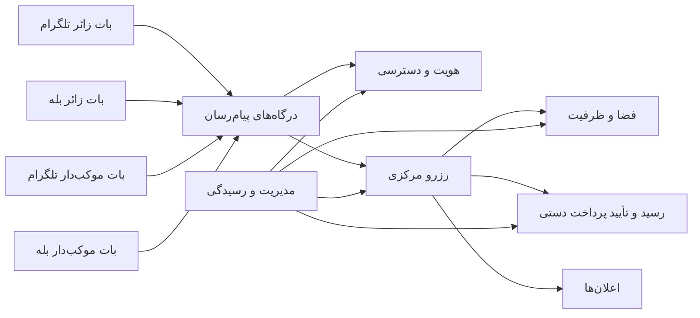
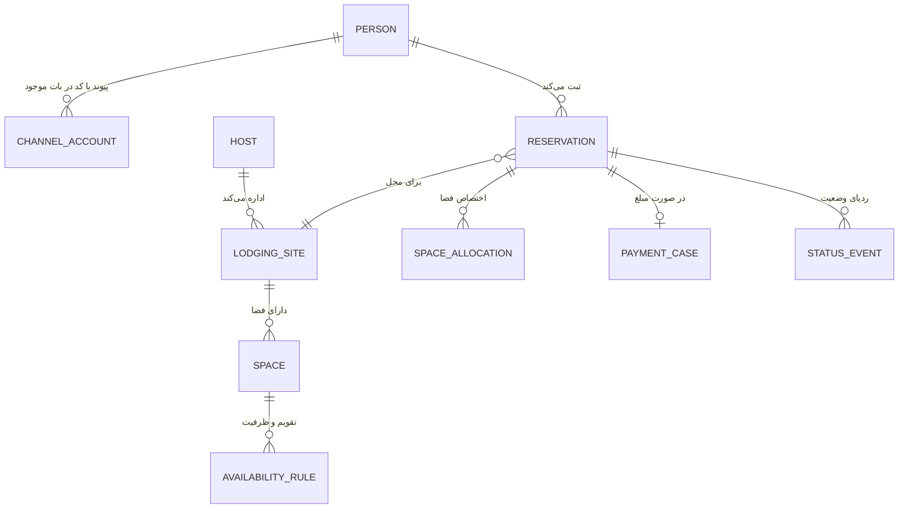

# ROOT MASTER — سامانه یکپارچه رزرو اسکان زائر

**وضعیت:** DRAFT برای تأیید کارفرما  
**تاریخ:** 2026-10-17  
**نویسنده:** Codex  
**نوع پروژه:** Greenfield؛ کد محصول، پایگاه داده و سرویس اجرایی هنوز وجود ندارد.

## ۱. چشم‌انداز و محدوده

موکب‌دار ظرفیت اسکان را برای شهر و زمان مشخص منتشر می‌کند؛ زائر ظرفیت واقعی را می‌بیند و رزرو می‌کند. محصول فقط اسکان شهرهای زیارتی به‌جز شهرهای عربستان را پوشش می‌دهد. دو نقش بات در دو پیام‌رسان تلگرام و بله، چهار درگاه کاربری می‌سازند؛ همه از یک منبع حقیقت برای هویت، فضا، تقویم و رزرو استفاده می‌کنند.

این سند تصمیم فناوری، نام جدول یا API را تصویب نمی‌کند. پنج مهلت عملیاتی در DEC-0025 هرکدام ۲۴ ساعت‌اند؛ مدت مجاز اقامت را موکب‌دار برای محل خود تعیین می‌کند.

## ۲. پرسونـا و اختیارها

| نقش | کار مجاز | نباید |
|---|---|---|
| زائر | جست‌وجو، ثبت و پیگیری رزرو خودش، لغو/اعلام تأخیر طبق قانون محل | تغییر ظرفیت، تأیید رسید خودش، دیدن داده دیگران |
| موکب‌دار | ثبت موکب و فضا، تقویم، قانون، تصمیم روی درخواست، ثبت ورود/خروج و رسید مربوط به موکب خودش | انتشار پیش از تأیید مدیر، تغییر قانون رزرو قطعی گذشته |
| مدیر اصلی | افزودن ادمین، بررسی موکب، مشاهده گزارش لازم | برداشت خودکار وجه یا تغییر بی‌ردپا در سوابق |
| ادمین منصوب | بررسی و تأیید موکب پس از دیدن مدارک لازم | افزودن ادمین یا دسترسی فراتر از نقش خود |

## ۳. نقشه ماژول‌ها و مرزها

مرز مسئولیت: درگاه پیام‌رسان فقط ورودی/خروجی پیام را تبدیل می‌کند. تصمیم ظرفیت در دامنه ظرفیت، تصمیم وضعیت رزرو در دامنه رزرو و وضعیت پول در دامنه مالی است. هیچ درگاهی نسخه مستقل از رزرو یا ظرفیت ندارد. وابستگی حلقوی و دسترسی مستقیم به داده دامنه نامرتبط ممنوع است.

## ۴. نبایدهای ریشه

1. هیچ قانون قیمت، مهلت، جریمه، سقف رزرو یا تصمیم اختلاف بدون تصمیم صریح کارفرما قطعی نمی‌شود.
2. ظرفیت عمومیِ بانوان و آقایان با هم جمع نمی‌شود تا درخواست نامتناسب به‌اشتباه پذیرفته شود؛ هر اتاق خصوصی در بازه یک رزرو دارد.
3. رزرو قطعی و وضعیت پرداخت نباید از روی عکس رسید یا پیام موفقیت بات حدس زده شود.
4. دو پیام‌رسان نباید ظرفیت و هویت مستقل بسازند؛ اتصال حساب‌ها فقط با درخواست کاربر و کد در باتِ حساب موجود انجام می‌شود.
5. هیچ توکن، شماره کامل کارت یا اطلاعات هویتی در کد/لاگ/گیت قرار نمی‌گیرد.
6. هیچ حذف یا مایگریشن مخرب بدون بازبینی خط‌به‌خط و مجوز صریح اجرا نمی‌شود.
7. قرارداد رزرو قطعی گذشته با ویرایش قانون موکب عوض نمی‌شود؛ تغییرات باید قابل ردیابی باشند.

## ۵. منبع حقیقت و روابط مفهومی

این ERD مفهومی است، نه طرح تصویب‌شده جدول/کلید/ایندکس. نام‌ها برای گفت‌وگو هستند و تا طراحی فنی به نام کلاس یا جدول تبدیل نمی‌شوند.

## ۶. درخت اسناد و تقدم

1. این سند: چشم‌انداز، مرزها و نبایدهای مشترک.
2. `domains/`: سند والد هر حوزه؛ قواعد قطعی، وضعیت‌ها و مرزهای داده.
3. `masters/MASTER_XX_*.md`: سند فرزند هر کار؛ سناریو، گراف، نبایدها، ماتریس آزمون و پرسش‌های باز.
4. `DECISIONS.md`: فقط تصمیم قطعی با شناسه DEC؛ در تعارض عبارت‌های پژوهشی/پیشنهادی، این دفتر و دستور تازه کارفرما ملاک‌اند.
5. `PROJECT_STATE.md`، `BACKLOG.md`، `INDEX.md` و `CHANGELOG.md`: حافظه و تحویل شیفت.

اسناد قدیمی `docs/01-research-mokeb-accommodation.md`، `docs/02-product-analysis-draft.md` و `docs/03-presentation-map.md` ورودی پژوهش و ارائه‌اند؛ از این پس قواعد قطعی باید در `docs/ai/` ثبت شوند. تحقیق منبع تصمیم جدید نیست مگر کارفرما آن را تأیید کند.

## ۷. دامنه‌های والد

| سند | مسئولیت |
|---|---|
| `domains/AUTH_AND_IDENTITY.md` | حساب واحد، نقش‌ها و اتصال داوطلبانه دو پیام‌رسان |
| `domains/LODGING_INVENTORY.md` | موکب، سالن و اتاق، تأیید انتشار |
| `domains/CORE_BUSINESS_ENGINE.md` | تقویم، ظرفیت و تطبیق درخواست |
| `domains/RESERVATION_LIFECYCLE.md` | درخواست تا پایان اقامت، لغو و عدم حضور |
| `domains/BILLING_AND_WALLET.md` | سه مدل مالی؛ کارت‌به‌کارت و رسید؛ بازگرداندن تضمین بیرون سامانه |
| `domains/NOTIFICATIONS_AND_JOBS.md` | اعلان‌ها و کارهای موعددار با پنج مهلت ۲۴ ساعته |
| `domains/CHANNEL_ADAPTERS.md` | تلگرام و بله بدون منطق مستقل رزرو |
| `domains/ADMIN_AND_TRUST.md` | تأیید موکب و رسیدگی به اختلاف |
| `domains/SOURCE_CONTROL_AND_DEPLOYMENT.md` | مخزن عمومی و استقرار ایزوله بدون اختلال در سرویس‌های موجود |

## ۸. دروازه‌های قبل از فاز اول

- تأیید کارفرما بر اسناد و پاسخ به پرسش‌های مسدودکننده در `BACKLOG.md`.
- تعیین جزئیات امنیت کد پیوند، نوع و نگهداری مدرک زائر خارجی، ساعت پایان روز آخر رزرو و نگه‌داشت ظرفیت.
- ثبت طرح GitHub و استقرار ایزوله VPS طبق MASTER-09؛ بررسی خواندنی سرویس‌ها و پورت‌های فعال انجام شده و فقط اسناد در مسیر جداگانه دریافت شده‌اند. پیش از هر استقرار اجرایی، بررسی تعارض دوباره لازم است.
- سپس انتخاب فناوری و طراحی طرح واقعی پایگاه داده در مستر اجرایی جدا. تا آن زمان وضعیت پروژه «فقط اسناد» است.

## ۹. ابزار کمکی تحلیل

gstack طبق DEC-0042 در همین پروژه به‌صورت زیرمخزن Git نصب شده است. روش استفاده و مرز آن در `masters/MASTER_11_GSTACK_WORKFLOW.md` ثبت شده است. خروجی این ابزار پس از بررسی با اسناد والد و تصمیم‌های مصوب قابل استفاده است؛ مرحله فعلی همچنان فقط تحلیل و مستندسازی است.
