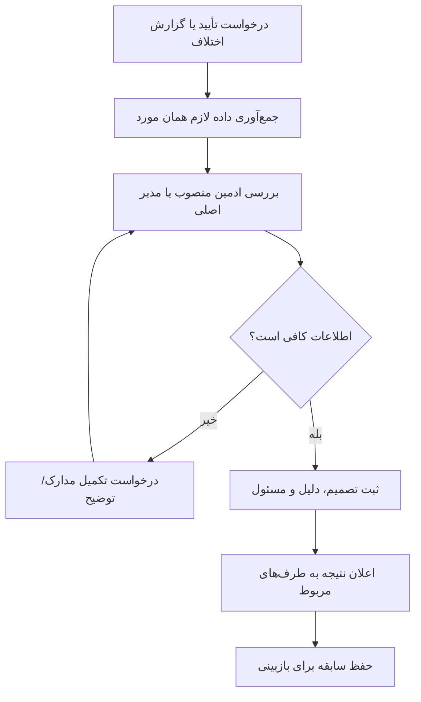

# سند والد دامنه مدیریت و اعتماد

**وضعیت:** DRAFT | **والد:** ROOT_MASTER | **تصمیم‌ها:** DEC-0004، DEC-0012، DEC-0013

## مرز دامنه

مدیر اصلی ادمین‌ها را منصوب می‌کند. هر ادمین منصوب می‌تواند پیش از انتشار، نام و شماره مسئول، نشانی دقیق، عکس محل و مدرک مسئولیت را ببیند و موکب را تأیید کند. پنل مدیریت در مرورگر باز می‌شود. زائر خارجی بدون پرداخت، مدرک و تماس را فقط برای موکب‌دار همان محل می‌فرستد؛ تأیید یا رد رزرو او با موکب‌دار است، نه ادمین. تعطیلی ناگهانی، تعارض ظرفیت و اختلاف حضور مسیر رسیدگی دارند. بررسی رسید پرداخت بر عهده موکب‌دار همان موکب است و بازپرداخت تضمین در سامانه ثبت نمی‌شود.

## نبایدها

- نباید محل تأییدنشده با برچسب «تأییدشده» دیده شود.
- نباید تصمیم اختلاف یا تغییر رزرو قطعی بدون دلیل، زمان و مسئول ثبت شود.
- نباید مدیر برای رسیدگی به یک مورد، دسترسی نامحدود به همه داده‌های هویتی بگیرد.
- نباید تعطیلی موکب رزروهای موجود را بی‌خبر و بی‌تعیین‌تکلیف حذف کند.

## گراف رسیدگی

## نقاط باز

دو نقش «مدیر اصلی» و «ادمین منصوب» و پنل مرورگر قطعی‌اند. برای تأیید موکب در همه کشورها همان نام و شماره مسئول، نشانی دقیق، عکس محل و مدرک مسئولیت کافی است. مهلت رسیدگی به اختلاف هنوز باز است. مدرک زائر خارجی گذرنامه است و تصمیم رزرو او با موکب‌دار همان محل است.
