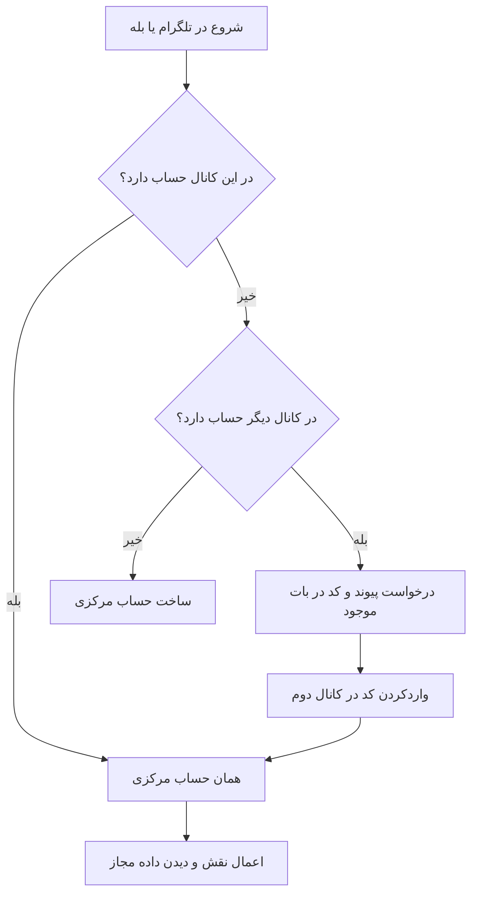

# سند والد دامنه هویت و دسترسی

**وضعیت:** DRAFT | **والد:** ROOT_MASTER | **تصمیم‌ها:** DEC-0003، DEC-0004، DEC-0008، DEC-0015

## قرارداد دامنه

هر انسان یک حساب مرکزی دارد و می‌تواند آن را در تلگرام و بله به کار ببرد؛ بسیاری فقط یک کانال خواهند داشت. در اولین ورود، حساب اولیه با شناسه معتبر همان پیام‌رسان ساخته می‌شود و شماره تماس تا زمان درخواست رزرو پرسیده نمی‌شود. برای افزودن کانال دوم، کاربر از حساب موجود درخواست پیوند می‌دهد و کد در همان بات برایش فرستاده می‌شود؛ کد از صدور تا ۲۴ ساعت معتبر و برای یک پیوند موفق یک‌بارمصرف است. پیامک لازم نیست. شماره یکسان یا نام نمایشی به‌تنهایی دلیل ادغام نیست. نقش‌های زائر، موکب‌دار، مدیر اصلی و ادمین منصوب جدا هستند. اگر دسترسی به بات قبلی از دست رفت، بازیابی/پیوند فقط پس از دسترسی دوباره به همان بات ممکن است. روند تغییر شماره هنوز باز است.

## نبایدها

- نباید صرف یک شماره تایپ‌شده یا نام مشابه، دو حساب ادغام شوند.
- نباید حساب زائر به اطلاعات موکب‌دار یا زائر دیگر دسترسی بگیرد.
- نباید شماره، تصویر مدرک یا شناسه محرمانه در لاگ عادی چاپ شود.
- نباید کد مصرف‌شده یا منقضی‌شده دوباره پیوند ایجاد کند.
- نباید رزروهای موجود در تغییر شماره بدون فرایند بازیابی مصوب جابه‌جا شوند.

## گراف هویت

## رابطه مفهومی و پرسش باز

Person به چند ChannelAccount وصل می‌شود؛ HostMembership اختیار موکب را جدا نگه می‌دارد. این‌ها نام مفهومی‌اند، نه جدول قطعی. شماره مشترک به‌تنهایی حساب‌ها را پیوند نمی‌دهد. کد ۲۴ ساعت از صدور معتبر است و پس از یک پیوند موفق مصرف می‌شود. روند تغییر شماره هنوز باید تعیین شود؛ بازیابی کانال از دست‌رفته فقط پس از دسترسی دوباره به بات قبلی است.
