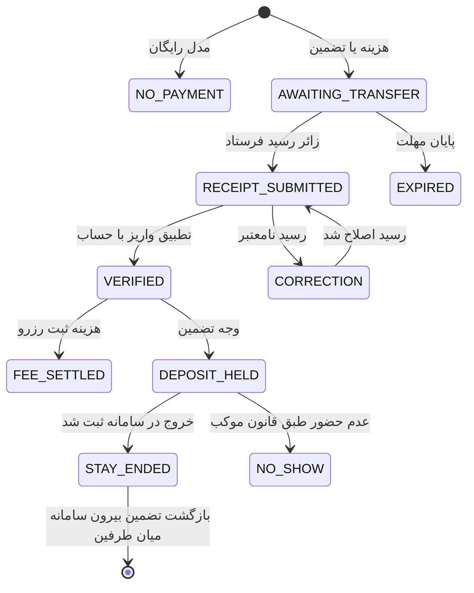

# سند والد دامنه پرداخت و وجه تضمین

**وضعیت:** DRAFT | **والد:** ROOT_MASTER | **تصمیم‌ها:** DEC-0011، DEC-0012، DEC-0013، DEC-0014

## مرز دامنه

نام فایل به پیروی از ساختار پروتکل است؛ «کیف پول» در نیازمندی تأییدشده وجود ندارد. هر عرضه فقط یک مدل دارد: رایگان، هزینه ثبت رزرو، یا وجه تضمین. مبلغ دو مدل پولی ثابت برای کل رزرو است. برای زائر عادی، پول به کارت شخصی موکب‌دار یا کارت موکب می‌رود و همان موکب‌دار واریز را دستی بررسی می‌کند؛ عکس رسید به‌تنهایی پرداخت را اثبات نمی‌کند. زائر خارجی در فاز فعلی برای هیچ عرضه‌ای پول نمی‌پردازد و مسیر تأیید ادمین دارد.

## نبایدها

- نباید هزینه ثبت رزرو و تضمین را هم‌زمان مطالبه کرد.
- نباید مبلغ را در تعداد نفر، اتاق یا شب ضرب کرد.
- نباید پیش از پذیرش موکب‌دار در مسیر تأیید دستی پول خواست.
- نباید رسید تصویرشده را برابر واریز قطعی فرض کرد.
- نباید از زائر خارجی در این فاز پول یا رسید پرداخت خواست؛ تأیید ادمین جایگزین شرط پرداخت او است.
- نباید سامانه وضعیت «بازپرداخت‌شده» یا شماره پیگیری تضمین را ادعا کند؛ بازگشت وجه بیرون از سامانه و هنگام خروج میان طرفین است.
- نباید شماره کامل کارت، شماره تلفن یا تصویر رسید در گزارش عمومی/لاگ عادی ثبت شود.

## ماشین وضعیت پرونده مالی

## رابطه مفهومی و تصمیم‌های باز

هر پرونده مالی عادی به یک رزرو، مبلغ، مدل، گیرنده و رویدادهای رسید/بررسی وصل است. موکب‌دار همان محل، رسید را حداکثر تا ۲۴ ساعت از دریافت با حساب خودش بررسی می‌کند. زائر خارجی پرونده پرداخت ندارد و فقط با تأیید ادمین رزرو می‌کند. احراز خارجی‌بودن و واحد نمایش پول باز است. بازگشت تضمین در سامانه ثبت یا پیگیری نمی‌شود؛ هیچ ادعای پرداخت یا استرداد خودکار مجاز نیست.
