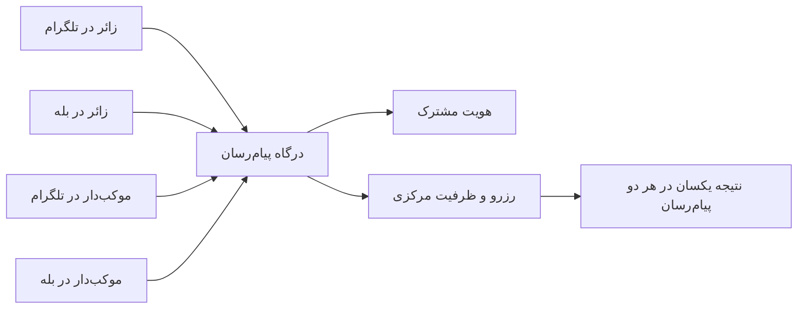

# سند والد دامنه درگاه‌های تلگرام و بله

**وضعیت:** DRAFT | **والد:** ROOT_MASTER | **تصمیم‌ها:** DEC-0003، DEC-0015، DEC-0016

## مرز دامنه

چهار بات، چهار رابط یک محصول‌اند. درگاه پیام‌رسان فرمان کاربر را به درخواست دامنه مرکزی تبدیل می‌کند و پاسخ ساده فارسی را نشان می‌دهد. درگاه حق تصمیم مستقل درباره ظرفیت، قطعی‌بودن رزرو، تأیید رسید یا هویت مشترک ندارد. رفتار قابل مشاهده در تلگرام و بله باید از نظر قاعده یکسان باشد، هرچند دکمه‌ها و امکانات فنی ممکن است متفاوت باشند.

## نبایدها

- نباید برای یک پیام‌رسان پایگاه ظرفیت جدا ساخت.
- نباید از شناسه تلگرام به‌عنوان شناسه شخص در بله استفاده کرد.
- نباید هنگام تکرار همان فرمان بر اثر قطع ارتباط، رزرو دوباره ساخت.
- نباید کاربر را به دلیل تفاوت دکمه‌ها مجبور به طی مسیر طولانی‌تر غیرضروری کرد.

## گراف یک منبع مشترک

## پرسش‌های باز

جزئیات فنی پیوند با کد در دو بات، محدودیت فایل رسید، رفتار هنگام قطع ارتباط و قواعد تکرار فرمان باید با API جاری هر پیام‌رسان آزمایش شود. این سند سازگاری را هدف می‌گذارد، نه ادعای بررسی‌شده درباره امکانات جاری بله.
