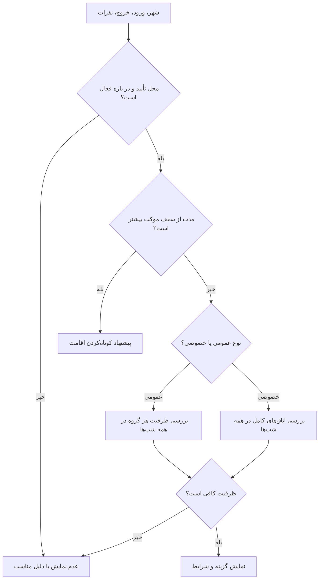

# سند والد دامنه ظرفیت و تطبیق

**وضعیت:** DRAFT | **والد:** ROOT_MASTER | **تصمیم‌ها:** DEC-0005، DEC-0006، DEC-0007، DEC-0009

## قرارداد دامنه

موکب‌دار بازه فعالیت، ساعت ورود/خروج و حداکثر اقامت را می‌دهد. موجودی برای تمام شب‌های درخواست باید کافی باشد. در عمومی، نفرات بر اساس گروه مجاز به سالن تخصیص می‌یابند؛ در خصوصی، اتاق کامل برای یک رزرو گرفته می‌شود. استثنای روز خاص و سهمی که موکب برای مراجعه حضوری کنار می‌گذارد در موجودی قابل رزرو اثر دارند. مقدار عددی سهم حضوری پیش‌فرض ندارد.

## نبایدها

- نباید با خالی بودن فقط شب اول، رزرو چندشبه پذیرفته شود.
- نباید دو بات آخرین ظرفیت یکسان را هم‌زمان قطعی کنند.
- نباید ظرفیت نگه‌داشته‌شده یا سهم حضوری به‌عنوان جاخالی قطعی نشان داده شود.
- نباید ساعت و تاریخ محل خارج ایران بدون زمان محلیِ روشن نمایش داده شود.

## گراف تصمیم ظرفیت

## مثال و گره تصمیم باز

خانواده ۲ آقا و ۳ خانم در دو شب، هر شب ۲ جای آقا و ۳ جای خانم لازم دارد. اگر یک شب سالن خانم‌ها فقط ۲ جای خالی داشته باشد، آن گزینه معتبر نیست. برای پنج نفر، یک اتاق ۴ نفره کافی نیست؛ کودک نیز یک نفر حساب می‌شود و استثنایی وجود ندارد. زائر می‌تواند دو اتاق انتخاب کند. مدت نگه‌داشت ظرفیت و روش آزادسازی باید با مهلت‌های ۲۴ ساعته سازگار طراحی شوند.
