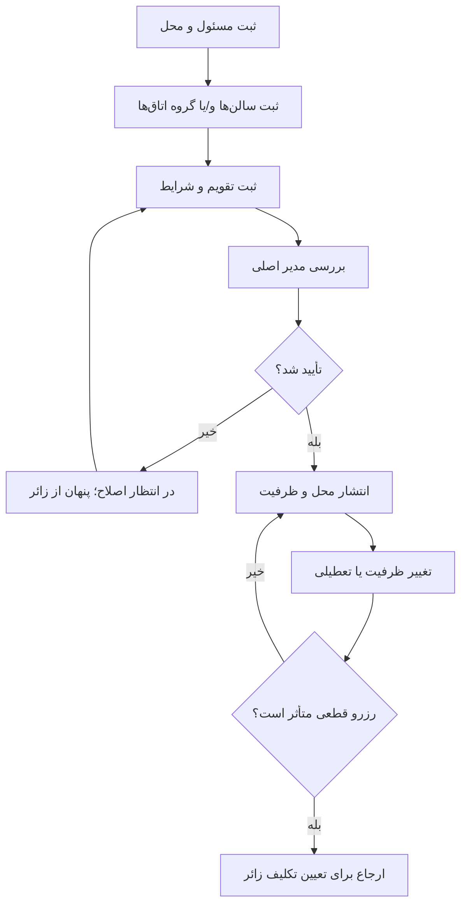

# سند والد دامنه موکب و فضا

**وضعیت:** DRAFT | **والد:** ROOT_MASTER | **تصمیم‌ها:** DEC-0002، DEC-0004، DEC-0005، DEC-0006، DEC-0007

## قرارداد دامنه

هر موکب یک مسئول و یک یا چند محل/فضای اسکان دارد. سالن عمومی ظرفیت نفر، گروه مجاز و تقویم خود را دارد. اتاق خصوصی ظرفیت نفر دارد ولی در هر بازه کامل به یک رزرو اختصاص می‌یابد. اتاق‌های همسان برای ثبت ساده می‌توانند گروه شوند؛ در شمارش ظرفیت باید تعداد واقعی اتاق‌ها باقی بماند. موکب ممکن است هر دو مدل را عرضه کند. انتشار محل پس از تأیید مدیر اصلی یا ادمین منصوب او است.

## نبایدها

- نباید ظرفیت سالن‌های زن/مرد را به یک عدد مبهم تبدیل کرد.
- نباید پنج نفر، حتی با کودک خردسال، در یک اتاق چهار نفره «قابل رزرو» نمایش داده شوند.
- نباید پنج تخت استفاده‌نشده اتاق ده نفره را به رزرو دوم اختصاص داد.
- نباید تعطیلی/کاهش ظرفیت، رزرو قطعی گذشته را بی‌صدا حذف کند.
- نباید محل تأییدنشده در جست‌وجوی زائر ظاهر شود.

## چرخه عرضه

## مثال و نقاط باز

سه سالن ۵۰ نفره، ظرفیت اسمی ۱۵۰ نفر است، ولی ظرفیت قابل عرضه در هر شب و هر گروه جدا محاسبه می‌شود. سه اتاق ۴ نفره و دو اتاق ۱۰ نفره دو گروه ثبت ساده‌اند، اما پنج واحد فیزیکی مستقل هستند. نام و شماره مسئول، نشانی دقیق، عکس محل و مدرک مسئولیت برای بررسی لازم‌اند؛ مدرک اضافه هر کشور، نام‌گذاری فضای «خانواده» و حداقل مشخصات ایمنی هنوز تصمیم نشده‌اند.
