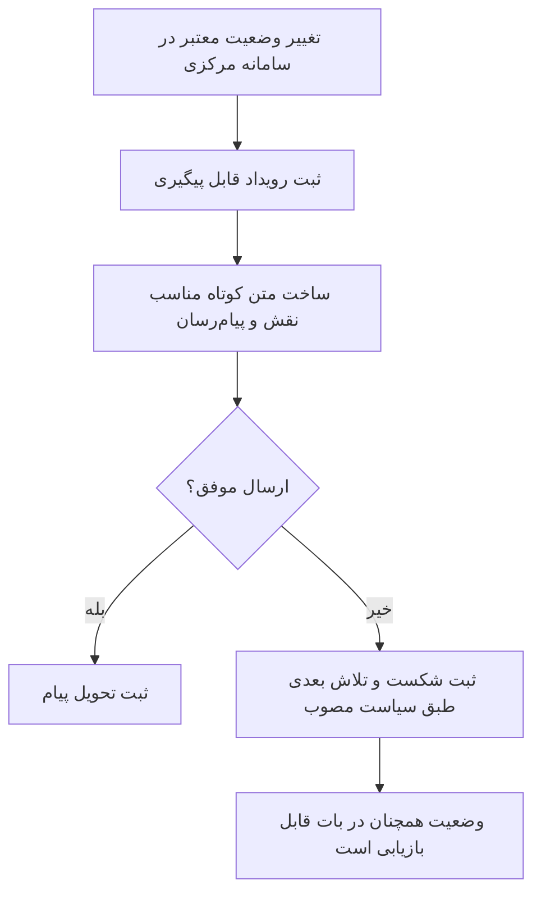

# سند والد دامنه اعلان و کار موعددار

**وضعیت:** DRAFT | **والد:** ROOT_MASTER | **تصمیم‌ها:** DEC-0003، DEC-0010، DEC-0013، DEC-0016

## مرز دامنه

اعلان نتیجه رویداد ثبت‌شده در سامانه مرکزی است، نه منبع حقیقت. وضعیت در «رزروهای من» و ابزار موکب‌دار باید قابل بازیابی باشد، حتی اگر پیام شکست بخورد. مهلت پاسخ موکب، پرداخت، بررسی رسید، لغو و عدم حضور طبق DEC-0025 هرکدام ۲۴ ساعت‌اند؛ موعدها از رویداد مربوط محاسبه می‌شوند. زمان یادآوری اختیاری هنوز باز است.

## نبایدها

- نباید شکست ارسال اعلان، رزرو یا تأیید پرداخت را عقب‌گرد دهد.
- نباید پیام تکراری، رزرو یا بررسی رسید تکراری ایجاد کند.
- نباید اعلان حاوی شماره کامل کارت، مدارک یا داده غیرضروری همراهان باشد.
- نباید مهلت پیش‌فرض از پیش ساخته شود.

## جریان رویداد تا پیام

## نمونه‌ها و نقاط باز

قبول/رد موکب‌دار، تأیید/رد رسید توسط موکب‌دار، قطعی‌شدن رزرو، تغییر محل و یادآوری ورود به مخاطب مربوط اعلام می‌شوند. درخواست زائر خارجی به موکب‌دار همان محل اعلام می‌شود، اما تصویر گذرنامه در متن اعلان یا لاگ قرار نمی‌گیرد؛ مشاهده آن باید با دسترسی محدود انجام شود. حذف تصویر ۳۰ روز پس از پایان اقامت، یا برای درخواست بی‌اقامت ۳۰ روز پس از بسته‌شدن آن، یک کار موعددار است. ثبت یا اعلان بازپرداخت تضمین در محصول وجود ندارد. زمان یادآوری، سقف تلاش دوباره، کانال جایگزین و مدت نگهداری تاریخچه پیام‌ها هنوز تصویب نشده‌اند.
