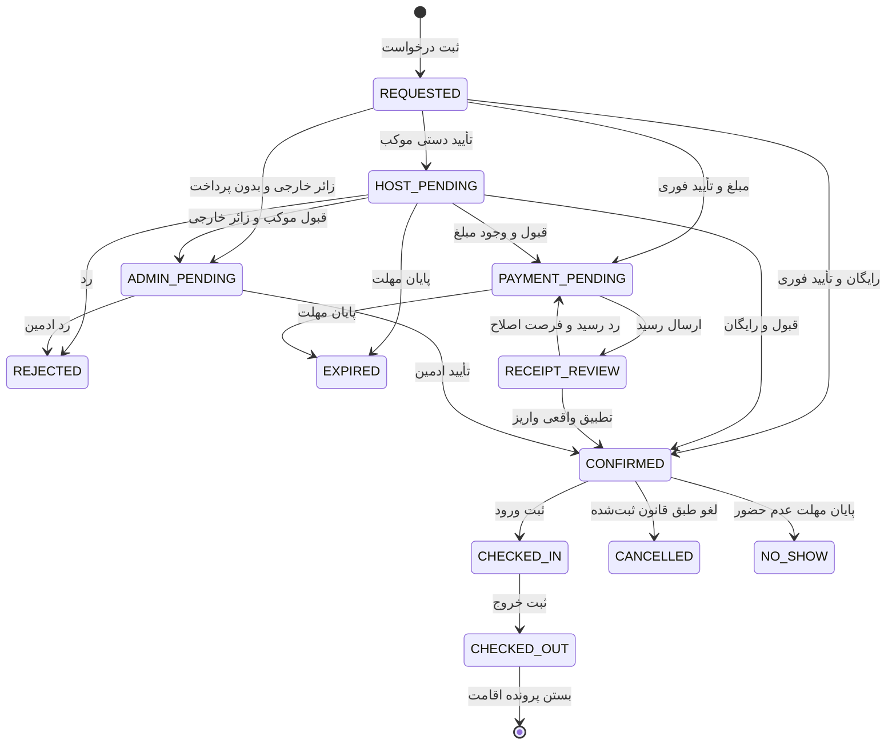

# سند والد دامنه چرخه رزرو و اقامت

**وضعیت:** DRAFT | **والد:** ROOT_MASTER | **تصمیم‌ها:** DEC-0008، DEC-0010، DEC-0013، DEC-0014

## قرارداد دامنه

برای زائران عادی چهار مسیر وجود دارد: فوری/دستی × بدون مبلغ/دارای مبلغ. «فوری» فقط به معنی بی‌نیازی از تأیید موکب‌دار است؛ اگر مبلغ وجود دارد، قطعی‌شدن به تأیید واقعی واریز توسط همان موکب‌دار وابسته است. درخواست دستیِ مبلغ‌دار پیش از قبول موکب‌دار نباید پول بخواهد. زائر خارجی برای همه مکان‌ها درخواست می‌دهد، پرداخت ندارد و فقط با تأیید ادمین قطعی می‌شود؛ ترتیب این تأیید با تأیید دستی موکب‌دار هنوز باز است. قانون لغو و عدم حضورِ لحظه ثبت در رزرو نگه داشته می‌شود.

## نبایدها

- نباید درخواست، نگه‌داشت ظرفیت یا عکس رسید را «رزرو قطعی» نامید.
- نباید رد/انقضا بدون آزادسازی درست ظرفیت یا تعیین تکلیف پول بماند.
- نباید ورود، خروج یا عدم حضور بدون رویداد قابل پیگیری ثبت شود.
- نباید جابه‌جایی/لغو اجباری محل رزرو قطعی بی‌اطلاع زائر انجام شود.

## ماشین وضعیت مفهومی

## پرسش‌های مسدودکننده

مهلت پاسخ موکب، پرداخت، بررسی رسید و عدم حضور هرکدام ۲۴ ساعت‌اند؛ لغو تا ۲۴ ساعت پیش از ورود است. اثر مالی لغو/عدم حضور همچنان متن قانون موکب است. احراز زائر خارجی و ترتیب تأیید دستی موکب/ادمین باز است. چرخه بالا نام وضعیت‌های تحلیلی است و اجرای آن به طراحی فنی نیاز دارد.
