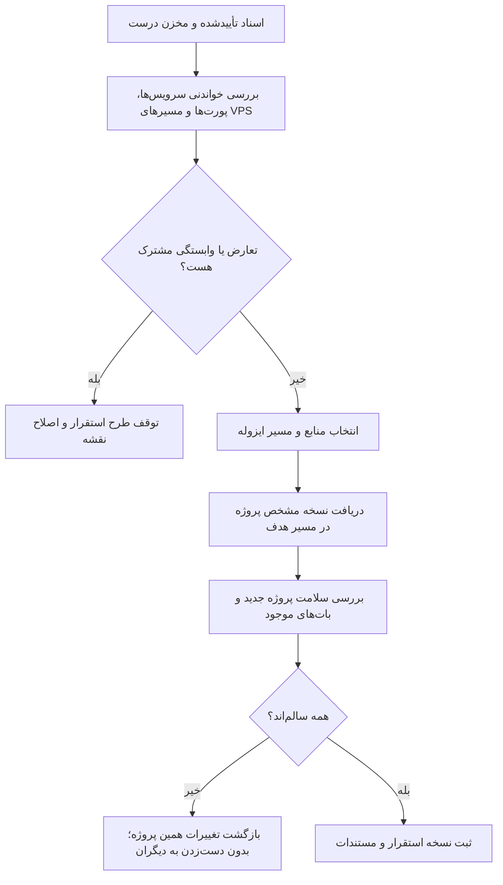

# سند والد دامنه مخزن و استقرار ایزوله

**وضعیت:** DRAFT | **والد:** ROOT_MASTER | **تصمیم‌ها:** DEC-0017، DEC-0029، DEC-0030

## قرارداد دامنه

مخزن عمومی با نام `rezervasiyonBOT` در حساب `elyas5203` محل ثبت اسناد و در آینده کد است. Git برای نسخه‌بندی فایل‌های پروژه است؛ داده‌های واقعی رزرو، مدارک، عکس رسید، پایگاه داده، رمز و توکن در مخزن قرار نمی‌گیرند. مسیر هدف سرور `/root/rezervasiyon/` است. تا تأیید اسناد و بررسی خواندنی VPS، استقرار عملی انجام نمی‌شود.

## نبایدها

- هیچ سرویس یا بات موجود در VPS متوقف، بازنشانی، حذف یا تغییر پیکربندی نشود.
- هیچ پورت، نام سرویس، کانتینر، پایگاه داده یا مسیر مشترکی بدون بررسی موجودی واقعی اشغال نشود.
- هیچ رمز، توکن، کلید SSH، IP سرور، فایل محیطی یا داده هویتی در مخزن عمومی، اسناد یا لاگ قرار نگیرد.
- `git pull` مستقیم روی سرویس در حال اجرا، مایگریشن یا restart بدون طرح اثر، بررسی و بازگشت انجام نشود.
- GitHub جای پشتیبان پایگاه داده و فایل‌های کاربران نیست؛ پشتیبان داده باید خارج از Git طراحی شود.

## گراف عبور ایمن

## رابطه داده و پرسش باز

تاریخچه Git شامل تغییرات فایل‌های پروژه است؛ داده عملیاتی روی VPS در منبع داده مستقل قرار می‌گیرد و هر چهار بات همان منبع را می‌خوانند. پیش از استقرار باید مالک حساب مخزن، روش احراز دسترسی سرور به GitHub، موجودی سرویس‌ها/پورت‌ها، محل داده و روش پشتیبان/بازگشت واقعی بررسی شوند. این سند هیچ پورت یا فناوری را از پیش تعیین نمی‌کند.
