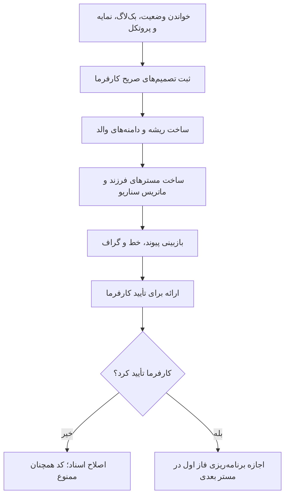

# MASTER-01 — پایه‌ریزی اسناد و دروازه شروع

**تاریخ تدوین:** 2026-10-17  
**وضعیت:** DRAFT؛ آماده بررسی کارفرما، بدون کد  
**والد:** docs/ai/ROOT_MASTER.md#L1-L12 — «چشم‌انداز و محدوده»  
**نماد/ماژول کد:** وجود ندارد؛ پروژه Greenfield است.  
**نویسنده:** Codex

## ۱. دستور و خروجی

درخواست کارفرما: «فقط فایل‌های مستر دقیق کارها را بساز؛ فعلاً کدنویسی نکن». خروجی این کار ساخت دفتر تصمیم‌ها، ریشه، دامنه‌ها، مسترهای فرزند، بک‌لاگ، نمایه و حافظه وضعیت است. این سند مجوز شروع فاز اجرایی نیست.

## ۲. نبایدها

- هیچ نام جدول، API، فریم‌ورک یا مهلت بیزینسی بدون تصمیم صریح کارفرما قطعی نشود.
- هیچ تصمیم باز در DECISIONS با وضعیت APPROVED ثبت نشود.
- هیچ سند پژوهشی قدیمی حذف یا بازنویسی مخرب نشود.

## ۳. گراف انجام و دروازه

## ۴. ماتریس فایل و ارجاع

| فایل هدف | خط/نماد فعلی | عمل | ریسک |
|---|---|---|---|
| docs/ai/ROOT_MASTER.md | #L1-L12، «چشم‌انداز» | ایجاد سند والد | حدس فناوری |
| docs/ai/DECISIONS.md | شناسه‌های DEC-0001 تا DEC-0030 | ثبت تصمیم مصوب | آمیختن پیشنهاد با تصمیم |
| docs/ai/domains/ | سندهای والد | ایجاد مرزها | تعارض دامنه |
| docs/ai/PROJECT_STATE.md | هدر و اولین خط زیر آن | امضای تحویل | فراموشی وضعیت |
| سورس محصول | وجود ندارد | بدون تغییر | شروع زودهنگام کد |

## ۵. اعتبارسنجی برنامه‌ریزی‌شده

| شناسه | بررسی | خروجی لازم | وضعیت |
|---|---|---|---|
| DOC-01 | وجود تمام فایل‌های ارجاع‌شده | بدون مسیر شکسته | قابل اجرای سندی |
| DOC-02 | یکتایی DECها و ترتیب MASTERها | بدون تکرار/پرش بی‌دلیل | قابل اجرای سندی |
| DOC-03 | هر مستر دارای Mermaid و نبایدها | کامل | قابل اجرای سندی |
| LIVE-01 | تست دیتابیس/سرویس | فقط بعد از کدنویسی و زیرساخت | NOT RUN؛ وجود ندارد |

## ۶. شرط پایان

تمام پرسش‌های مسدودکننده در BACKLOG ثبت و اسناد برای تأیید کارفرما ارائه شوند. وضعیت مستر تا آن زمان DRAFT می‌ماند.
