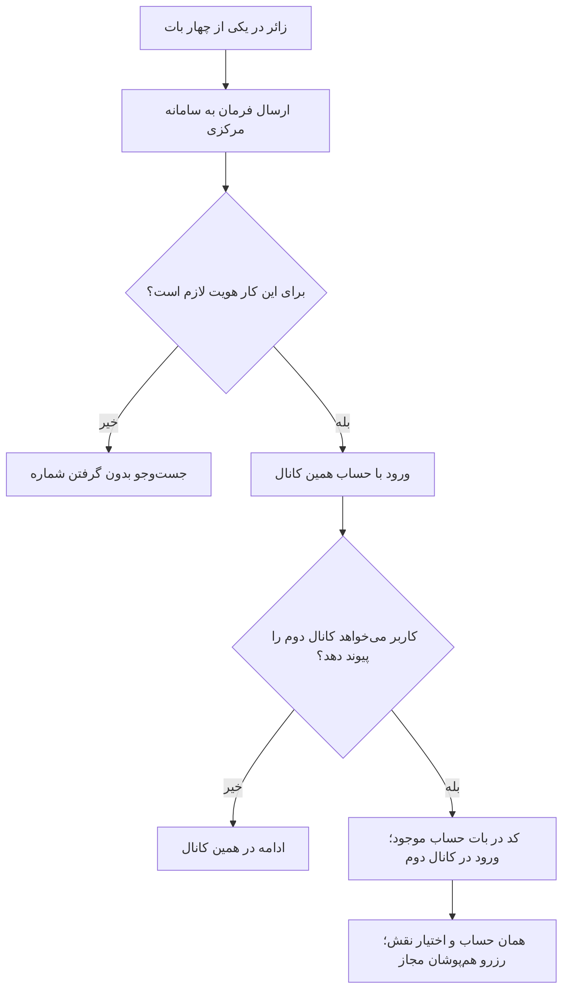

# MASTER-02 — هویت مشترک و چهار بات

**تاریخ تدوین:** 2026-10-17  
**وضعیت:** DRAFT؛ بدون کد  
**والدها:** docs/ai/domains/AUTH_AND_IDENTITY.md#L5-L30 — «قرارداد/گراف هویت»؛ docs/ai/domains/CHANNEL_ADAPTERS.md#L5-L29 — «مرز/گراف درگاه»  
**نماد/ماژول کد:** وجود ندارد؛ مسیر و تابع بعد از انتخاب معماری تعیین می‌شود.  
**تصمیم‌ها:** DEC-0003، DEC-0015، DEC-0016

## ۱. هدف و سفر ساده

زائر می‌تواند در تلگرام یا بله جست‌وجو کند. هر شخص، از جمله موکب‌دار، یک حساب مرکزی دارد؛ داشتن هر دو کانال اجباری نیست. اگر خواست کانال دوم را وصل کند، از بات حساب موجود کد می‌گیرد و در بات دوم وارد می‌کند؛ پیامک ندارد. شماره یکسان به‌تنهایی حساب‌ها را ادغام نمی‌کند. هیچ باتی وضعیت رزرو را مستقل نگه نمی‌دارد.

## ۲. نبایدها

- شماره تایپی یا نام نمایشی برای ادغام کافی نیست.
- شناسه یک پیام‌رسان به‌عنوان شناسه مشترک شخص استفاده نمی‌شود.
- تکرار پیام پس از قطع ارتباط، رزرو/حساب دوم نمی‌سازد.
- متن بات اصطلاحات فنی مانند UUID یا null ندارد.

## ۳. گراف رفتار

## ۴. ماتریس سناریو و آزمون آینده

| شناسه | مثال | انتظار | وضعیت |
|---|---|---|---|
| ID-01 | درخواست پیوند از بات موجود و ورود کد در کانال دوم | یک شخص، دو حساب کانال | NOT RUN؛ کد ندارد |
| ID-02 | دو شماره تایپی مشابه | ادغام نشود | NOT RUN |
| ID-03 | پیام تکراری به علت قطع ارتباط | عملیات دوباره انجام نشود | NOT RUN |
| ID-04 | زائر پیش از دیدن نتایج | شماره خواسته نشود | NOT RUN |
| ID-05 | کد ۲۴ ساعت گذشته یا قبلاً برای پیوند موفق مصرف شده | هیچ پیوندی انجام نشود | NOT RUN |

## ۵. وابستگی و سؤال مسدودکننده

کد پیوند ۲۴ ساعت از صدور معتبر است و یک بار پس از پیوند موفق مصرف می‌شود؛ مصرف دوباره یا پیوند پس از انقضا مجاز نیست. روند تغییر شماره هنوز باز است. بازیابی پس از از‌دست‌رفتن کانال فقط با دسترسی دوباره به بات قبلی است. حساب موکب‌دار نیز در دو پیام‌رسان واحد است. ارجاع کد و دیتابیس فعلاً وجود ندارد؛ بعد از ایجاد، مسیر+خط+نماد افزوده می‌شود.

## ۶. روایت دقیق برای ساخت رابط

**اولین ورود:** زائر در یکی از دو بات زائر، و موکب‌دار در یکی از دو بات موکب‌دار، وارد می‌شود. حساب اولیه از شناسه معتبر همان پیام‌رسان ساخته می‌شود. بات نباید کاربر را به نصب پیام‌رسان دوم مجبور کند و شماره تماس را پیش از جست‌وجو نمی‌پرسد؛ شماره هنگام درخواست رزرو لازم می‌شود. اگر کاربر در پیام‌رسان دوم نیز حساب اولیه بسازد، تنها با کد پیوند معتبر به همان حساب مرکزی متصل می‌شود؛ شماره یکسان دلیل ادغام خودکار نیست.

**پیوند اختیاری:** در بات حساب موجود، کاربر «اتصال پیام‌رسان دیگر» را انتخاب می‌کند، کدی در همان بات می‌بیند و آن را در بات دوم وارد می‌کند. کد ۲۴ ساعت از صدور اعتبار دارد و پس از یک پیوند موفق مصرف می‌شود. پس از پیوند، رزروها و اختیار موکب‌داری از یک حساب مرکزی خوانده می‌شوند. اگر کد اشتباه/منقضی/مصرف‌شده بود، هیچ حسابی ادغام نشود. تعداد تلاش مجاز هنوز مصوب نیست و عامل کدنویس نباید عددی اختراع کند. اگر بات قبلی در دسترس نیست، بازیابی تا دسترسی دوباره به همان بات انجام نمی‌شود.

**نمونه:** فاطمه در تلگرام یک رزرو دارد. با کد پیوند، بله را وصل می‌کند؛ در بله همان رزرو را می‌بیند. اگر شماره تایپی حساب دیگری شبیه شماره او باشد، ادغام رخ نمی‌دهد. اگر برای دو خانواده در یک تاریخ رزرو کند، هم‌پوشانی به‌تنهایی مانع نیست.

**مرز امنیت:** اختیار زائر، موکب‌دار و ادمین از «نقش و عضویت مرکزی» می‌آید، نه از نام بات یا شماره پیام‌رسان. هر عملیات باید فقط داده‌های متعلق به همان حساب/موکب را نشان دهد. نتیجه پیام‌رسان نباید منبع هویت مستقل باشد.
