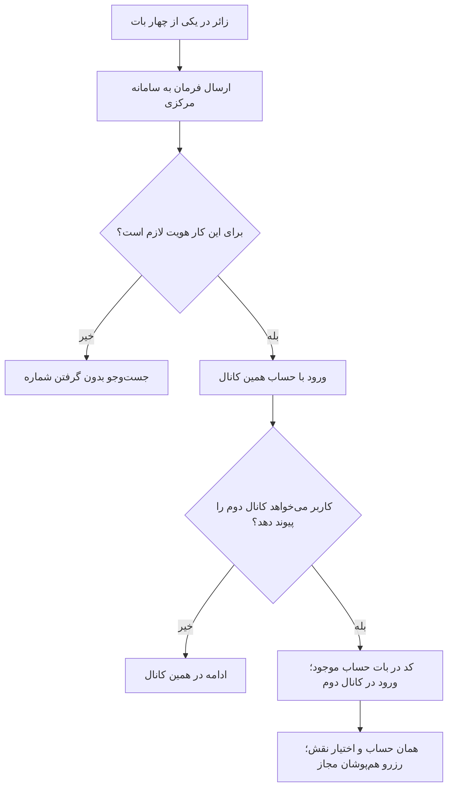

# MASTER-02 — هویت مشترک و چهار بات

**تاریخ تدوین:** 2026-10-17  
**وضعیت:** DRAFT؛ بدون کد  
**والدها:** docs/ai/domains/AUTH_AND_IDENTITY.md#L5-L30 — «قرارداد/گراف هویت»؛ docs/ai/domains/CHANNEL_ADAPTERS.md#L5-L29 — «مرز/گراف درگاه»  
**نماد/ماژول کد:** وجود ندارد؛ مسیر و تابع بعد از انتخاب معماری تعیین می‌شود.  
**تصمیم‌ها:** DEC-0003، DEC-0015، DEC-0016

## ۱. هدف و سفر ساده

زائر می‌تواند در تلگرام یا بله جست‌وجو کند. هر شخص، از جمله موکب‌دار، یک حساب مرکزی دارد؛ داشتن هر دو کانال اجباری نیست. اگر خواست کانال دوم را وصل کند، از بات حساب موجود کد می‌گیرد و در بات دوم وارد می‌کند؛ پیامک ندارد. شماره یکسان به‌تنهایی حساب‌ها را ادغام نمی‌کند. هیچ باتی وضعیت رزرو را مستقل نگه نمی‌دارد.

## ۲. نبایدها

- شماره تایپی یا نام نمایشی برای ادغام کافی نیست.
- شناسه یک پیام‌رسان به‌عنوان شناسه مشترک شخص استفاده نمی‌شود.
- تکرار پیام پس از قطع ارتباط، رزرو/حساب دوم نمی‌سازد.
- متن بات اصطلاحات فنی مانند UUID یا null ندارد.

## ۳. گراف رفتار

## ۴. ماتریس سناریو و آزمون آینده

| شناسه | مثال | انتظار | وضعیت |
|---|---|---|---|
| ID-01 | درخواست پیوند از بات موجود و ورود کد در کانال دوم | یک شخص، دو حساب کانال | NOT RUN؛ کد ندارد |
| ID-02 | دو شماره تایپی مشابه | ادغام نشود | NOT RUN |
| ID-03 | پیام تکراری به علت قطع ارتباط | عملیات دوباره انجام نشود | NOT RUN |
| ID-04 | زائر پیش از دیدن نتایج | شماره خواسته نشود | NOT RUN |

## ۵. وابستگی و سؤال مسدودکننده

انقضا و مصرف کد، تغییر شماره و بازیابی حساب باید پیش از اجرای پیوند تعیین شوند. حساب موکب‌دار نیز در دو پیام‌رسان واحد است. ارجاع کد و دیتابیس فعلاً وجود ندارد؛ بعد از ایجاد، مسیر+خط+نماد افزوده می‌شود.
