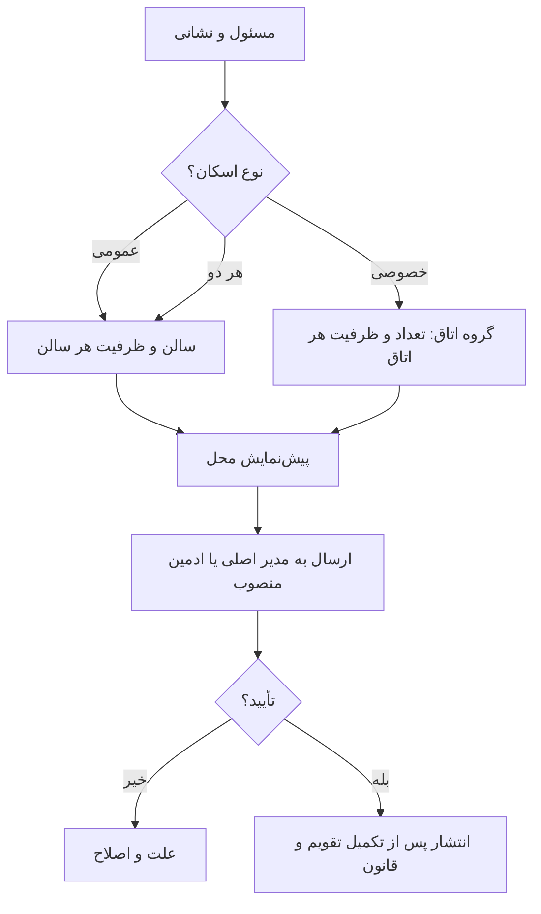

# MASTER-03 — ثبت موکب، سالن و اتاق

**تاریخ تدوین:** 2026-10-17  
**وضعیت:** DRAFT؛ بدون کد  
**والدها:** docs/ai/domains/LODGING_INVENTORY.md#L5-L34 — «قرارداد/چرخه عرضه»؛ docs/ai/domains/ADMIN_AND_TRUST.md#L5-L30 — «تأیید مدیر»  
**نماد/ماژول کد:** وجود ندارد.  
**تصمیم‌ها:** DEC-0004، DEC-0005، DEC-0006، DEC-0007، DEC-0016

## ۱. خروجی کار

موکب‌دار با پرسش‌های کوتاه نام و شماره مسئول، نشانی دقیق، عکس محل، مدرک مسئولیت و نوع فضا را ثبت می‌کند. سه حالت فضا پشتیبانی می‌شود: فقط سالن، فقط اتاق، یا هر دو. سالن‌ها مستقل و با گروه مجاز ثبت می‌شوند. اتاق‌های همسان به‌صورت «تعداد × ظرفیت هر اتاق» ثبت می‌شوند؛ اتاق‌های متفاوت گروه جدا دارند. هر ادمینی که مدیر اصلی منصوب کرده باشد می‌تواند پرونده را بررسی و موکب را تأیید کند.

## ۲. نبایدها

- نباید «۳ اتاق ۴ نفره» به یک اتاق ۱۲ نفره تبدیل شود.
- نباید سالن زن و مرد به ظرفیت مشترک تبدیل شود.
- نباید محل ردشده/در انتظار تأیید در نتیجه جست‌وجو باشد.
- نباید اتاق خصوصی هم‌زمان به دو رزرو برسد.

## ۳. گراف ثبت

## ۴. مثال و ماتریس آینده

موکب نمونه سه سالن ۵۰ نفره دارد: دو سالن آقایان و یک سالن بانوان. جمع اسمی ۱۵۰ نفر است؛ ظرفیت هر سالن جداست. همان موکب سه اتاق ۴ نفره و دو اتاق ۱۰ نفره هم دارد؛ پنج اتاق مستقل‌اند.

| شناسه | سناریو | انتظار | اجرا |
|---|---|---|---|
| HOST-01 | ثبت ۳ اتاق ۴ نفره | سه اتاق مستقل، یک مرحله ورود داده | NOT RUN |
| HOST-02 | افزودن اتاق ۱۰ نفره | گروه جدید؛ قبلی دست‌نخورده | NOT RUN |
| HOST-03 | محل در انتظار مدیر | پنهان از زائر | NOT RUN |
| HOST-04 | سالن بانوان ۵۰ نفره | فقط برای گروه مجاز نمایش | NOT RUN |
| HOST-05 | موکب در کشور دیگر با همان چهار قلم مدرک | مدرک اضافه کشوری خواسته نشود؛ ادمین منصوب بتواند بررسی کند | NOT RUN |

## ۵. پرسش‌های باز و ارجاع کد

مدارک پایه تأیید و اختیار ادمین منصوب قطعی شده‌اند؛ همین مدارک در همه کشورها کافی‌اند و مدرک اضافه کشوری درخواست نمی‌شود. تعریف دقیق سالن خانواده و امکان ثبت چند مسئول برای یک موکب باز است. هیچ فایل کد/شماره خط/نام تابعی هنوز وجود ندارد؛ بعد از فاز طراحی فنی افزوده می‌شود.

## ۶. مسیر موکب‌دار با کمترین پرسش

۱. موکب‌دار نام و شماره مسئول، شهر و نشانی دقیق را می‌دهد و عکس محل و مدرک مسئولیت را می‌فرستد. اگر چند محل دارد، هر محل جداگانه ظرفیت و تقویم می‌گیرد.  
۲. برای هر محل «عمومی»، «خصوصی» یا «هر دو» را انتخاب می‌کند. برای سالن عمومی، نام سالن، گروه مجاز و ظرفیت نفر وارد می‌شود. برای اتاق خصوصی، اتاق‌های همسان در یک مرحله با «تعداد × ظرفیت هر اتاق» ثبت می‌شوند؛ هر اتاق در حساب موجودی مستقل می‌ماند.  
۳. تقویم فعالیت، ساعت ورود/خروج، حداکثر اقامت، مدل مالی و روش تأیید درخواست در مرحله‌های بعد از ثبت پایه تکمیل می‌شوند. بات باید خلاصه قابل اصلاح نشان دهد تا موکب‌دار مجبور نباشد همه پاسخ‌ها را دوباره وارد کند.  
۴. آگهی تا تصمیم مدیر اصلی یا ادمین منصوب، در جست‌وجوی زائر دیده نمی‌شود. رد یا درخواست تکمیل باید دلیل خوانا داشته باشد. بعد از تأیید، فقط ظرفیت تاریخ‌های فعال عرضه می‌شود.

**نمونه سالن:** سالن «الف» ۵۰ آقا و سالن «ب» ۵۰ خانم دارد. عدد کل ۱۰۰ جایگاه، جایگزین بررسی جداگانه جنسیت نمی‌شود. اگر سالن «ب» در یک روز بسته است، آن روز ۵۰ جایگاه آقایان و صفر جایگاه بانوان عرضه می‌شود.

**نمونه اتاق:** سه اتاق ۴ نفره و دو اتاق ۱۰ نفره، پنج اتاق مستقل‌اند. یک خانواده ۶ نفره یک اتاق ۴ نفره نمی‌گیرد؛ حتی اگر دو نفر کودک باشند. زائر می‌تواند یک اتاق ۱۰ نفره یا چند اتاق را آگاهانه انتخاب کند. ظرفیت خالی یک اتاق خصوصی به رزرو دوم واگذار نمی‌شود.

**تغییر پس از انتشار:** ویرایش عکس، نشانی، ظرفیت یا تقویم نباید رزرو قطعی را بی‌اطلاع جابه‌جا کند. اینکه کدام تغییر نیازمند تأیید دوباره ادمین است، هنوز تصمیم نشده و باید پیش از اجرای آن از کارفرما پرسیده شود.
