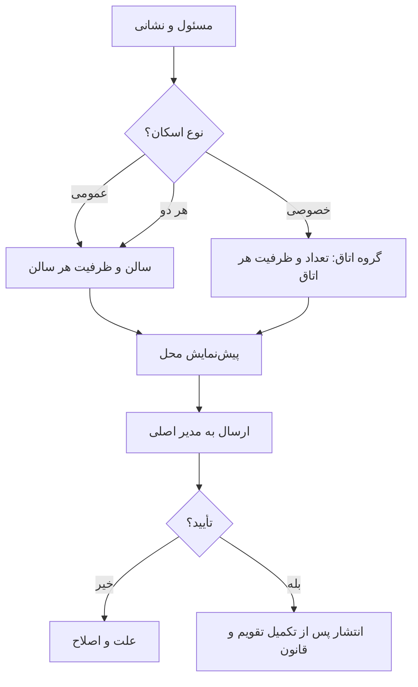

# MASTER-03 — ثبت موکب، سالن و اتاق

**تاریخ تدوین:** 2026-10-17  
**وضعیت:** DRAFT؛ بدون کد  
**والدها:** docs/ai/domains/LODGING_INVENTORY.md#L5-L34 — «قرارداد/چرخه عرضه»؛ docs/ai/domains/ADMIN_AND_TRUST.md#L5-L30 — «تأیید مدیر»  
**نماد/ماژول کد:** وجود ندارد.  
**تصمیم‌ها:** DEC-0004، DEC-0005، DEC-0006، DEC-0007، DEC-0016

## ۱. خروجی کار

موکب‌دار با پرسش‌های کوتاه نام و شماره مسئول، نشانی دقیق، عکس محل، مدرک مسئولیت و نوع فضا را ثبت می‌کند. سه حالت فضا پشتیبانی می‌شود: فقط سالن، فقط اتاق، یا هر دو. سالن‌ها مستقل و با گروه مجاز ثبت می‌شوند. اتاق‌های همسان به‌صورت «تعداد × ظرفیت هر اتاق» ثبت می‌شوند؛ اتاق‌های متفاوت گروه جدا دارند. هر ادمینی که مدیر اصلی منصوب کرده باشد می‌تواند پرونده را بررسی و موکب را تأیید کند.

## ۲. نبایدها

- نباید «۳ اتاق ۴ نفره» به یک اتاق ۱۲ نفره تبدیل شود.
- نباید سالن زن و مرد به ظرفیت مشترک تبدیل شود.
- نباید محل ردشده/در انتظار تأیید در نتیجه جست‌وجو باشد.
- نباید اتاق خصوصی هم‌زمان به دو رزرو برسد.

## ۳. گراف ثبت

## ۴. مثال و ماتریس آینده

موکب نمونه سه سالن ۵۰ نفره دارد: دو سالن آقایان و یک سالن بانوان. جمع اسمی ۱۵۰ نفر است؛ ظرفیت هر سالن جداست. همان موکب سه اتاق ۴ نفره و دو اتاق ۱۰ نفره هم دارد؛ پنج اتاق مستقل‌اند.

| شناسه | سناریو | انتظار | اجرا |
|---|---|---|---|
| HOST-01 | ثبت ۳ اتاق ۴ نفره | سه اتاق مستقل، یک مرحله ورود داده | NOT RUN |
| HOST-02 | افزودن اتاق ۱۰ نفره | گروه جدید؛ قبلی دست‌نخورده | NOT RUN |
| HOST-03 | محل در انتظار مدیر | پنهان از زائر | NOT RUN |
| HOST-04 | سالن بانوان ۵۰ نفره | فقط برای گروه مجاز نمایش | NOT RUN |

## ۵. پرسش‌های باز و ارجاع کد

مدارک پایه تأیید و اختیار ادمین منصوب قطعی شده‌اند. مدرک اضافه هر کشور، تعریف دقیق سالن خانواده و امکان ثبت چند مسئول برای یک موکب باز است. هیچ فایل کد/شماره خط/نام تابعی هنوز وجود ندارد؛ بعد از فاز طراحی فنی افزوده می‌شود.
