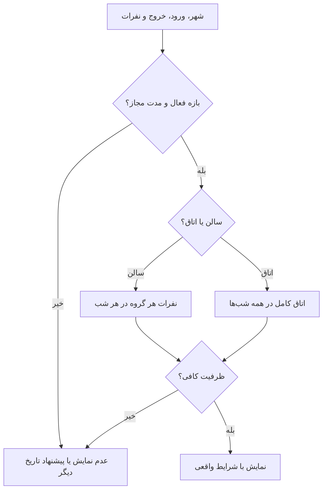

# MASTER-04 — تقویم، مدت و ظرفیت واقعی

**تاریخ تدوین:** 2026-10-17  
**وضعیت:** DRAFT؛ بدون کد  
**والدها:** docs/ai/domains/CORE_BUSINESS_ENGINE.md#L5-L33 — «قرارداد/گراف ظرفیت»؛ docs/ai/domains/LODGING_INVENTORY.md#L5-L17 — «فضا و نبایدها»  
**نماد/ماژول کد:** وجود ندارد.  
**تصمیم‌ها:** DEC-0005، DEC-0006، DEC-0007، DEC-0009

## ۱. خروجی کار

موکب می‌تواند همیشه باز، در یک بازه، یا در چند بازه فعال باشد. ساعت ورود/خروج و سقف مدت اقامت را خودش تعیین می‌کند. استثنای روز خاص ممکن است. جست‌وجو باید برای تک‌تک شب‌های درخواست ظرفیت درست همان سالن/اتاق را بررسی کند و سهم حضوری را کنار بگذارد.

## ۲. نبایدها

- خالی بودن شب اول مجوز رزرو چندشبه نیست.
- سهم حضوری و درخواست‌های در انتظار نباید به‌عنوان جای خالی قطعی نمایش داده شوند.
- آخرین ظرفیت نباید از دو پیام‌رسان دوبار قطعی شود.
- کاهش ظرفیت نباید رزرو قطعی موجود را بی‌تعیین‌تکلیف کند.

## ۳. گراف تطبیق

## ۴. مثال‌های محاسبه و آزمون آینده

۱۰ تا ۱۲ شهریور یعنی دو شب. خانواده ۲ آقا و ۳ خانم باید هر دو شب ۲ جای آقایان و ۳ جای بانوان بیابد. اگر شب ۱۱ فقط ۲ جای بانوان مانده باشد، این محل برای خانواده نمایش داده نمی‌شود. یک اتاق ۴ نفره برای پنج نفر، حتی اگر نفر پنجم کودک خردسال باشد، کافی نیست؛ زائر می‌تواند دو اتاق انتخاب کند.

| شناسه | ورودی | انتظار | اجرا |
|---|---|---|---|
| CAP-01 | ۱۰ تا ۱۲؛ شب دوم پر | عدم عرضه همان محل | NOT RUN |
| CAP-02 | ۵ نفر؛ اتاق ۴ نفره | رد تطبیق | NOT RUN |
| CAP-03 | دو درخواست آخرین اتاق | فقط یکی قطعی | NOT RUN |
| CAP-04 | چهار شب؛ سقف موکب سه شب | پیشنهاد کوتاه‌کردن | NOT RUN |
| CAP-05 | سالن بسته با رزرو قطعی | ارجاع به رسیدگی | NOT RUN |

## ۵. گره‌های تصمیم

سیاست آماده‌سازی اتاق و ظرفیت حضوری هنوز مصوب نیستند. پنج مهلت کاری ۲۴ ساعت‌اند؛ اثر آن‌ها بر نگه‌داشت موقت ظرفیت باید بدون دوباره‌فروشی جا طراحی شود. تقسیم گروه میان چند اتاق با انتخاب زائر مجاز است. ارجاع به کد فعلاً ناممکن است؛ هیچ سورس محصولی وجود ندارد.
