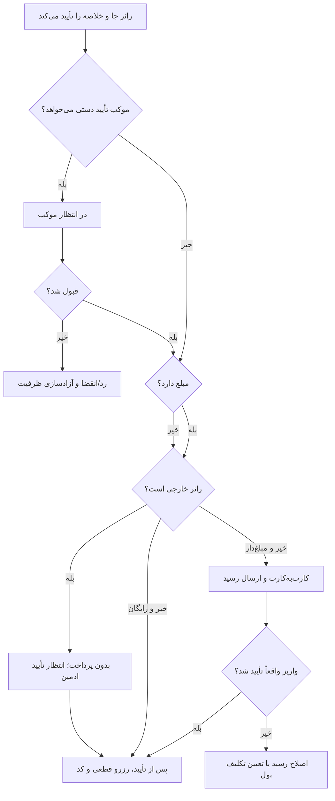

# MASTER-05 — جست‌وجوی زائر و چهار مسیر رزرو

**تاریخ تدوین:** 2026-10-17  
**وضعیت:** DRAFT؛ بدون کد  
**والدها:** docs/ai/domains/RESERVATION_LIFECYCLE.md#L5-L39 — «قرارداد/ماشین رزرو»؛ docs/ai/domains/CORE_BUSINESS_ENGINE.md#L5-L33 — «تطبیق ظرفیت»  
**نماد/ماژول کد:** وجود ندارد.  
**تصمیم‌ها:** DEC-0008، DEC-0010، DEC-0015، DEC-0016

## ۱. سفر کوتاه زائر

ترتیب پرسش‌ها: شهر، تاریخ، تعداد نفرات؛ تفکیک گروه فقط هنگام نیاز. نتیجه‌های دارای ظرفیت پیش از درخواست داده هویتی نشان داده می‌شوند. زائر نوع عمومی/خصوصی، نشانی، ساعت، مبلغ و قانون لغو را در خلاصه می‌بیند. زائر خارجی نیز همه مکان‌ها را می‌بیند، پرداخت نمی‌کند و برای قطعی‌شدن رزرو منتظر تأیید ادمین می‌ماند. بعد از ثبت، بات فقط وضعیت واقعی را می‌گوید.

## ۲. نبایدها

- نام و شماره پیش از دیدن گزینه‌های واقعی اجباری نشود.
- «در انتظار موکب/پرداخت/رسید» به‌عنوان قطعی نمایش داده نشود.
- سالن‌های دور از هم برای خانواده بدون آگاهی قبلی پیشنهاد نشوند.
- قانون لغو بعد از تأیید پنهان یا عوض نشود.

## ۳. گراف چهار مسیر

## ۴. ماتریس مسیر و آزمون آینده

| شناسه | روش موکب | مبلغ | نتیجه تا قبل از شرط پایانی | اجرا |
|---|---|---|---|---|
| BOOK-01 | فوری | رایگان | کد قطعی پس از کنترل ظرفیت | NOT RUN |
| BOOK-02 | دستی | رایگان | انتظار قبول موکب | NOT RUN |
| BOOK-03 | فوری | هزینه/تضمین | انتظار بررسی واقعی واریز | NOT RUN |
| BOOK-04 | دستی | هزینه/تضمین | اول قبول موکب، بعد واریز/رسید | NOT RUN |
| BOOK-05 | هر روش | رد/انقضا | آزادسازی جا و وضعیت روشن | NOT RUN |
| BOOK-06 | زائر خارجی | هر مدل عرضه | بدون پرداخت؛ قطعی فقط پس از تأیید ادمین | NOT RUN |

## ۵. پرسش‌های باز

مهلت پاسخ، پرداخت و بررسی رسید هرکدام ۲۴ ساعت‌اند؛ نگه‌داشت ظرفیت باید با آن‌ها سازگار طراحی شود. یک حساب می‌تواند برای چند خانواده رزرو هم‌پوشان داشته باشد؛ رد خودکار بر پایه شماره مجاز نیست. پیوند کانال دوم با کد در بات موجود انجام می‌شود. احراز زائر خارجی و ترتیب تأیید ادمین/موکب‌دار در حالت دستی باز است. هیچ مسیر کد و شماره خطی برای ارجاع وجود ندارد.
