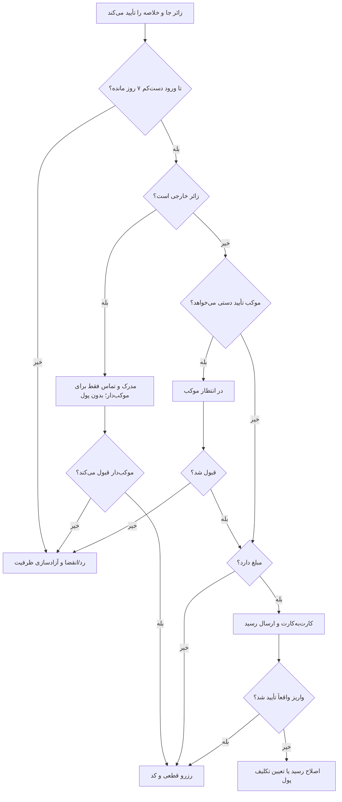

# MASTER-05 — جست‌وجوی زائر و چهار مسیر رزرو

**تاریخ تدوین:** 2026-10-17  
**وضعیت:** DRAFT؛ بدون کد  
**والدها:** docs/ai/domains/RESERVATION_LIFECYCLE.md#L5-L39 — «قرارداد/ماشین رزرو»؛ docs/ai/domains/CORE_BUSINESS_ENGINE.md#L5-L33 — «تطبیق ظرفیت»  
**نماد/ماژول کد:** وجود ندارد.  
**تصمیم‌ها:** DEC-0008، DEC-0010، DEC-0015، DEC-0016

## ۱. سفر کوتاه زائر

ترتیب پرسش‌ها: شهر، تاریخ، تعداد نفرات؛ تفکیک گروه فقط هنگام نیاز. نتیجه‌های دارای ظرفیت پیش از درخواست داده هویتی نشان داده می‌شوند. زائر نوع عمومی/خصوصی، نشانی، ساعت، مبلغ و قانون لغو را در خلاصه می‌بیند. آخرین روز درخواست هفت روز پیش از ورود است. زائر خارجی همه مکان‌ها را می‌بیند، پرداخت نمی‌کند و تصویر مدرک و اطلاعات تماس او فقط به موکب‌دار همان محل برای قبول یا رد می‌رسد. بعد از ثبت، بات فقط وضعیت واقعی را می‌گوید.

## ۲. نبایدها

- نام و شماره پیش از دیدن گزینه‌های واقعی اجباری نشود.
- «در انتظار موکب/پرداخت/رسید» به‌عنوان قطعی نمایش داده نشود.
- سالن‌های دور از هم برای خانواده بدون آگاهی قبلی پیشنهاد نشوند.
- قانون لغو بعد از تأیید پنهان یا عوض نشود.

## ۳. گراف چهار مسیر

## ۴. ماتریس مسیر و آزمون آینده

| شناسه | روش موکب | مبلغ | نتیجه تا قبل از شرط پایانی | اجرا |
|---|---|---|---|---|
| BOOK-01 | فوری | رایگان | کد قطعی پس از کنترل ظرفیت | NOT RUN |
| BOOK-02 | دستی | رایگان | انتظار قبول موکب | NOT RUN |
| BOOK-03 | فوری | هزینه/تضمین | انتظار بررسی واقعی واریز | NOT RUN |
| BOOK-04 | دستی | هزینه/تضمین | اول قبول موکب، بعد واریز/رسید | NOT RUN |
| BOOK-05 | هر روش | رد/انقضا | آزادسازی جا و وضعیت روشن | NOT RUN |
| BOOK-06 | زائر خارجی | هر مدل عرضه | بدون پرداخت؛ مدرک و تماس فقط برای موکب‌دار؛ قطعی فقط پس از قبول او | NOT RUN |
| BOOK-07 | ورود ۲۰ آبان | درخواست در ۱۳ یا ۱۴ آبان | ۱۳ مجاز؛ ۱۴ مردود | NOT RUN |

## ۵. پرسش‌های باز

مهلت پاسخ، پرداخت و بررسی رسید هرکدام ۲۴ ساعت‌اند؛ ظرفیت در هر گام انتظار تا پایان مهلت همان گام نگه داشته می‌شود. یک حساب می‌تواند برای چند خانواده رزرو هم‌پوشان داشته باشد؛ رد خودکار بر پایه شماره مجاز نیست. پیوند کانال دوم با کد در بات موجود انجام می‌شود. روز آخر تا پایان همان روز به وقت شهر مقصد است. زائر خارجی تصویر گذرنامه می‌دهد؛ تصویر ۳۰ روز پس از اقامت یا، اگر اقامتی نبود، ۳۰ روز پس از بسته‌شدن درخواست حذف می‌شود. هیچ مسیر کد و شماره خطی برای ارجاع وجود ندارد.

## ۶. روایت گام‌به‌گام بات زائر

**جست‌وجو:** بات در کمترین پرسش شهر، تاریخ ورود/خروج و تعداد نفرات را می‌گیرد. جنسیت اعضای گروه فقط برای اسکان عمومی یا جایی که بر نتیجه اثر دارد پرسیده می‌شود. پیش از گرفتن داده هویتی، محل‌های دارای ظرفیت واقعی در همه شب‌ها دیده می‌شوند. اگر هیچ نتیجه‌ای نیست، پیام ساده «برای این تاریخ و تعداد جا پیدا نشد» نمایش داده شود؛ پیشنهاد تاریخ دیگر فقط وقتی ظرفیت واقعی آن معلوم است.

**انتخاب:** هر کارت نتیجه نوع عمومی/خصوصی، ظرفیت مناسب، نشانی، ساعت ورود/خروج، مدت مجاز، رایگان/هزینه/تضمین و روش تأیید را روشن نشان دهد. پیش از دکمه نهایی، خلاصه یک‌صفحه‌ای شامل تعداد نفرات و اتاق‌های انتخاب‌شده، مبلغ کل، قانون لغو/عدم حضور و وضعیت احتمالی انتظار نمایش داده شود. اصطلاح «رزرو قطعی» فقط پس از تحقق همه شرط‌ها به کار رود.

**چهار مسیر زائر عادی:** رایگان+فوری پس از ثبت معتبر و ظرفیت قطعی می‌شود؛ رایگان+دستی تا قبول موکب منتظر است؛ مبلغ‌دار+فوری تا بررسی واقعی واریز توسط موکب‌دار منتظر است؛ مبلغ‌دار+دستی ابتدا ۲۴ ساعت برای پاسخ موکب منتظر می‌ماند و فقط پس از قبول، مسیر واریز/رسید را می‌بیند. مهلت ارسال رسید از پذیرش ۲۴ ساعت و مهلت بررسی موکب از دریافت رسید ۲۴ ساعت است.

**زائر خارجی:** برای همه محل‌ها جست‌وجو و درخواست می‌دهد. بات نباید مبلغ کارت‌به‌کارت یا عکس رسید بخواهد. تصویر گذرنامه و اطلاعات تماس فقط به موکب‌دار همان محل می‌رسد؛ وضعیت تا قبول یا رد او «در انتظار موکب‌دار» است، حتی اگر پذیرش عادی آن موکب فوری باشد. ادمین این رزرو را تأیید نمی‌کند. تصویر گذرنامه ۳۰ روز پس از اقامت یا، اگر اقامتی نبود، ۳۰ روز پس از بسته‌شدن درخواست حذف می‌شود.

**پیگیری:** هر درخواست یک وضعیت و شناسه قابل بازیابی در «رزروهای من» دارد. اگر اعلان گم شد یا کاربر بات دیگر را باز کرد، همان وضعیت مرکزی دیده می‌شود. ارسال دوباره دکمه یا پیام نباید درخواست، اتاق یا مبلغ تکراری بسازد. یک حساب می‌تواند برای چند خانواده درخواست هم‌زمان ثبت کند.
