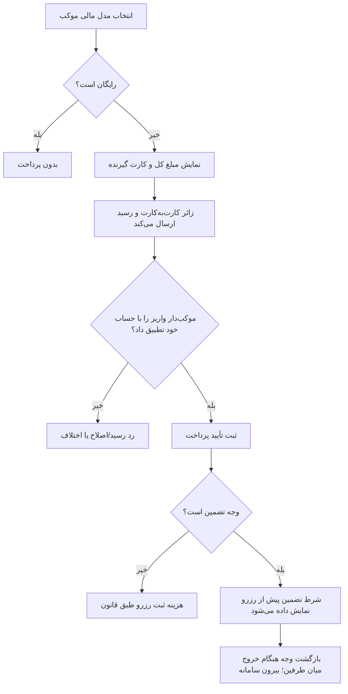

# MASTER-06 — هزینه ثبت رزرو، تضمین و رسید دستی

**تاریخ تدوین:** 2026-10-17  
**وضعیت:** DRAFT؛ بدون کد  
**والد:** docs/ai/domains/BILLING_AND_WALLET.md#L5-L37 — «مدل مالی و ماشین پرونده»  
**نماد/ماژول کد:** وجود ندارد.  
**تصمیم‌ها:** DEC-0011، DEC-0012، DEC-0013، DEC-0014

## ۱. سه مدل انحصاری

رایگان: مبلغ صفر. هزینه ثبت رزرو: یک مبلغ ثابت برای کل رزرو که به کارت موکب‌دار/موکب می‌رود. وجه تضمین: یک مبلغ ثابت برای کل رزرو که پس از خروج طبق قانون میان طرفین برگردانده می‌شود. هزینه و تضمین هم‌زمان نداریم. این مسیر پرداخت برای زائر عادی است؛ زائر خارجی برای همه مکان‌ها بدون پرداخت درخواست می‌دهد و ادمین رزرو او را تأیید می‌کند. موکب‌دار رسید زائر عادی را تا ۲۴ ساعت بررسی می‌کند.

## ۲. نبایدها

- عکس رسید، پرداخت قطعی محسوب نشود.
- قبل از قبول موکب در مسیر دستی پول درخواست نشود.
- هزینه در تعداد نفر/اتاق/شب ضرب نشود.
- بازپرداخت به‌عنوان وضعیت یا عملیات سامانه نشان داده نشود؛ موضوع هنگام خروج میان زائر و موکب‌دار است.
- هیچ کیف پول یا تسویه به حساب مالک سامانه از این مستر استنباط نشود.

## ۳. گراف پرداخت و مرز تضمین

## ۴. مثال عددی و آزمون آینده

اگر موکب هزینه ثبت رزرو را ۱۰۰ هزار تومان تعیین کند، خانواده پنج نفره برای دو شب همان ۱۰۰ هزار تومان کل را می‌بیند. اگر تضمین را ۳۰۰ هزار تومان تعیین کند، شرط بازگشت پیش از رزرو دیده می‌شود و هنگام خروج، طرفین خودشان وجه را برمی‌گردانند؛ بات وضعیت بازپرداخت ندارد. عدم حضور بر پایه قانون موکب است.

| شناسه | سناریو | انتظار | اجرا |
|---|---|---|---|
| PAY-01 | رسید تصویری بدون واریز واقعی | رزرو قطعی نشود | NOT RUN |
| PAY-02 | واریز واقعی، پیام بات قطع شد | پول و رزرو دوباره ساخته نشود؛ پیگیری بماند | NOT RUN |
| PAY-03 | هزینه + تضمین هم‌زمان | رد تعریف عرضه | NOT RUN |
| PAY-04 | خروج ثبت شد و رزرو تضمینی بود | بات وضعیت بازپرداخت نخواهد؛ شرط تضمین قبلاً نمایش داده شده است | NOT RUN |
| PAY-05 | قانون موکب بعداً تغییر کرد | رزرو قبلی با قانون زمان ثبت بماند | NOT RUN |
| PAY-06 | زائر خارجی، عرضه مبلغ‌دار | بدون پرداخت/رسید؛ انتظار تأیید ادمین | NOT RUN |

## ۵. پرسش‌های مسدودکننده

موکب‌دار مسئول تطبیق رسید با حساب خودش تا ۲۴ ساعت از دریافت است. زائر خارجی فعلاً پرداخت ندارد. احراز خارجی‌بودن و ارز نمایش پول بازند. بازگشت تضمین از وظیفه سامانه خارج است.
