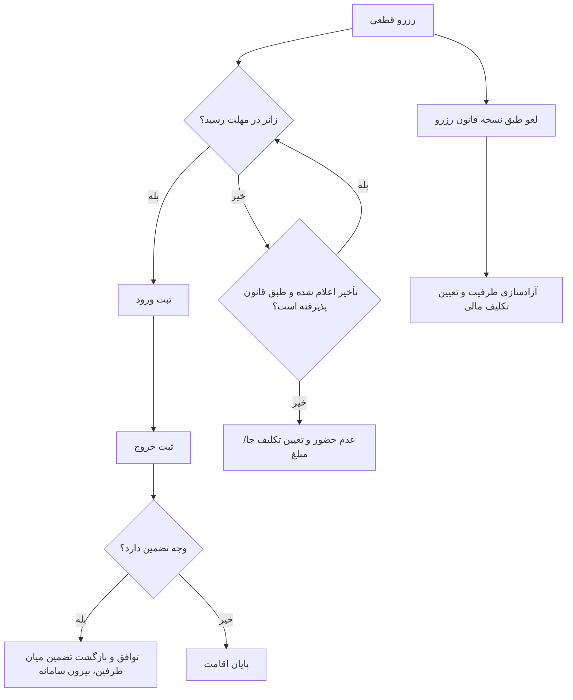

# MASTER-07 — حضور، لغو، عدم حضور و اعلان

**تاریخ تدوین:** 2026-10-17  
**وضعیت:** DRAFT؛ بدون کد  
**والدها:** docs/ai/domains/RESERVATION_LIFECYCLE.md#L5-L39 — «چرخه رزرو»؛ docs/ai/domains/NOTIFICATIONS_AND_JOBS.md#L5-L28 — «اعلان/موعد»  
**نماد/ماژول کد:** وجود ندارد.  
**تصمیم‌ها:** DEC-0013، DEC-0014، DEC-0016

## ۱. خروجی کار

زائر کد رزرو را در محل نشان می‌دهد؛ موکب‌دار ورود و سپس خروج را ثبت می‌کند. زائر می‌تواند تأخیر یا لغو را اعلام کند. عدم حضور پس از ۲۴ ساعت از زمان ورود برنامه‌ریزی‌شده معنی دارد. هر رزرو نسخه قانون زمان ثبت را حفظ می‌کند. اعلان تغییر وضعیت به کاربر مربوط می‌رود و خود وضعیت در بات قابل بازیابی است.

## ۲. نبایدها

- عدم حضور پیش از مهلت همان رزرو ثبت نشود.
- متن شرط تضمین پیش از رزرو نمایش داده شود؛ بات وضعیت بازپرداخت نسازد.
- لغو موکب‌دار رزرو قطعی را بدون خبر و رسیدگی پاک نکند.
- شکست پیام‌رسان، وضعیت ثبت‌شده مرکزی را از بین نبرد.

## ۳. گراف بعد از رزرو

## ۴. ماتریس آینده

| شناسه | مثال | انتظار | اجرا |
|---|---|---|---|
| STAY-01 | زائر آمد و رفت | ورود/خروج ثبت شود؛ بازپرداخت در سامانه ثبت نشود | NOT RUN |
| STAY-02 | زائر دیر رسید و خبر داد | طبق قانون همان موکب بررسی | NOT RUN |
| STAY-03 | زائر نیامد | پس از مهلت، عدم حضور | NOT RUN |
| STAY-04 | موکب سالن را بست | رسیدگی مدیر و اعلان | NOT RUN |
| STAY-05 | ارسال اعلان شکست خورد | وضعیت در بات باقی بماند | NOT RUN |

## ۵. پرسش‌های باز

لغو تا ۲۴ ساعت پیش از ورود و اعلام عدم حضور پس از ۲۴ ساعت از زمان ورود است. اثر مالی لغو/تأخیر طبق قانون اعلام‌شده موکب است. زمان یادآوری و روش ثبت خروج در اینترنت ضعیف بازند. ارجاع کد/دیتابیس وجود ندارد.

## ۶. سناریوهای بعد از قطعی‌شدن

**پذیرش:** زائر کد همان رزرو را نشان می‌دهد. موکب‌دار فقط رزرو متعلق به محل خودش را می‌بیند و ورود را ثبت می‌کند. ورود باید به همان اشخاص/تعداد و همان بازه مرتبط باشد؛ اگر گروه با تعداد دیگری حاضر شد، افزایش ظرفیت خودکار مجاز نیست و باید ظرفیت واقعی و تصمیم موکب بررسی شود.

**خروج:** موکب‌دار پایان اقامت را ثبت می‌کند. در رزرو دارای تضمین، طرفین در محل درباره بازگشت وجه اقدام می‌کنند؛ بات هیچ حالت یا رسید بازپرداخت ندارد. آزادشدن زودهنگام اتاق برای رزرو جدید، بدون تصمیم درباره آماده‌سازی اتاق، خودکار فرض نشود.

**لغو از سوی زائر:** تا ۲۴ ساعت پیش از ساعت ورود برنامه‌ریزی‌شده امکان لغو طبق DEC-0025 وجود دارد. ظرفیت فقط یک بار و پس از تغییر معتبر وضعیت آزاد می‌شود. اثر مالی هزینه ثبت رزرو یا تضمین از متن قانون همان موکب که هنگام رزرو ذخیره شده به دست می‌آید؛ مبلغ یا درصدی حدس زده نمی‌شود. وضعیت و نتیجه باید در هر دو پیام‌رسان قابل بازیابی باشد.

**عدم حضور:** ۲۴ ساعت پس از ساعت ورود برنامه‌ریزی‌شده، اگر ورود ثبت نشده و تأخیرِ پذیرفته‌شده وجود ندارد، موکب‌دار می‌تواند طبق قانون همان رزرو عدم حضور را تعیین کند. نقطه تصمیم در اقامت‌های کوتاه و تأخیرِ اعلام‌شده نیازمند بازبینی سناریو است؛ صرف گذشت زمان نباید رزرو قطعی را بی‌ردپا پاک کند.

**تعطیلی از سوی موکب:** رزروهای قطعی گذشته پنهان یا حذف نمی‌شوند. مدیر/ادمین باید پرونده‌های متأثر را ببیند و زائران پیام روشن درباره تغییر وضعیت بگیرند. جابه‌جایی به محل دیگر یا تکلیف مالی بدون قاعده مصوب خودکار نشود.
