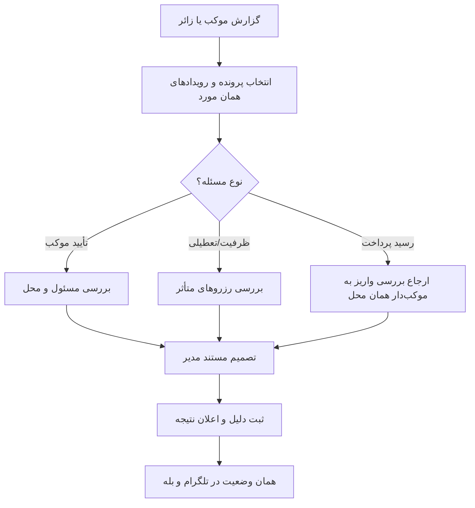

# MASTER-08 — مدیریت موکب، اختلاف و عملیات چهار بات

**تاریخ تدوین:** 2026-10-17  
**وضعیت:** DRAFT؛ بدون کد  
**والدها:** docs/ai/domains/ADMIN_AND_TRUST.md#L5-L30 — «مدیریت/رسیدگی»؛ docs/ai/domains/CHANNEL_ADAPTERS.md#L5-L29 — «درگاه مشترک»  
**نماد/ماژول کد:** وجود ندارد.  
**تصمیم‌ها:** DEC-0003، DEC-0004، DEC-0012

## ۱. خروجی کار

مدیر اصلی ادمین‌ها را منصوب می‌کند؛ هر ادمین منصوب می‌تواند موکب را با مدارک مسئول و محل تأیید کند. پنل مدیریت در مرورگر باز می‌شود. موکب‌دار همان محل رزرو زائر خارجی را با مدرک و تماس او، بدون دریافت پول، قبول یا رد می‌کند؛ ادمین در این تصمیم دخالت ندارد. اختلاف‌های ظرفیت، تعطیلی و حضور با سابقه ثبت‌شده بررسی می‌شوند. موکب‌دار رسید مالی محل خودش را بررسی می‌کند؛ بازپرداخت تضمین در سامانه ثبت نمی‌شود. یک رویداد رزرو در چهار بات معنی یکسان دارد.

## ۲. نبایدها

- تصمیم مدیر بی‌دلیل و بدون نام مسئول/زمان ثبت نشود.
- آخرین ظرفیت در دو بات دو بار قطعی نشود.
- رزرو قطعی هنگام تعطیلی محل بی‌خبر حذف نشود.
- مدیر بدون نیاز به داده هویتی اضافی دسترسی نگیرد.

## ۳. گراف عملیات و رسیدگی

## ۴. آزمون‌های آینده

| شناسه | سناریو | انتظار | اجرا |
|---|---|---|---|
| ADM-01 | موکب تأییدنشده | پنهان از جست‌وجو | NOT RUN |
| ADM-02 | تعطیلی با رزرو قطعی | پرونده رسیدگی و خبر به زائر | NOT RUN |
| ADM-03 | موکب‌دار رسید پرداخت را بررسی می‌کند | ادمین به‌جای او تأیید پرداخت نمی‌زند | NOT RUN |
| CH-01 | آخرین اتاق از تلگرام گرفته شد | در بله هم پر است | NOT RUN |
| CH-02 | پیام تکراری بات | عملیات تکراری ندارد | NOT RUN |

## ۵. دروازه اجرا

دو نقش مدیر، مدارک پایه تأیید و پنل مرورگر مصوب‌اند. احراز خارجی‌بودن، جزئیات مدرک کشورها و مرجع نهایی اختلاف هنوز بازند. پس از تصویب اسناد، فناوری، مسیر فایل، خط و نام نماد در مستر اجرای فاز اول ثبت می‌شود؛ این سند کد را شروع نمی‌کند.

## ۶. پنل مرورگر و حدود اختیار

**مدیر اصلی:** ادمین منصوب می‌کند و همان اختیارات بررسی موکب را دارد. **ادمین منصوب:** پرونده موکب، نام و شماره مسئول، نشانی، عکس محل و مدرک مسئولیت را برای تصمیم می‌بیند. هر تصمیم تأیید/رد/درخواست تکمیل باید زمان، تصمیم‌گیرنده و دلیل داشته باشد. ادمین نمی‌تواند خودسرانه موکب دیگری را صاحب حساب کند یا ظرفیت و رزرو گذشته را بی‌ردپا تغییر دهد.

پنل در مرورگر روی رایانه و موبایل باز می‌شود. نمونه لینک ورود قبلی کارفرما تنها نمونه تجربه کاربری است؛ هیچ توکن یا URL آن به این پروژه منتقل نمی‌شود. روش احراز هویت خود پنل، مهلت نشست و بازیابی مدیر هنوز تصمیم فنی/امنیتی می‌خواهد و نباید از مثال قبلی استنباط شود.

**پرونده خطا:** موکب تأییدنشده نباید در جست‌وجو ظاهر شود. اگر محل بعد از رزرو قطعی تعطیل شد، پنل باید رزروهای متأثر را به مدیر نشان دهد، بدون پاک‌کردن سابقه. اگر رسید مالی محل محل اختلاف بود، بررسی واقعی واریز با موکب‌دار همان محل است؛ پنل نباید به‌جای او پرداخت را تأیید کند.

**داده حساس:** تصویر مدرک و شماره تماس فقط به کسی نمایش داده شود که برای همان تصمیم مجاز است. محتوای کامل مدرک، توکن ورود یا شماره کامل کارت در لاگ عادی، اعلان عمومی و مخزن Git نباشد. مدت نگهداری مدرک و راه حذف/بازیابی آن هنوز نیازمند تصمیم است.
