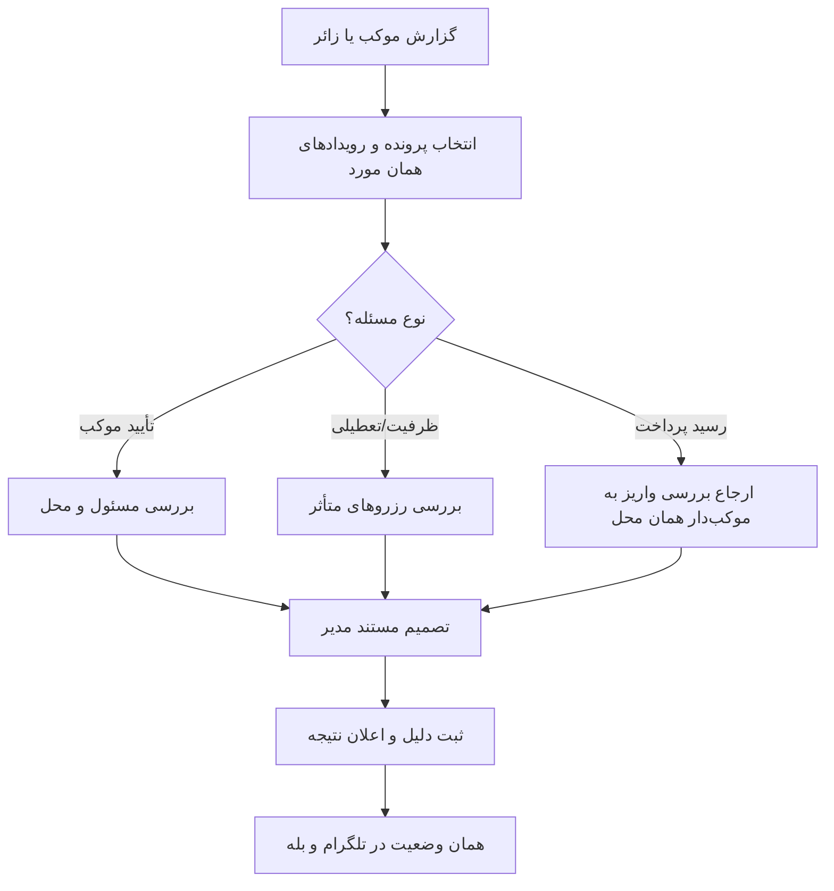

# MASTER-08 — مدیریت موکب، اختلاف و عملیات چهار بات

**تاریخ تدوین:** 2026-10-17  
**وضعیت:** DRAFT؛ بدون کد  
**والدها:** docs/ai/domains/ADMIN_AND_TRUST.md#L5-L30 — «مدیریت/رسیدگی»؛ docs/ai/domains/CHANNEL_ADAPTERS.md#L5-L29 — «درگاه مشترک»  
**نماد/ماژول کد:** وجود ندارد.  
**تصمیم‌ها:** DEC-0003، DEC-0004، DEC-0012

## ۱. خروجی کار

مدیر اصلی ادمین‌ها را منصوب می‌کند؛ هر ادمین منصوب می‌تواند موکب را با مدارک مسئول و محل تأیید کند. پنل مدیریت در مرورگر باز می‌شود. ادمین رزرو زائر خارجی را بدون دریافت پول تأیید می‌کند. اختلاف‌های ظرفیت، تعطیلی و حضور با سابقه ثبت‌شده بررسی می‌شوند. موکب‌دار رسید مالی محل خودش را بررسی می‌کند؛ بازپرداخت تضمین در سامانه ثبت نمی‌شود. یک رویداد رزرو در چهار بات معنی یکسان دارد.

## ۲. نبایدها

- تصمیم مدیر بی‌دلیل و بدون نام مسئول/زمان ثبت نشود.
- آخرین ظرفیت در دو بات دو بار قطعی نشود.
- رزرو قطعی هنگام تعطیلی محل بی‌خبر حذف نشود.
- مدیر بدون نیاز به داده هویتی اضافی دسترسی نگیرد.

## ۳. گراف عملیات و رسیدگی

## ۴. آزمون‌های آینده

| شناسه | سناریو | انتظار | اجرا |
|---|---|---|---|
| ADM-01 | موکب تأییدنشده | پنهان از جست‌وجو | NOT RUN |
| ADM-02 | تعطیلی با رزرو قطعی | پرونده رسیدگی و خبر به زائر | NOT RUN |
| ADM-03 | موکب‌دار رسید پرداخت را بررسی می‌کند | ادمین به‌جای او تأیید پرداخت نمی‌زند | NOT RUN |
| CH-01 | آخرین اتاق از تلگرام گرفته شد | در بله هم پر است | NOT RUN |
| CH-02 | پیام تکراری بات | عملیات تکراری ندارد | NOT RUN |

## ۵. دروازه اجرا

دو نقش مدیر، مدارک پایه تأیید و پنل مرورگر مصوب‌اند. احراز خارجی‌بودن، جزئیات مدرک کشورها و مرجع نهایی اختلاف هنوز بازند. پس از تصویب اسناد، فناوری، مسیر فایل، خط و نام نماد در مستر اجرای فاز اول ثبت می‌شود؛ این سند کد را شروع نمی‌کند.
