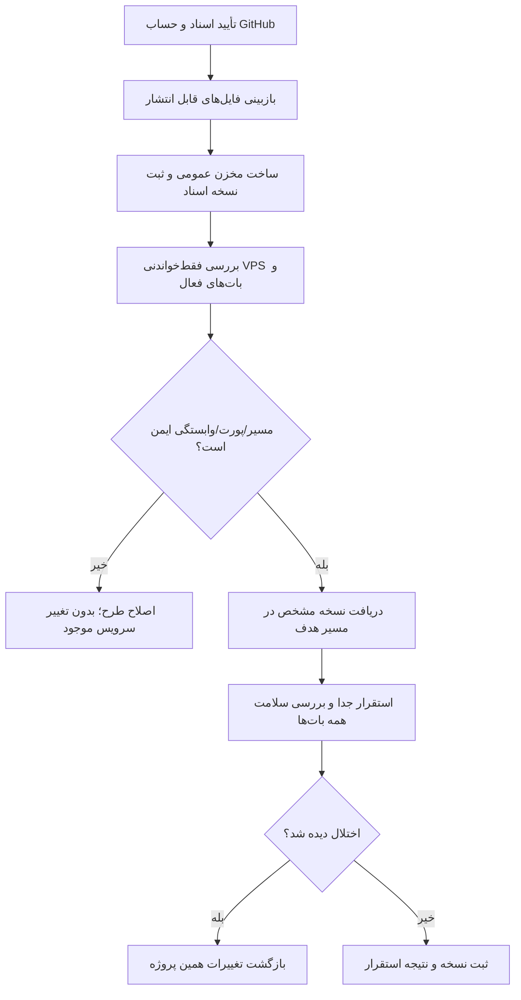

# MASTER-09 — مخزن عمومی و استقرار بدون اختلال در بات‌های موجود

**تاریخ تدوین:** 2026-10-17  
**وضعیت:** DRAFT؛ بدون کد یا تغییر VPS  
**والدها:** docs/ai/domains/SOURCE_CONTROL_AND_DEPLOYMENT.md#L5-L34 — «قرارداد تا پرسش باز»؛ docs/ai/ROOT_MASTER.md#L44-L53 — «نبایدهای ریشه»  
**نماد/ماژول کد:** وجود ندارد.  
**تصمیم‌ها:** DEC-0017، DEC-0029، DEC-0030

## ۱. خروجی مطلوب

اسناد کنونی و سپس کد تأییدشده در مخزن عمومی `elyas5203/rezervasiyonBOT` نسخه‌بندی شوند. مقصد VPS، `/root/rezervasiyon/` است. pull و استقرار فقط پس از بررسی خواندنی سرویس‌های در حال اجرا، پورت‌ها، مسیرها و وابستگی‌ها انجام شوند. نسخه دقیق مستقرشده و نتیجه بررسی سلامت بات‌های موجود ثبت شود.

## ۲. نبایدها و مرز داده

- مخزن عمومی نباید شامل رمز VPS، توکن ورود، کلید بات، فایل `.env`، دیتابیس، داده زائران، رسید یا مدارک باشد.
- commit و push فایل‌های پروژه به معنی ذخیره خودکار داده‌های واقعی کاربران نیست؛ داده‌ها به پشتیبان جدا نیاز دارند.
- هیچ بات موجود به خاطر انتخاب پورت، restart سرویس مشترک یا تغییر تنظیمات سرور مختل نشود.
- پیش از بررسی واقعی، هیچ پورت، نام سرویس، ابزار استقرار یا دیتابیس به عنوان «آزاد» فرض نشود.
- هیچ دستور مخرب/مایگریشن روی VPS بدون بازبینی خط‌به‌خط اجرا نشود.

## ۳. گراف مسیر کار

## ۴. مثال و آزمون آینده

اگر پورت پیشنهادی پروژه تازه قبلاً دست بات دیگری باشد، همان پورت استفاده نمی‌شود و بات موجود دست‌نخورده می‌ماند. اگر دریافت نسخه جدید شکست خورد، سرویس‌های قبلی همچنان کار می‌کنند. هیچ عدد پورت یا دستور اجرایی در این مرحله تصویب نشده است.

| شناسه | سناریو | انتظار | اجرا |
|---|---|---|---|
| OPS-01 | پورت یا نام سرویس تکراری | طرح استقرار متوقف شود؛ بات موجود تغییر نکند | NOT RUN |
| OPS-02 | فایل رمز در فهرست انتشار | commit/push متوقف و فایل از انتشار خارج شود | NOT RUN |
| OPS-03 | pull ناموفق | بات‌های قبلی بدون اختلال بمانند | NOT RUN |
| OPS-04 | پروژه تازه بالا آمد | سلامت آن و بات‌های موجود جداگانه بررسی شود | NOT RUN |

## ۵. دروازه اجرا

حساب GitHub درست و روش دسترسی به آن باید احراز شود. پیش از اتصال به VPS، موجودی واقعی سرویس‌ها و پورت‌ها فقط خوانده شود. جزئیات پشتیبان داده و طرح بازگشت پیش از هر استقرار عملی کامل شوند. در این مستر کد، فایل استقرار، پورت یا اتصال VPS ساخته نمی‌شود.
