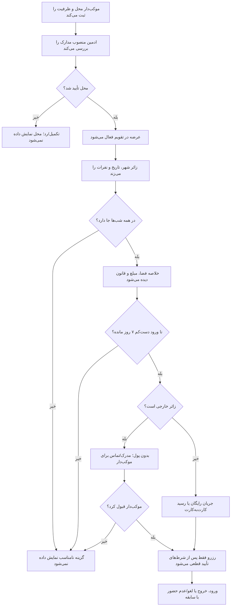

# MASTER-10 — قرارداد تحویل به هوش مصنوعی کدنویس و سناریوهای سرتاسری

**تاریخ تدوین:** 2026-10-17  
**وضعیت:** DRAFT؛ فقط تحلیل، بدون مجوز کدنویسی  
**والدها:** docs/ai/ROOT_MASTER.md#L8-L100 — «چشم‌انداز تا دروازه فاز اول»؛ docs/ai/domains/RESERVATION_LIFECYCLE.md#L5-L45 — «قرارداد و ماشین رزرو»  
**نماد/ماژول کد:** وجود ندارد؛ تا انتخاب فناوری نامی جعل نمی‌شود.  
**تصمیم‌ها:** DEC-0001 تا DEC-0039؛ در تعارض، تصمیم جدیدتر و پاسخ صریح کارفرما مقدم است.

## ۱. ترتیب خواندن برای عامل کدنویس

۱. بالای `docs/ai/PROJECT_STATE.md`، سپس `BACKLOG.md` و `INDEX.md`.  
۲. `ROOT_MASTER.md` و دفتر تصمیم‌ها.  
۳. سند دامنه مرتبط، سپس MASTER اختصاصی کار.  
۴. پیش از هر تغییر اجرایی، سند فرزند جدید با شماره بعدی، گراف، نبایدها، فایل‌های هدف و معیار پذیرش.  
۵. اسناد قدیمی `docs/01-*` تا `docs/03-*` و فایل‌های XMind فقط پیشینه/ارائه‌اند؛ هیچ قاعده قدیمی مخالف DEC را اجرا نکن.

## ۲. محصول از نگاه کاربر؛ جمله‌های قابل آزمون

| نقش | ورودی کوتاه | خروجی قابل فهم | شرط پنهانِ لازم |
|---|---|---|---|
| موکب‌دار | محل، سالن/اتاق، ظرفیت، تقویم و قانون | آگهی آماده بررسی | انتشار تنها پس از تأیید ادمین منصوب |
| زائر | شهر، ورود/خروج، نفرات | فقط محل‌های مناسب با خلاصه شرایط | بررسی ظرفیت تمام شب‌ها و گروه مجاز |
| زائر عادی | انتخاب محل و تأیید خلاصه | کد قطعی یا وضعیت انتظار دقیق | تأیید موکب و/یا واریز متناسب با عرضه |
| زائر خارجی | انتخاب هر محل و ارسال مدرک/تماس | وضعیت انتظار موکب‌دار، بدون درخواست پول | مدرک فقط برای موکب‌دار همان محل |
| مدیر/ادمین | پرونده موکب | تصمیم ثبت‌شده و اعلان | فقط اختیار نقش خودش |

## ۳. گراف تصمیم سرتاسری

## ۴. ترکیب قواعد؛ هیچ حالتی حذف نشود

هر عرضه ممکن است عمومی، خصوصی یا ترکیبی باشد؛ هر موکب می‌تواند تأیید فوری یا دستی داشته باشد؛ هر رزرو از نظر مدل مالی فقط یکی از رایگان، هزینه ثابت ثبت رزرو، یا تضمین ثابت کل رزرو است. کانال تلگرام یا بله هیچ تغییری در این قواعد نمی‌دهد. برای زائر خارجی، مسیر بدون پرداخت و تأیید موکب‌دار همان محل روی هر مدل عرضه اعمال می‌شود. آخرین روز درخواست هفت روز پیش از ورود است. چند اتاق خصوصی فقط با انتخاب آگاهانه زائر و بدون عبور از ظرفیت اسمی هر اتاق تخصیص می‌یابند. یک حساب می‌تواند برای چند خانواده در تاریخ هم‌پوشان رزرو کند.

## ۵. معیارهای پذیرش سرتاسری؛ هنوز اجرا نشده‌اند

| شناسه | داستان نمونه | نتیجه لازم | وضعیت |
|---|---|---|---|
| E2E-01 | ۳ سالن ۵۰ نفری، یکی بسته | ظرفیت شب بسته ۱۰۰ نفر و تفکیک جنسیت محفوظ | NOT RUN |
| E2E-02 | ۵ نفر شامل کودک، اتاق ۴ نفره | همان یک اتاق رد؛ چند اتاق یا اتاق بزرگ‌تر پیشنهاد شود | NOT RUN |
| E2E-03 | آخرین اتاق هم‌زمان از تلگرام و بله درخواست شد | فقط یک رزرو قطعی؛ وضعیت دیگری روشن | NOT RUN |
| E2E-04 | موکب دستی و رایگان | درخواست تا پاسخ موکب قطعی نامیده نشود؛ مهلت پاسخ ۲۴ ساعت | NOT RUN |
| E2E-05 | موکب فوری با هزینه ثبت | پس از رسید، موکب‌دار واریز را بررسی کند؛ عکس رسید کافی نیست | NOT RUN |
| E2E-06 | موکب دستی با تضمین | اول قبول موکب، سپس درخواست واریز؛ تضمین در خروج بیرون سامانه | NOT RUN |
| E2E-07 | زائر خارجی، محل دارای مبلغ و تأیید فوری عادی | بات پول نخواهد؛ مدرک و تماس فقط به موکب‌دار برسد؛ تا قبول او قطعی نشود | NOT RUN |
| E2E-15 | ورود ۲۰ آبان، درخواست ۱۳ و ۱۴ آبان | تا پایان ۱۳ آبان به وقت شهر مقصد مجاز؛ از آغاز ۱۴ آبان رد شود | NOT RUN |
| E2E-16 | درخواست منتظر پاسخ موکب، پرداخت یا بررسی رسید | ظرفیت تا پایان مهلت ۲۴ ساعته هر گام برای همان درخواست نگه داشته شود | NOT RUN |
| E2E-17 | پایان اقامت زائر خارجی | تصویر گذرنامه ۳۰ روز بعد حذف شود؛ فقط موکب‌دار همان محل پیش از حذف آن را ببیند | NOT RUN |
| E2E-18 | درخواست خارجی رد/لغو/منقضی شد | تصویر گذرنامه ۳۰ روز پس از بسته‌شدن درخواست حذف شود | NOT RUN |
| E2E-19 | موکب هزینه ثبت یا تضمین تعریف می‌کند | مبلغ ثابت کل رزرو به تومان نمایش و ذخیره شود | NOT RUN |
| E2E-20 | کاربر بات قدیمی را از دست داد | پیوند/بازیابی تا دسترسی دوباره به همان بات ممکن نباشد | NOT RUN |
| E2E-08 | همان شخص دو کانال را با کد وصل می‌کند | یک حساب و همان رزروها؛ بدون پیامک یا ادغام با شماره تایپی | NOT RUN |
| E2E-09 | همان حساب برای سه خانواده رزرو هم‌پوشان می‌زند | تنها به سبب هم‌پوشانی رد نشود؛ ظرفیت واقعی رعایت شود | NOT RUN |
| E2E-10 | تاریخ ۱۰ تا ۱۲، شب دوم پر | محل برای دو شب عرضه نشود | NOT RUN |
| E2E-11 | زائر لغو می‌کند یا دیر می‌رسد | قانون ذخیره‌شده همان رزرو، مهلت ۲۴ ساعت و سابقه اعمال شود | NOT RUN |
| E2E-12 | پیام موفقیت یکی از بات‌ها گم می‌شود | کاربر همان وضعیت مرکزی را از «رزروهای من» ببیند؛ رزرو دوباره ایجاد نشود | NOT RUN |
| E2E-13 | محل تأییدنشده یا تعطیل | در جست‌وجو قابل رزرو نباشد؛ رزروهای قبلی بی‌خبر حذف نشوند | NOT RUN |
| E2E-14 | دریافت نسخه روی VPS | بات‌های موجود، پورت‌ها و پایگاه داده‌هایشان بدون تغییر فعال بمانند | NOT RUN برای استقرار محصول |

## ۶. نبایدها و دروازه واقعی شروع کد

- «کامل‌بودن سند» به معنی مجوز کدنویسی نیست؛ کارفرما قبلاً فاز فعلی را فقط اسناد تعیین کرده است.
- ابهام‌های `BACKLOG.md` باید برای جریان وابسته پاسخ و با DEC تازه ثبت شوند؛ هیچ پیش‌فرض بیزینسی ساخته نشود.
- ابزار، نام جدول، پورت، فناوری و روش ورود مدیر قبل از تصمیم فنی در مستر اجرایی قطعی نیست.
- تست‌های بالا فقط طراحی پذیرش هستند؛ تا اجرای واقعی، همه `NOT RUN` می‌مانند.
- داده واقعی، رمز و توکن به مخزن عمومی منتقل نمی‌شود؛ GitHub پشتیبان دیتابیس نیست.
