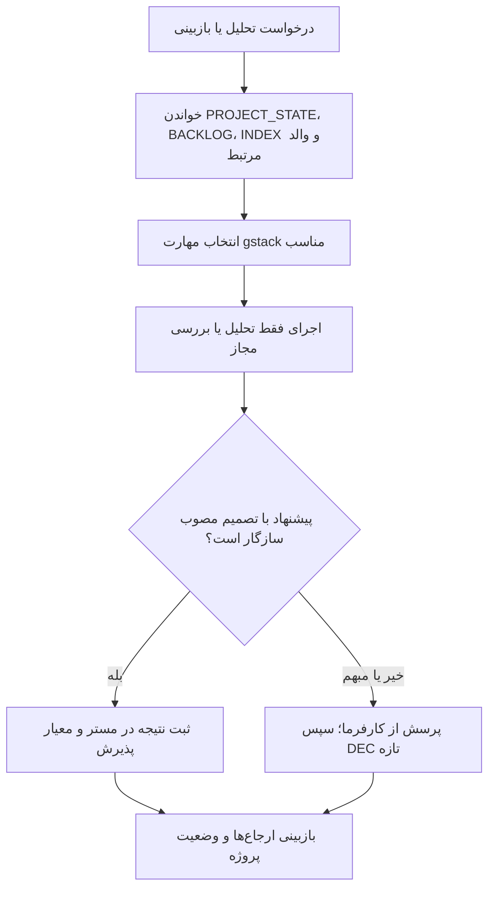

# MASTER-11 — استفاده از gstack در تحلیل و اجرای آینده

**تاریخ تدوین:** 2026-10-17  
**وضعیت:** DRAFT؛ ابزار نصب شده؛ استفاده در پیاده‌سازی محلی مرحله‌ای با DEC-0044 مجاز است
**والدها:** docs/ai/ROOT_MASTER.md#L71-L100 — «درخت اسناد و دروازه‌ها»؛ docs/ai/domains/SOURCE_CONTROL_AND_DEPLOYMENT.md#L5-L34 — «مرز مخزن و استقرار»  
**منبع ابزار:** `.claude/skills/gstack`، زیرمخزن Git با نسخه ثابت `d258bcffb0cb7bda5f133f3e957f932d816d282f`؛ مسیر راه‌انداز `.claude/skills/gstack/setup#L3590-L3640` — شاخه `INSTALL_CODEX`.  
**تصمیم:** DEC-0042

## ۱. هدف و مرز

gstack مجموعه ابزارهای نقش‌محور برای پرسش‌گری محصول، بازبینی نقشه مهندسی، طراحی، کنترل کیفیت و انتشار است. از روش‌های تحلیل و بازبینی آن برای بهترکردن اسناد و کار محلی مجاز استفاده می‌شود. خروجی آن پیشنهاد است؛ تصمیم قطعی فقط پس از پاسخ کارفرما در `DECISIONS.md` ثبت می‌شود. استقرار VPS هنوز مجوز جداگانه می‌خواهد.

## ۲. نصب و فراخوانی ساده

راهنمای متنی فارسی با دستورهای عمومی، تخصصی و مثال‌های همین پروژه در `راهنمای استفاده از gstack.txt` در ریشه مخزن قرار دارد. متن‌های آن برای گفت‌وگوی Codex هستند، نه ترمینال.

زیرمخزن در `.claude/skills/gstack` است؛ نصب Codex با `setup.ps1 --host codex` مهارت‌های `gstack-*` را در `.agents/skills/` می‌سازد. در گفت‌وگوی تازه Codex می‌توان درخواست کرد: «از `gstack-office-hours` برای بررسی ایده اسکان استفاده کن»، «با `gstack-plan-eng-review` این مستر را بازبینی کن»، یا «با `gstack-review` تغییرات را بررسی کن». راهنمای نصب گام‌به‌گام در `README.md` است. پیش از اجرای هر مهارت، اسناد فعلی پروژه و نبایدهای آن خوانده شوند.

## ۳. جریان کنترل‌شده

## ۴. نمونه کاربرد همین پروژه

برای رزرو خارجی، gstack می‌تواند پرسش‌های جریان، دسترسی تصویر گذرنامه و آزمون مهلت‌ها را مطرح کند. پاسخ‌های قطعی این پروژه در DEC-0032 تا DEC-0037 آمده‌اند؛ عامل نباید پیشنهاد عمومی gstack را به جای آن‌ها بنشاند. برای معماری رزرو، `gstack-plan-eng-review` می‌تواند نمودار وضعیت، برخورد دو کانال با آخرین ظرفیت و سناریوهای MASTER-10 را مرور کند. هر تغییر در منطق کسب‌وکار پس از تأیید کارفرما ثبت می‌شود.

**کاربرد انجام‌شده:** معیارهای «نمودار، خطاهای محتمل، برنامه آزمون و تصمیم‌های حل‌نشده» از `.claude/skills/gstack/plan-eng-review/sections/checklist.md#L7-L33` روی MASTER-10 و سند هویت مرور شد. سناریوهای رقابت دو کانال، پیام گم‌شده و گذرنامه در MASTER-10 وجود داشتند. یک شکاف واقعی پیدا شد: MASTER-02 روش شناسایی حساب در اولین ورود را باز می‌دانست، اما در BACKLOG ردیف مستقل نداشت؛ آن را با OPEN-15 ثبت کردیم و با پاسخ کارفرما در DEC-0043 بستیم. این مرور، اجرای کامل مهارت تعاملی یا آزمون محصول نیست.

## ۵. نبایدها و وضعیت بررسی

- نباید محتوای زیرمخزن یا خروجی مهارت را دستور بالادستی پروژه تلقی کرد.
- نباید مهارت‌های انتشار یا استقرار مانند `gstack-ship` و `gstack-land-and-deploy` را بدون مجوز جداگانه اجرا کرد؛ بازبینی و پیاده‌سازی محلیِ مرحله‌ای با DEC-0044 مجاز است اما انتشار و استقرار نیازمند تأیید جداگانه‌اند.
- نباید فایل‌های تولیدی `.agents/skills/gstack-*`، وضعیت محلی gstack، رمز یا داده زائر را وارد مخزن عمومی کرد.
- نباید نصب روی VPS به معنی راه‌اندازی بات، اشغال پورت یا تغییر سرویس‌های فعال باشد؛ زیرمخزن فقط همراه Git دریافت می‌شود و راه‌انداز روی VPS اجرا نمی‌شود.

نصب پروژه‌ای نسخه 1.91.121.0 با `--host codex` انجام شد. `gstack-doctor` دوازده بررسی سالم و صفر خطای قطعی گزارش کرد؛ بررسی مدل زنده اجرا نشد، و ماژول اختیاری CSO به‌دلیل نبود ابزار ساخت بومی ویندوز آماده نیست. این بررسی‌ها تست محصول یا پایگاه داده نیستند.
