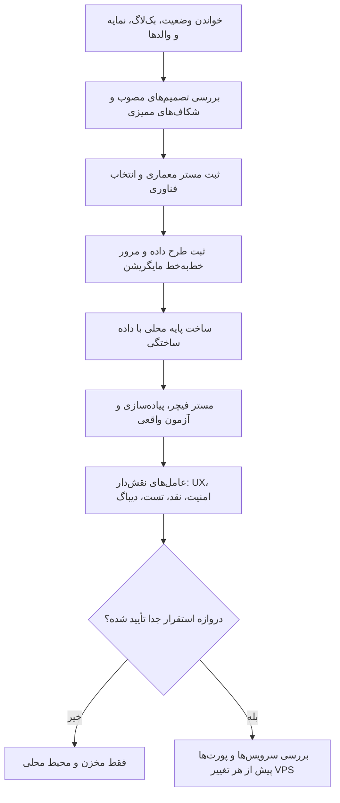

# MASTER-12 — آغاز مرحله‌ای پیاده‌سازی فاز اول

**تاریخ:** 2026-10-17  
**وضعیت:** مجوز شروع مرحله‌ای از کارفرما دریافت شد؛ طراحی فناوری و داده هنوز انجام نشده است.  
**والدها:** `docs/ai/ROOT_MASTER.md#L23-L53` — مرزها/نبایدها؛ `docs/ai/domains/SOURCE_CONTROL_AND_DEPLOYMENT.md#L5-L34` — مرز استقرار؛ `docs/ai/masters/MASTER_10_END_TO_END_ACCEPTANCE.md#L55-L89` — پذیرش سرتاسری.  
**تصمیم:** DEC-0044.  
**نماد/فایل کد:** هنوز وجود ندارد؛ عامل اجرا پس از ایجاد کد ارجاع مسیر+خط+نماد را می‌افزاید.

## ۱. خروجی و ترتیب

اجازه تازه کارفرما برای انتخاب فناوری و ساخت پایه پروژه به‌صورت مرحله‌ای است. ترتیب: خواندن اسناد و ممیزی آمادگی؛ پیشنهاد/ثبت معماری و انتخاب فناوری؛ مستر طرح داده و بازبینی مایگریشن؛ ساخت پایه محلی و قراردادهای دامنه؛ سپس فیچرهای کوچک با مستر اختصاصی، تست واقعی و مرور شخصیت‌های بازبین. استقرار VPS یک دروازه جداست.

## ۲. نبایدها

- از مجوز «شروع مرحله‌ای» مجوز استقرار روی VPS یا تغییر بات‌های دیگر استنباط نشود.
- قانون بیزینسی، مبلغ، سقف، جریمه یا مهلتِ بی‌DEC ساخته نشود.
- فناوری انتخابی پیش از ثبت مستر، نام جدول و مایگریشن اجراییِ پنهان ایجاد نکند.
- پرونده ورود مدیر، ویرایش محل تأییدشده، تغییر شماره، سیاست اختلاف و یادآوری‌های زمان‌دار تا رفع ابهام مربوطه پیاده نشوند.
- رمز، توکن، کارت کامل یا داده واقعی زائر به مخزن عمومی و لاگ وارد نشود.
- عامل‌های نقش‌دار اجازه خراب‌کاری واقعی یا دور زدن این مرزها ندارند.

## ۳. معیار پذیرش مرحله اول

| شناسه | شرط قابل بررسی | وضعیت فعلی |
|---|---|---|
| START-01 | مستر فناوری با نمودار، مرز ماژول‌ها، گزینه انتخاب‌شده و دلیل آن | NOT RUN |
| START-02 | مستر طرح داده و بازبینی خط‌به‌خط مایگریشن پیش از اجرا | NOT RUN |
| START-03 | پایه محلی بدون رمز واقعی، بدون سرویس VPS و با داده ساختگی | NOT RUN |
| START-04 | آزمون واقعی سناریوهای مرتبط MASTER-10 با شاهد اجرا | NOT RUN |
| START-05 | گزارش هر نقش بازبین با شاهد و شدت مشکل | NOT RUN |

## ۴. نقاط توقف تصمیم

فهرست کامل یافته‌ها در `docs/ai/IMPLEMENTATION_READINESS_AUDIT.md` است. عامل باید فیچر وابسته به هر موضوع باز را متوقف کند، سؤال مشخص بپرسد و پاسخ کارفرما را با DEC تازه ثبت کند. سایر بخش‌های مستقل می‌توانند ادامه یابند.
