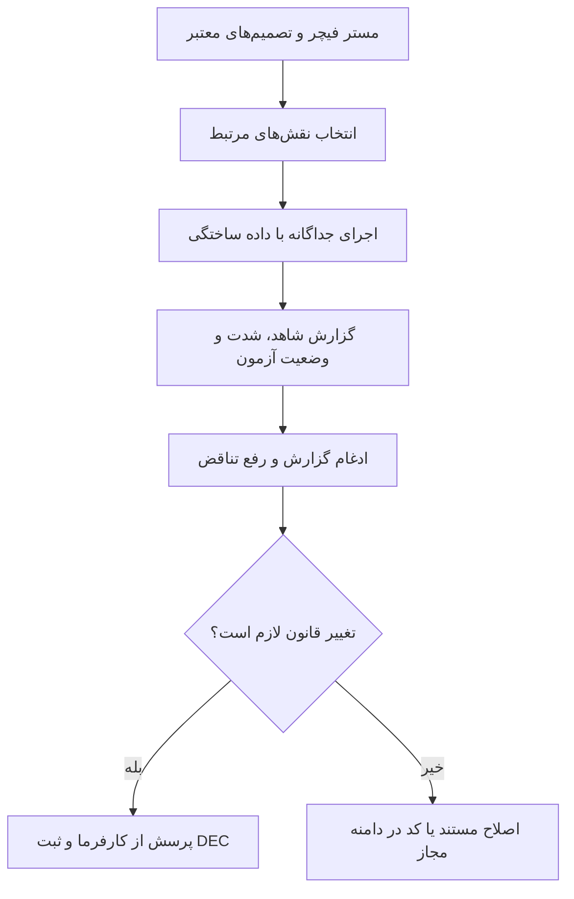

# MASTER-13 — عامل‌های نقش‌دار برای نقد و آزمون

**تاریخ:** 2026-10-17  
**وضعیت:** کارت‌های نقش آماده؛ اجرا و آزمون واقعی هنوز انجام نشده است.  
**والدها:** `docs/ai/ROOT_MASTER.md#L44-L53` — نبایدها؛ `docs/ai/masters/MASTER_12_PHASE_ONE_IMPLEMENTATION_START.md#L1-L48` — دروازه اجرا.  
**منبع اجرا:** `docs/ai/agents/AGENT_PLAYBOOK.md` و هفت کارت نقش همان پوشه.

## ۱. هدف و جریان

عامل کدنویس برای هر فیچرِ مهم، دیدگاه‌های متفاوت را جداگانه اجرا می‌کند تا خطای ظرفیت، متن گیج‌کننده، دسترسی غیرمجاز و ضعف سناریوهای آزمون زود پیدا شود. نقش‌ها تصمیم‌گیر کسب‌وکار نیستند؛ گزارش آن‌ها پیشنهاد است و هر تغییر قاعده نیاز به پاسخ کارفرما و DEC دارد.

## ۲. نبایدها و معیار پذیرش

- نقش‌ها نباید سرویس زنده را مختل کنند، اسرار را بخوانند/ثبت کنند یا عملیات مخرب خارج از محیط ایزوله انجام دهند.
- گزارش بدون شاهد یا آزمون اجراشده، اثبات خطا/موفقیت نیست.
- گزارش مثبت نباید خطاهای جدی را پنهان کند؛ گزارش منفی نباید مزیت واقعی را انکار کند.
- پذیرش: هر نقش انتخاب‌شده گزارش جدا، سناریوی روشن، شاهد دقیق، نتیجه واقعی و اقدام پیشنهادی داشته باشد؛ عامل کدنویس نتیجه نهایی و اختلاف نظرها را ثبت کند.
