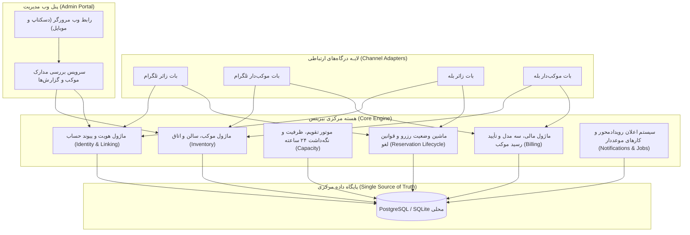

# MASTER-14 — انتخاب فناوری، ساختار ماژول‌ها و طرح داده پایه

**تاریخ تدوین:** 2026-10-17  
**وضعیت:** DRAFT؛ طراحی فنی و معماری محلی مرحله‌ای؛ بدون کد محصول و بدون تغییر VPS  
**والدها:** `docs/ai/ROOT_MASTER.md#L23-L70` — مرز ماژول‌ها و منبع حقیقت؛ `docs/ai/masters/MASTER_12_PHASE_ONE_IMPLEMENTATION_START.md#L9-L44` — آغاز مرحله‌ای؛ `docs/ai/IMPLEMENTATION_READINESS_AUDIT.md#L6-L31` — ممیزی آمادگی  
**تصمیم‌ها:** DEC-0003 (چهار بات، یک منبع)، DEC-0028 (پنل مرورگر)، DEC-0029 (ایزولاسیون VPS)، DEC-0043 (شناسه پیام‌رسان در ورود)، DEC-0044 (مجوز آغاز محلی)  
**نماد/فایل کد:** هنوز ایجاد نشده؛ پس از ساخت اسکلت محلی، ارجاع مسیر+خط+نماد درج می‌شود.

---

## ۱. هدف و دامنه مرحله اول

پیرو مجوز DEC-0044 و پرامپت ریشه پروژه، این سند انتخاب پشته فناوری، ساختار ماژولار و قرارداد داده مرحله اول را ثبت می‌کند. هدف، پیاده‌سازی محلی و ایزوله هسته بیزینس و لایه‌های اتصال بات‌ها با داده ساختگی است، بدون آنکه تعارضی با سرور یا سرویس‌های فعال VPS ایجاد شود.

---

## ۲. نقشه معماری و مرز ماژول‌ها

سامانه از چهار لایه اصلی مستقل تشکیل می‌شود که همگی به یک منبع داده مرکزی متصل‌اند:

---

## ۳. بررسی و انتخاب پشته فناوری (Tech Stack)

### الف. زبان و سکوی اجرایی (Runtime)
- **گزینه انتخابی (توصیه‌شده):** **Node.js (TypeScript)** با رویکرد Modular Monolith.
  - *دلایل انتخاب:*
    1. اشتراک کامل انواع داده (Shared Types/DTOs) میان هسته بیزینس، بات‌های تلگرام/بله و واسط وب.
    2. کتابخانه‌های استاندارد و قوی برای تلگرام (مانند `grammY` یا `telegraf`) و سهولت اتصال به وب‌سرویس بات بله.
    3. مدیریت ناهمگام و رویدادمحور عالی برای پردازش هم‌زمان وب‌هوک‌ها، اعلان‌ها و تایمرهای ۲۴ ساعته بدون مسدود شدن نخ اصلی.
  - *گزینه جایگزین:* **Python (FastAPI + aiogram)**. اگرچه پایتون نیز مناسب است، مدیریت یکپارچه کدهای فرانت‌اند پنل ادمین و تایپ‌های اشتراکی در پشته تک‌زبانه تایپ‌اسکریپت سریع‌تر و خطاناپذیرتر است.

### ب. پایگاه داده و ابزار دسترسی (ORM / Migration)
- **گزینه انتخابی:** **PostgreSQL** برای تولید و توسعه، با پشتیبانی از **SQLite** برای آزمون‌های خودکار محلی سریع.
- **ابزار مایگریشن و ORM:** **Prisma** یا **Drizzle ORM**.
  - *دلایل انتخاب:*
    1. نگارش شفاف و خط‌به‌خط اسکیمای پایگاه داده با قابلیت بازبینی کامل پیش از اعمال.
    2. تولید خودکار تایپ‌های TypeScript منطبق با اسکیما که از خطاهای داده‌ای جلوگیری می‌کند.
    3. مایگریشن‌های صریح و نسخه خورده SQL بدون تغییرات پنهان.

### ج. درگاه‌های پیام‌رسان (Bot Adapters)
- **تلگرام:** کتابخانه `grammY` (پشتیبانی از Polling در توسعه محلی و Webhook در استقرار).
- **بله:** کلاینت اختصاصی بر بستر HTTP/Webhook منطبق با مستندات Bot API بله.
- *قاعده مرزی:* هیچ منطق بیزینسی، محاسبه ظرفیت، یا قانون مهلتی داخل هندلرهای بات قرار نمی‌گیرد؛ بات‌ها صرفاً مترجم ورودی/خروجی به متدهای Core Engine هستند.

### د. پنل مدیریت تحت وب (Admin Portal)
- **گزینه انتخابی:** **React / Vite** با کامپوننت‌های سبک (یا Next.js داخلی در حالت SSR).
- *قاعده مرزی:* پنل در مرورگر رایانه و موبایل کار می‌کند (DEC-0028). روش ورود و احراز هویت ادمین تا تعیین تکلیف تصمیم باز، به‌صورت ساختگی (Mock) در محیط محلی خواهد بود.

---

## ۴. طرح مفهومی داده‌ها و جداول اولیه

طرح اولیه داده بدون اختراع قوانین بیزینسی و منطبق با تصمیم‌های مصوب:

1. **`persons` (حساب مرکزی انسان):**
   - `id`: شناسه یکتای جهانی (UUID)
   - `created_at`, `updated_at`: زمان ثبت
   - *نکته:* شماره تلفن در ابتدا خالی است و طبق DEC-0043 هنگام اولین درخواست رزرو دریافت می‌شود.

2. **`channel_accounts` (حساب‌های کانال پیام‌رسان):**
   - `id`, `person_id` (ارجاع به persons)
   - `channel_type`: `TELEGRAM` یا `BALE`
   - `channel_user_id`: شناسه عددی کاربر در پیام‌رسان
   - `created_at`

3. **`link_codes` (کدهای اتصال موقت حساب‌ها):**
   - `id`, `person_id`, `code` (کد رندوم امن)
   - `expires_at` (دقیقاً ۲۴ ساعت طبق DEC-0040)
   - `used_at` (یک‌بارمصرف، ثبت زمان مصرف)

4. **`mokebe_places` (موکب‌ها و اقامتگاه‌ها):**
   - `id`, `host_person_id` (مدیر موکب)
   - `title`, `city`, `address`
   - `contact_name`, `contact_phone`
   - `status`: `PENDING_VERIFICATION`, `APPROVED`, `REJECTED`, `SUSPENDED`
   - `supply_type`: `PUBLIC`, `PRIVATE`, `BOTH` (DEC-0005)
   - `financial_model`: `FREE`, `FIXED_FEE`, `FIXED_DEPOSIT` (DEC-0011)
   - `approval_mode`: `INSTANT`, `MANUAL` (DEC-0010)

5. **`spaces` (سالن‌های عمومی و اتاق‌های خصوصی):**
   - `id`, `place_id`
   - `space_type`: `PUBLIC_HALL` یا `PRIVATE_ROOM`
   - `title`: نام سالن یا اتاق
   - `gender_group`: `MEN`, `WOMEN`, `ALL` (تفکیک جنسیت سالن DEC-0007)
   - `nominal_capacity`: ظرفیت اسمی بر اساس نفر (بدون استثنای کودک DEC-0027)

6. **`calendar_policies` (تقویم و ظرفیت فعال تاریخ‌ها):**
   - `id`, `space_id`, `date`
   - `is_active`: فعال یا مسدود در تاریخ مشخص
   - `capacity_override`: ظرفیت اختصاصی تاریخ (در صورت تنظیم)

7. **`reservation_requests` (پرونده درخواست و رزرو اسکان):**
   - `id`, `tracking_code`
   - `person_id` (زائر درخواست‌دهنده)
   - `place_id`, `space_id`
   - `check_in_date`, `check_out_date`
   - `male_count`, `female_count`, `child_count`, `total_count`
   - `status`: ماشین وضعیت (ثبت اولیه، در انتظار پاسخ موکب‌دار، در انتظار واریز/رسید، در انتظار تأیید موکب‌دار، قطعی، لغو، عدم حضور، پایان اقامت)
   - `hold_expires_at`: مهلت ۲۴ ساعته نگه‌داشت ظرفیت برای گام فعلی (DEC-0025, DEC-0035)
   - `is_foreign_pilgrim`: فلگ زائر غیرایرانی (DEC-0032)
   - `passport_image_path`: مسیر موقت مدرک زائر خارجی (حذف پس از ۳۰ روز طبق DEC-0036/0037)

---

## ۵. نبایدها و خطوط قرمز اجرایی

- **نباید هیچ تغییری روی سرور VPS ایجاد شود؛** پورت‌ها، پایگاه‌داده و سرویس‌های فعال دیگر نباید لمس شوند.
- **نباید داده واقعی یا محرمانه زائران و موکب‌داران ثبت شود؛** کلیه آزمایش‌ها محلی و با دیتای فیک (Mock/Fixture) است.
- **نباید قواعد بیزینسی فاقد DEC مصوب جعل شوند؛** مواردی مانند ورود ادمین و تغییر اطلاعات پس از تأیید تا تصمیم نهایی موک می‌مانند.
- **نباید مایگریشن دیتابیس بدون بازبینی خط‌به‌خط اسکیمای متنی اجرا گردد.**
- **نباید هیچ آزمون اجرا‌نشده‌ای در گزارش‌ها `PASS` نامیده شود.**

---

## ۶. معیارهای پذیرش فنی (Acceptance Criteria)

| شناسه | شرط پذیرش | وضعیت فعلی |
|---|---|---|
| TECH-01 | تصویب ساختار پروژه و ایجاد دایرکتوری‌های ایزوله محلی بدون دستکاری مخزن VPS | NOT RUN |
| TECH-02 | تعریف فایل اسکیما (Schema) دیتابیس و بازبینی متن مایگریشن اولیه | NOT RUN |
| TECH-03 | پیاده‌سازی آزمون واحد (Unit Test) ماشین وضعیت هویت و پیوند حساب با مهلت ۲۴ ساعته | NOT RUN |
| TECH-04 | پیاده‌سازی آزمون واحد موتور ظرفیت و عدم هم‌پوشانی اتاق خصوصی با داده ساختگی | NOT RUN |
| TECH-05 | گزارش بازبینی نقش‌های هفت‌گانه برای ساختار پایه و اسکیما | NOT RUN |

---

## ۷. گام اجرایی بعدی

پس از ثبت این مستر، بازبینی نقش‌های Playbook انجام شده و سپس اسکلت ساختار کدهای محلی (دایرکتوری `src/` شامل `core/`، `adapters/` و `tests/`) در محیط محلی ایجاد خواهد شد.
