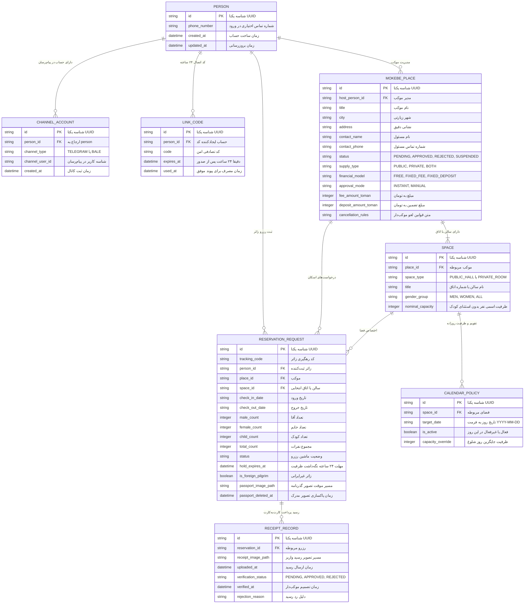

# MASTER-15 — طراحی تفصیلی طرح داده، اسکیما و مایگریشن‌های پایه

**تاریخ تدوین:** 2026-10-17  
**وضعیت:** DRAFT؛ طراحی دقیق اسکیما و پیاده‌سازی محلی؛ بدون تغییر روی VPS  
**والدها:** `docs/ai/ROOT_MASTER.md#L54-L70` — رابطه مفهومی داده و منبع حقیقت؛ `docs/ai/masters/MASTER_14_TECH_STACK_AND_DATA_FOUNDATION.md#L94-L146` — طرح اولیه داده؛ `docs/ai/IMPLEMENTATION_READINESS_AUDIT.md#L24-L31` — تعریف آمادگی مرحله اول  
**تصمیم‌ها:** DEC-0003، DEC-0005، DEC-0006، DEC-0007، DEC-0010، DEC-0011، DEC-0012، DEC-0013، DEC-0014، DEC-0020، DEC-0024، DEC-0025، DEC-0027، DEC-0032، DEC-0033، DEC-0034، DEC-0035، DEC-0036، DEC-0037، DEC-0038، DEC-0039، DEC-0040، DEC-0041، DEC-0043، DEC-0044  
**نماد/فایل کد:** `src/db/schema.ts`، `src/core/types.ts`، `src/tests/schema.test.ts`

---

## ۱. هدف و دامنه اجرایی

این سند بر اساس مصوبات [BACKLOG.md](file:///z:/rezervasiyon-BOT-TEL/docs/ai/BACKLOG.md#L32) (آیتم NEXT-03) و [MASTER-14](file:///z:/rezervasiyon-BOT-TEL/docs/ai/masters/MASTER_14_TECH_STACK_AND_DATA_FOUNDATION.md)، طرح تفصیلی اسکیمای پایگاه داده، کلیدها، شاخص‌ها، محدودیت‌ها (Constraints) و وضعیت‌های شمارشی (Enums) را ثبت می‌کند. همه این جداول در مخزن محلی با TypeScript تعریف می‌شوند و هدف آن اطمینان از سازگاری ۱۰۰٪ با تصمیم‌های قطعی بیزینس پیش از راه‌اندازی هرگونه سرویس زنده است.

---

## ۲. دیاگرام ارتباط موجودیت‌ها (ER Diagram)

---

## ۳. بازبینی خط‌به‌خط اسکیمای جداول و انطباق با DECها

### ۱. جدول `persons` (حساب مرکزی)
- **قاعده DEC-0043:** در اولین ورود زائر یا موکب‌دار، تنها شناسه پیام‌رسان اخذ می‌شود. بنابراین فیلد `phone_number` در زمان ایجاد حساب مقداردهی نمی‌شود و `nullable` است؛ شماره تماس فقط زمان ثبت رزرو یا ثبت موکب الزامی می‌شود.
- **قاعده DEC-0039:** بازیابی حساب مرکزی بدون دسترسی به بات قبلی ممکن نیست؛ هیچ متد تغییر رمز یا پیامک وجود ندارد.

### ۲. جدول `channel_accounts` (حساب‌های کانال پیام‌رسان)
- **قاعده DEC-0003:** تلگرام و بله با یک منبع حقیقت کار می‌کنند.
- **شاخص یکتا (Unique Constraint):** ترکیب `(channel_type, channel_user_id)` یکتاست؛ یک حساب تلگرام یا بله نمی‌تواند هم‌زمان به دو شخص متفاوت متصل باشد.

### ۳. جدول `link_codes` (کدهای اتصال داوطلبانه دو پیام‌رسان)
- **قاعده DEC-0040:** کد اتصال از زمان صدور دقیقاً ۲۴ ساعت اعتبار دارد (`expires_at = now() + 24 hours`).
- **یک‌بارمصرف بودن:** فیلد `used_at` با اولین پیوند موفق پر می‌شود و کد دیگر معتبر نخواهد بود. شماره تایپ‌شده مشابه باعث ادغام خودکار حساب‌ها نمی‌شود.

### ۴. جدول `mokebe_places` (اطلاعات موکب و اقامتگاه)
- **قاعده DEC-0005:** عرضه به سه شکل عمومی (`PUBLIC`)، خصوصی (`PRIVATE`) و هر دو (`BOTH`) است.
- **قاعده DEC-0010:** تأیید درخواست‌ها فوری (`INSTANT`) یا دستی با موکب‌دار (`MANUAL`) است.
- **قاعده DEC-0011:** مدل مالی دقیقاً یکی از سه حالت: رایگان (`FREE`)، هزینه ثابت ثبت رزرو (`FIXED_FEE`)، یا تضمین ثابت (`FIXED_DEPOSIT`) است.
- **قاعده DEC-0038:** واحد تمام مبالغ پولی، تومان (`integer`) است و ریال یا ارز خارجی در سامانه ذخیره نمی‌شود.
- **قاعده DEC-0014:** متن قوانین لغو و عدم حضور مستقیماً توسط موکب‌دار تعیین و در `cancellation_rules` ذخیره می‌شود.

### ۵. جدول `spaces` (فضاها، سالن‌ها و اتاق‌ها)
- **قاعده DEC-0006:** اتاق‌های خصوصی با ظرفیت‌های متنوع (مانند ۴ نفره و ۱۰ نفره) هر کدام رکورد مستقل با ظرفیت اختصاصی دارند.
- **قاعده DEC-0007:** سالن‌های عمومی تفکیک جنسیتی دارند (`gender_group: MEN / WOMEN / ALL`).
- **قاعده DEC-0027:** ظرفیت اسمی اتاق بدون استثنای کودک است؛ همه کودکان در ظرفیت اسمی (`nominal_capacity`) شمرده می‌شوند.

### ۶. جدول `calendar_policies` (تقویم و ظرفیت تاریخ‌ها)
- **قاعده DEC-0009:** تقویم و روزهای فعالیت در اختیار موکب‌دار است.
- **کلید یکتا:** ترکیب `(space_id, target_date)` یکتاست تا برای هر اتاق/سالن در هر روز فقط یک رکورد وضعیتی ثبت شود.

### ۷. جدول `reservation_requests` (درخواست‌های رزرو)
- **قاعده DEC-0024:** رزرو هم‌پوشان برای یک حساب زائر مجاز است.
- **قاعده DEC-0025 و DEC-0035:** ظرفیت در هر گام انتظار (پاسخ موکب، واریز، تأیید رسید) به مدت ۲۴ ساعت در فیلد `hold_expires_at` نگه داشته می‌شود و پس از انقضا یا رد آزاد می‌گردد.
- **قاعده DEC-0033 و DEC-0034:** آخرین روز مجاز ثبت درخواست، پایان روز هفتم پیش از تاریخ ورود بر اساس ساعت و تقویم رسمی شهر مقصد است.
- **قاعده DEC-0032:** زائر غیرایرانی (`is_foreign_pilgrim = true`) در سامانه هیچ پرداختی ندارد و تأیید آن منحصراً با موکب‌دار همان محل است.
- **قاعده DEC-0036 و DEC-0037:** تصویر گذرنامه زائر خارجی ۳۰ روز پس از پایان اقامت (یا ۳۰ روز پس از لغو/رد در درخواست بی‌اقامت) پاکسازی می‌شود و تاریخ حذف در `passport_deleted_at` درج می‌گردد.

### ۸. جدول `receipt_records` (رسیدهای واریز)
- **قاعده DEC-0012 و DEC-0020:** واریز کارت‌به‌کارت مستقیم به شماره حساب موکب‌دار است و بررسی و تأیید رسید فقط با موکب‌دار همان محل انجام می‌شود (ادمین کل یا سامانه حق تأیید واریزی به جای موکب‌دار را ندارند).

---

## ۴. نبایدها و خطوط قرمز اجرایی

1. **نباید دسترسی یا تغییری روی سرور VPS انجام شود؛** تمام جداول، آزمون‌ها و داده‌ها کاملاً در محیط محلی و با دیتابیس تست ایزوله (مانند SQLite در حافظه/فایل محلی) پیاده‌سازی می‌شوند.
2. **نباید داده‌های هویتی یا گذرنامه واقعی در فایل‌های اسکیما یا تست ثبت شوند؛** تمام تست‌ها صرفاً با داده ساختگی (Mock) اجرا می‌گردند.
3. **نباید قوانین بیزینسی تأییدنشده به اسکیما اضافه شوند؛** به عنوان مثال، روش احراز هویت ادمین، سهم پذیرش حضوری و زمان‌های نظافت اتاق‌ها تا زمان تصمیم قطعی کارفرما، خارج از اسکیما باقی می‌مانند.
4. **نباید هیچ ادعای تستی بدون اجرای واقعی PASS ثبت شود.**

---

## ۵. معیارهای پذیرش (Acceptance Criteria)

| شناسه | شرط پذیرش | وضعیت فعلی |
|---|---|---|
| SCHEMA-01 | پیاده‌سازی تعاریف تایپ و اسکیمای جداول ۸گانه در `src/core/types.ts` و `src/db/schema.ts` منطبق بر DECها | PASS (کدها ایجاد و با تایپ‌چک تأیید شدند) |
| SCHEMA-02 | آزمون واحد انقضای ۲۴ ساعته کد اتصال (`link_codes`) و یک‌بارمصرف بودن آن | PASS (۴ آزمون در `src/tests/schema.test.ts#L17-L50`) |
| SCHEMA-03 | آزمون واحد مهلت ۲۴ ساعته نگه‌داشت ظرفیت (`hold_expires_at`) در درخواست رزرو | PASS (۱ آزمون در `src/tests/schema.test.ts#L53-L63`) |
| SCHEMA-04 | آزمون واحد قانون مرز ۷ روز پیش از ورود به وقت شهر مقصد | PASS (۱ آزمون در `src/tests/schema.test.ts#L65-L78`) |
| SCHEMA-05 | آزمون واحد شمارش کودکان در ظرفیت اسمی اتاق بدون استثنا | PASS (۳ آزمون در `src/tests/schema.test.ts#L80-L115`) |
| SCHEMA-06 | آزمون واحد زائر خارجی بدون پرداخت و لزوم تأیید موکب‌دار | PASS (۳ آزمون در `src/tests/schema.test.ts#L117-L138`) |

---

## ۶. ارتباط و پیگیری در اسناد

این سند ذیل [MASTER_14_TECH_STACK_AND_DATA_FOUNDATION.md](file:///z:/rezervasiyon-BOT-TEL/docs/ai/masters/MASTER_14_TECH_STACK_AND_DATA_FOUNDATION.md) تعریف شده و شرط آغاز پیاده‌سازی اسکلت کدهای محلی در `src/` است.
