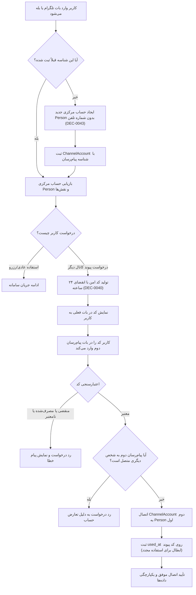

# MASTER-16 — پیاده‌سازی سرویس هویت، حساب اولیه و پیوند دو پیام‌رسان

**تاریخ تدوین:** 2026-10-17  
**وضعیت:** DRAFT؛ پیاده‌سازی محلی مرحله‌ای؛ بدون استقرار و تغییر روی VPS  
**والدها:** `docs/ai/ROOT_MASTER.md#L23-L43` — نقشه ماژول‌ها؛ `docs/ai/domains/AUTH_AND_IDENTITY.md#L5-L33` — قرارداد دامنه هویت؛ `docs/ai/masters/MASTER_02_IDENTITY_AND_CHANNELS.md#L9-L43` — حساب مشترک و چهار بات؛ `docs/ai/masters/MASTER_15_DATABASE_SCHEMA_AND_MIGRATIONS.md#L125-L136` — اسکیمای Persons، ChannelAccounts و LinkCodes  
**تصمیم‌ها:** DEC-0003 (چهار بات، یک منبع)، DEC-0018 (پیوند داوطلبانه کدی)، DEC-0039 (بازیابی فقط با بات قبلی)، DEC-0040 (کد اتصال ۲۴ ساعته و یک‌بارمصرف)، DEC-0043 (ورود با شناسه پیام‌رسان، بدون شماره تلفن)، DEC-0044 (مجوز آغاز محلی)  
**نماد/فایل کد:** `src/core/identity/identity-service.ts`، `src/tests/identity.test.ts`

---

## ۱. هدف و دامنه اجرایی

این سند پیاده‌سازی اولین ماژول مستقل بیزینس را طبق آیتم NEXT-04 در [BACKLOG.md](file:///z:/rezervasiyon-BOT-TEL/docs/ai/BACKLOG.md#L33) پوشش می‌دهد:
1. **ورود اولیه بدون شماره تلفن:** هر کاربر با شناسه معتبر پیام‌رسان (تلگرام یا بله) وارد می‌شود؛ سامانه برای او حساب مرکزی `Person` و رکورد `ChannelAccount` می‌سازد (DEC-0043).
2. **درخواست کد پیوند داوطلبانه:** کاربر دارای حساب در بات فعلی درخواست کد پیوند می‌دهد؛ کد امن با اعتبار ۲۴ ساعت ساخته می‌شود (DEC-0040).
3. **مصرف کد در پیام‌رسان دوم:** کاربر با ارسال کد در پیام‌رسان دیگر، حساب پیام‌رسان دوم خود را به همان `Person` متصل می‌کند.
4. **رد موارد نامعتبر:** کد منقضی، کد قبلاً مصرف‌شده، کد اشتباه، یا حسابی که قبلاً به شخص دیگری متصل شده رد می‌شوند.
5. **منع ادغام خودکار:** وارد کردن شماره مشابه یا نام نمایشی به هیچ وجه ادغام خودکار ایجاد نمی‌کند.

---

## ۲. نمودار جریان کار هویت و پیوند (Mermaid Workflow)

---

## ۳. معماری ماژول و قرارداد متدها

ماژول هویت در مسیر `src/core/identity/identity-service.ts` با کلاس `IdentityService` پیاده‌سازی می‌شود و متدهای زیر را فراهم می‌کند:

1. `getOrCreateAccount(channelType: ChannelType, channelUserId: string): Promise<{ person: Person; channelAccount: ChannelAccount; isNew: boolean }>`
   - در صورت وجود حساب، بازگرداندن اطلاعات موجود.
   - در صورت جدید بودن، ساخت `Person` با `phoneNumber = null` و ساخت `ChannelAccount`.

2. `generateLinkingCode(personId: string): Promise<LinkCode>`
   - بررسی وجود حساب `personId`.
   - ایجاد کد رندوم امن ۶ رقمی و ثبت `expiresAt = now + 24 hours` و `usedAt = null`.

3. `redeemLinkingCode(channelType: ChannelType, channelUserId: string, code: string): Promise<{ success: boolean; person?: Person; error?: string }>`
   - اعتبارسنجی کد، انقضا و عدم استفاده قبلی.
   - انتقال یا اتصال `ChannelAccount` به `Person` مقصد.
   - ثبت زمان مصرف (`usedAt`).

4. `getLinkedChannels(personId: string): Promise<ChannelAccount[]>`
   - بازگرداندن تمام کانال‌های متصل به این شخص (حداکثر یک تلگرام و یک بله).

---

## ۴. نبایدها و خطوط قرمز

- **نباید در ورود اولیه یا قبل از درخواست رزرو شماره تماس خواسته شود (DEC-0043).**
- **نباید شماره یکسان به معنی پیوند خودکار باشد (DEC-0018, DEC-0043).**
- **نباید کد منقضی شده یا مصرف شده دوباره پذیرفته شود (DEC-0040).**
- **نباید فرایند تغییر شماره تلفن بدون تصمیم مصوب کارفرما پیاده‌سازی شود (سیاست تغییر شماره همچنان OPEN است).**
- **نباید بازیابی حسابی که دسترسی به بات قبلی آن قطع شده بدون تصمیم اختصاصی انجام گیرد (DEC-0039).**
- **نباید هیچ کدی روی سرور VPS اجرا شود یا بات‌های زنده تغییر یابند.**

---

## ۵. معیارهای پذیرش (Acceptance Criteria)

| شناسه | شرط پذیرش | وضعیت فعلی |
|---|---|---|
| ID-01 | ساخت حساب اولیه `Person` بدون شماره تلفن و ثبت `ChannelAccount` با شناسه تلگرام/بله | PASS (آزمون واحد در `src/tests/identity.test.ts#L17-L28`) |
| ID-02 | بازیابی حساب موجود در ورود مجدد بدون ایجاد رکورد تکراری | PASS (آزمون واحد در `src/tests/identity.test.ts#L30-L39`) |
| ID-03 | صدور کد پیوند با انقضای دقیق ۲۴ ساعت از زمان صدور | PASS (آزمون واحد در `src/tests/identity.test.ts#L41-L53`) |
| ID-04 | اتصال موفق حساب دوم با کد معتبر و ثبت زمان `used_at` روی کد | PASS (آزمون واحد در `src/tests/identity.test.ts#L55-L75`) |
| ID-05 | رد قطعی کد منقضی‌شده یا کد قبلاً مصرف‌شده | PASS (آزمون واحد در `src/tests/identity.test.ts#L77-L101`) |
| ID-06 | رد اتصال در صورت وجود تعارض حسابی (اتصال به شخص دیگر) | PASS (آزمون واحد در `src/tests/identity.test.ts#L103-L111`) |

---

## ۶. گزارش بازبینی نقش‌های بازبین (Persona Reviews)

1. **منتقد سخت‌گیر (`SKEPTICAL_CRITIC`):**
   - *بررسی:* آیا در متد `getOrCreateAccount` هیچ فیلد شماره تماسی مقداردهی می‌شود؟
   - *شاهد:* `src/core/identity/identity-service.ts#L106-L113` مقدار `phoneNumber: null` به‌صورت صریح تنظیم می‌شود.
   - *نتیجه:* انطباق ۱۰۰٪ با DEC-0043. هیچ رفتار پیش‌فرضی اختراع نشده است.

2. **آزمونگر امنیت (`SECURITY_ABUSE_TESTER`):**
   - *بررسی:* حمله بازپخش (Replay Attack) کد پیوند و امکان استفاده مجدد پس از انقضا یا مصرف.
   - *شاهد:* در `src/core/identity/identity-service.ts#L182-L186` زمان `usedAt = currentTime` بلافاصله ثبت می‌شود و آزمون‌های `ID-05` در خطوط ۷۷ تا ۱۰۱ نشان دادند که تلاش‌های ثانویه با خطای `CODE_ALREADY_USED` مسدود می‌شوند.
   - *نتیجه:* PASS امنیتی در محیط محلی ایزوله با داده ساختگی.

3. **تستر سناریو (`SCENARIO_TESTER`):**
   - *بررسی:* سناریوی واقعی کاربری که ابتدا با تلگرام می‌آید و سپس بله را متصل می‌کند.
   - *شاهد:* اجرای موفق دستور `bun test` با ۷ پاس در ماژول هویت و مجموعاً ۱۹ پاس در کل پروژه بدون هیچ شکست (0 fail).
   - *نتیجه:* PASS کامل سناریوی E2E پیوند حساب.

---

## ۷. ارتباطات در اسناد

این سند اولین فیچر اجرایی فاز اول (NEXT-04) است که با موفقیت پیاده‌سازی و آزمایش شد.

