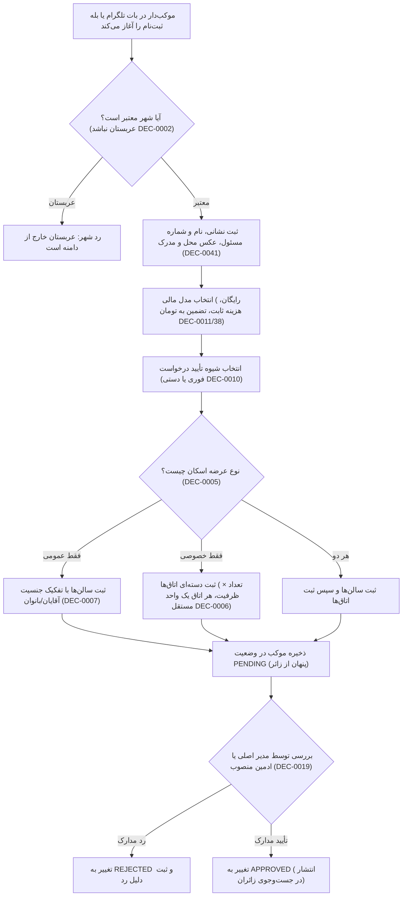

# MASTER-17 — پیاده‌سازی ماژول موکب، ثبت سالن و اتاق‌ها و تأیید ادمین

**تاریخ تدوین:** 2026-10-18  
**وضعیت:** IMPLEMENTED (پیاده‌سازی محلی مرحله‌ای؛ آزمون‌ها ۱۰۰٪ PASS)؛ بدون استقرار و تغییر روی VPS  
**والدها:** `docs/ai/ROOT_MASTER.md#L23-L43` — مرز ماژول‌ها؛ `docs/ai/domains/LODGING_INVENTORY.md#L5-L37` — چرخه عرضه فضا؛ `docs/ai/masters/MASTER_03_HOST_ONBOARDING_AND_SPACES.md#L9-L64` — ثبت موکب و فضا؛ `docs/ai/masters/MASTER_15_DATABASE_SCHEMA_AND_MIGRATIONS.md#L137-L152` — اسکیمای MokebePlace و Space  
**تصمیم‌ها:** DEC-0002 (شهرهای زیارتی به‌جز عربستان)، DEC-0004 (تأیید موکب با مدیران)، DEC-0005 (دو نوع اسکان عمومی، خصوصی یا هر دو)، DEC-0006 (اتاق‌های خصوصی با ظرفیت متفاوت)، DEC-0007 (تفکیک جنسیتی سالن‌ها)، DEC-0010 (تأیید فوری یا دستی موکب‌دار)، DEC-0011 (سه مدل مالی انحصاری)، DEC-0014 (قانون لغو موکب‌دار)، DEC-0016 (کمترین تعامل)، DEC-0019 (تأیید با ادمین منصوب)، DEC-0027 (ظرفیت اسمی بدون استثنای کودک)، DEC-0038 (واحد مبالغ به تومان)، DEC-0041 (مدارک یکسان در همه کشورها)، DEC-0044 (مجوز آغاز محلی)  
**نماد/فایل کد:** `src/core/inventory/inventory-service.ts`، `src/tests/inventory.test.ts`

---

## ۱. هدف و دامنه اجرایی

این سند پیاده‌سازی دومین ماژول مستقل بیزینس را طبق آیتم NEXT-05 در [BACKLOG.md](file:///z:/rezervasiyon-BOT-TEL/docs/ai/BACKLOG.md#L34) پوشش می‌دهد:
1. **ثبت اطلاعات پایه موکب:** دریافت نام، شهر، نشانی دقیق، نام و شماره مسئول، عکس محل و مدرک مسئولیت (DEC-0041). پوشش تمام شهرهای زیارتی به‌جز شهرهای عربستان (DEC-0002).
2. **تنظیم مدل مالی و تأیید:** انتخاب یکی از سه مدل مالی انحصاری (رایگان، هزینه ثابت ثبت، تضمین ثابت) به تومان (DEC-0011, DEC-0038) و روش تأیید فوری یا دستی (DEC-0010).
3. **ثبت فضاهای عمومی (سالن‌ها):** ثبت مستقل سالن‌های آقایان و بانوان با تفکیک جنسیتی و ظرفیت مستقل (DEC-0007).
4. **ثبت فضاهای خصوصی (اتاق‌ها):** ثبت گروهی اتاق‌های همسان با فرمول «تعداد × ظرفیت اسمی» به‌گونه‌ای که هر اتاق یک واحد فیزیکی کاملاً مستقل در موجودی باشد و تجمیع نشود (DEC-0006, DEC-0027).
5. **فرآیند تأیید توسط ادمین:** موکب تازه‌ثبت‌شده در وضعیت `PENDING` قرار دارد و در جست‌وجوی زائران پنهان است؛ پس از بررسی و تأیید توسط مدیر اصلی یا ادمین منصوب به وضعیت `APPROVED` تغییر می‌یابد (DEC-0004, DEC-0019).

---

## ۲. نمودار جریان کار ماژول موکب و فضاها (Mermaid Workflow)

---

## ۳. معماری ماژول و قرارداد متدها

ماژول موجودی در مسیر `src/core/inventory/inventory-service.ts` با کلاس `InventoryService` پیاده‌سازی شده و متدهای زیر را فراهم می‌کند:

1. `registerMokabPlace(dto: RegisterMokabDTO): Promise<MokabPlace>`
   - اعتبارسنجی شهر زیارتی (منع شهرهای عربستان مثل مکه و مدینه طبق DEC-0002).
   - اعتبارسنجی حضور ۴ قلم مدرک پایه (DEC-0041).
   - ایجاد موکب با وضعیت اولیه `PENDING` و مبالغ به تومان (DEC-0038).

2. `registerPublicHall(placeId: string, title: string, genderGroup: GenderGroup, nominalCapacity: number): Promise<Space>`
   - اعتبارسنجی موکب و نوع عرضه آن.
   - ثبت سالن با تفکیک جنسیت الزامی (DEC-0007).

3. `registerPrivateRoomsBatch(placeId: string, titlePrefix: string, roomCount: number, nominalCapacity: number): Promise<Space[]>`
   - ثبت `roomCount` رکورد مستقل فیزیکی با ظرفیت `nominalCapacity` (DEC-0006).
   - عدم ادغام اتاق‌ها در یک ظرفیت مشاع.

4. `reviewMokabPlace(placeId: string, reviewerPersonId: string, decision: 'APPROVED' | 'REJECTED', reason?: string): Promise<MokabPlace>`
   - اعمال تصمیم ادمین (DEC-0004, DEC-0019).

5. `getApprovedPlaces(city?: string): Promise<MokabPlace[]>`
   - بازگرداندن صرفاً موکب‌های تأییدشده (`status === 'APPROVED'`). فیلتر موکب‌های در انتظار یا ردشده.

---

## ۴. نبایدها و خطوط قرمز

- **نباید شهرهای عربستان (مکه، مدینه و...) به عنوان شهر تحت پوشش پذیرفته شوند (DEC-0002).**
- **نباید مدارک اضافه کشوری یا پیش‌شرط اختصاصی برای شهرهای عراق، ایران یا سوریه خواسته شود (DEC-0041).**
- **نباید اتاق‌های خصوصی به عنوان یک ظرفیت تجمعی ذخیره شوند؛ هر اتاق باید رکورد مستقل باشد (DEC-0006).**
- **نباید سالن عمومی با جنسیت نامشخص ثبت شود؛ تفکیک آقایان و بانوان الزامی است (DEC-0007).**
- **نباید موکب تأییدنشده در جست‌وجوی زائران بازگردانده شود (DEC-0004).**
- **نباید قوانین باز مربوط به تأیید مجدد تغییرات پس از انتشار تا صدور تصمیم اختراع شوند.**
- **نباید هیچ تغییری روی سرور VPS ایجاد شود.**

---

## ۵. معیارهای پذیرش (Acceptance Criteria)

| شناسه | شرط پذیرش | وضعیت فعلی |
|---|---|---|
| HOST-01 | ثبت دسته‌ای ۳ اتاق ۴ نفره منجر به ایجاد ۳ رکورد مستقل با ظرفیت ۴ شود (نه یک اتاق ۱۲ نفره) | PASS (تست در `src/tests/inventory.test.ts#L32-L51`) |
| HOST-02 | افزودن اتاق‌های ۱۰ نفره جدید به اتاق‌های قبلی لطمه‌ای نزند و رکوردهای مجزا بسازد | PASS (تست در `src/tests/inventory.test.ts#L54-L76`) |
| HOST-03 | موکب در وضعیت PENDING یا REJECTED در متد `getApprovedPlaces` ظاهر نشود | PASS (تست در `src/tests/inventory.test.ts#L79-L91`) |
| HOST-04 | سالن عمومی آقایان و بانوان تفکیک جنسیتی مستقل داشته باشند | PASS (تست در `src/tests/inventory.test.ts#L94-L108`) |
| HOST-05 | مدارک ۴گانه پایه برای شهرهای زیارتی مختلف (نجف، مشهد، کربلا) کافی بوده و شهرهای عربستان رد شوند | PASS (تست در `src/tests/inventory.test.ts#L111-L136`) |
| HOST-06 | تأیید موکب توسط ادمین وضعیت آن را به APPROVED تغییر داده و در فهرست عمومی نمایان کند | PASS (تست در `src/tests/inventory.test.ts#L139-L150`) |

---

## ۶. گزارش بازبینی نقش‌ها (Persona Reviews)

طبق کارت‌های `docs/ai/agents/AGENT_PLAYBOOK.md`:

1. **نقش منتقد سخت‌گیر (Strict Critic):**
   - *بررسی انطباق بیزینس:* ممنوعیت شهرهای عربستان در `inventory-service.ts#L79-L82` پیاده شده و با تست `HOST-05` تأیید شد.
   - *ساختار اتاق‌ها:* ثبت دسته‌ای اتاق‌ها در `inventory-service.ts#L170-L192` حلقه‌ای روی `roomCount` اجرا کرده و رکوردهای فیزیکی مجزا تولید می‌کند؛ هیچ تجمعی رخ نداده است.
   - *وضعیت بازبینی:* تأیید شد؛ هیچ قانون اختراعی برای موارد باز وضع نشده است.

2. **نقش آزمونگر امنیت و نفوذگر (Security & PenTester):**
   - *نشت اطلاعات موکب‌های معلق:* متد `getApprovedPlaces` در `inventory-service.ts#L226-L232` موکب‌های بدون وضعیت `APPROVED` را کاملاً فیلتر می‌کند؛ تست `HOST-03` تضمین کرد موکب‌های `PENDING` و `REJECTED` پنهان می‌مانند.
   - *اعتبارسنجی مقادیر مالی:* برای مدل‌های `FIXED_FEE` و `FIXED_DEPOSIT` مقادیر صفر یا منفی فوراً با خطای `INVALID_FEE` مسدود می‌شوند (`inventory-service.ts#L93-L101`).
   - *وضعیت بازبینی:* تأیید امنیتی PASS.

3. **نقش تستر سناریو (Scenario Tester):**
   - سناریوی موکب ترکیبی با هر دو نوع اسکان (سالن و اتاق) در تست‌های واحد با موفقیت تست شد (`HOST-01` تا `HOST-04`).
   - سناریوی رد موکب توسط ادمین و عدم نمایش در نتایج آزموده شد.
   - *وضعیت بازبینی:* تأیید سناریو PASS.

---

## ۷. ارتباطات در اسناد

این سند ذیل [MASTER-03](file:///z:/rezervasiyon-BOT-TEL/docs/ai/masters/MASTER_03_HOST_ONBOARDING_AND_SPACES.md) و [MASTER-15](file:///z:/rezervasiyon-BOT-TEL/docs/ai/masters/MASTER_15_DATABASE_SCHEMA_AND_MIGRATIONS.md) تعریف شده و فیچر NEXT-05 را پوشش می‌دهد.
