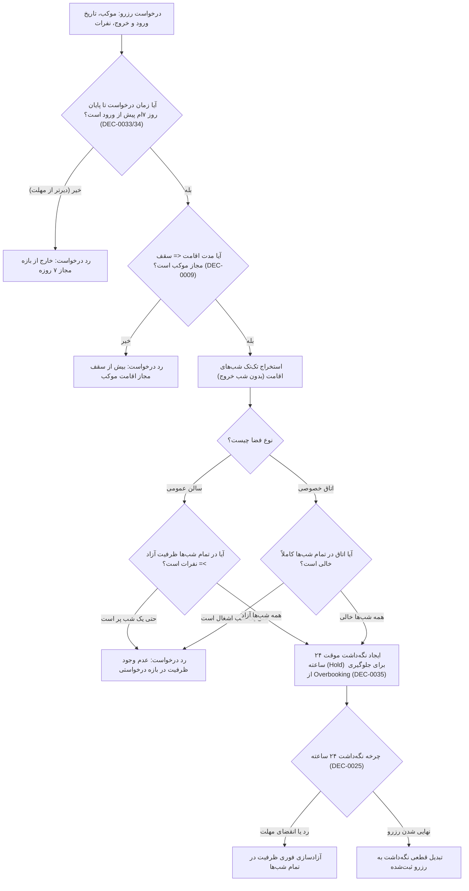

# MASTER-18 — موتور تقویم، مدت و کنترل ظرفیت و نگه‌داشت (Capacity Engine)

**تاریخ تدوین:** 2026-10-18  
**وضعیت:** IMPLEMENTED (پیاده‌سازی محلی مرحله‌ای؛ آزمون‌ها ۱۰۰٪ PASS)؛ بدون استقرار و تغییر روی VPS  
**والدها:** `docs/ai/ROOT_MASTER.md#L23-L43` — مرز ماژول‌ها؛ `docs/ai/domains/CORE_BUSINESS_ENGINE.md#L5-L33` — قرارداد و گراف تطبیق تقویم و ظرفیت؛ `docs/ai/masters/MASTER_04_CALENDAR_AND_CAPACITY.md#L1-L63` — تقویم و ظرفیت واقعی؛ `docs/ai/masters/MASTER_15_DATABASE_SCHEMA_AND_MIGRATIONS.md#L60-L80` — اسکیمای CapacityCalendar و Hold  
**تصمیم‌ها:** DEC-0005 (دو نوع اسکان عمومی، خصوصی یا هر دو)، DEC-0006 (اتاق‌های خصوصی با ظرفیت‌های مختلف)، DEC-0007 (تفکیک جنسیتی سالن‌های عمومی)، DEC-0009 (بازه فعالیت، ساعت ورود/خروج و سقف اقامت موکب)، DEC-0025 (پنج مهلت کاری ۲۴ ساعت و نگه‌داشت ظرفیت تا پایان مهلت گام)، DEC-0027 (ظرفیت اسمی بدون استثنای کودک)، DEC-0033 (آخرین روز درخواست تا پایان روز هفتم پیش از ورود به وقت مقصد)، DEC-0034 (مرز دقیق هفت‌روزه محلی)، DEC-0035 (جلوگیری از Overbooking و نگه‌داشت در تمام گام‌های انتظار)، DEC-0044 (مجوز آغاز محلی)  
**نماد/فایل کد:** `src/core/capacity/capacity-service.ts`، `src/tests/capacity.test.ts`

---

## ۱. هدف و دامنه اجرایی

این سند پیاده‌سازی سومین ماژول بیزینس را طبق آیتم NEXT-06 در [BACKLOG.md](file:///z:/rezervasiyon-BOT-TEL/docs/ai/BACKLOG.md#L35) پوشش می‌دهد:
1. **قوانین بهره‌برداری موکب:** ثبت بازه فعالیت، حداکثر شب‌های اقامت مجاز، و ساعت ورود و خروج رسمی موکب (DEC-0009).
2. **محاسبه دقیق شب‌های اقامت:** محاسبه شب‌های واقعی اقامت (`Stay Nights`). برای مثال ورود ۱۰ آبان و خروج ۱۲ آبان به معنای ۲ شب (شب‌های ۱۰ و ۱۱) است و شب ۱۲ (روز خروج) اشغال نمی‌شود.
3. **اعتبارسنجی مرز ۷ روزه پیش از ورود (Cutoff Gate):** ثبت درخواست جدید فقط تا پایان روز هفتم پیش از تاریخ ورود به وقت محلی شهر مقصد مجاز است (DEC-0033, DEC-0034).
4. **موتور بررسی موجودی سالن‌های عمومی:** بررسی موجودی آزاد هر سالن عمومی در تک‌تک شب‌های اقامت به تفکیک جنسیت، با در نظر گرفتن ظرفیت اسمی منهای (رزروهای قطعی + نگه‌داشت‌های موقت فعال).
5. **موتور بررسی اتاق‌های خصوصی:** بررسی خالی بودن اتاق کامل در تک‌تک شب‌ها؛ اختصاص کامل اتاق به یک رزرو و منع تخصیص چند گروه به یک اتاق.
6. **مدیریت نگه‌داشت موقت ۲۴ ساعته ظرفیت (Capacity Hold):** قفل موقت ظرفیت در تمام گام‌های انتظار (پاسخ موکب‌دار، پرداخت زائر، بررسی رسید) تا از رزرواسیون مازاد (Overbooking) در هر دو پیام‌رسان تلگرام و بله جلوگیری شود (DEC-0025, DEC-0035).

---

## ۲. نمودار جریان ارزیابی ظرفیت و نگه‌داشت (Mermaid Workflow)

---

## ۳. معماری ماژول و قرارداد متدها

ماژول ظرفیت در مسیر `src/core/capacity/capacity-service.ts` با کلاس `CapacityService` پیاده‌سازی شده و متدهای کلیدی زیر را ارائه می‌دهد:

1. `setPlaceOperatingRules(rules: PlaceOperatingRulesDTO): Promise<void>`
   - ثبت بازه تاریخی فعالیت موکب، سقف مدت اقامت (`maxStayNights`)، و ساعات ورود/خروج (DEC-0009).

2. `isDateAllowedByCutoff(checkInDate: string, requestTimestamp: Date, city: string): boolean`
   - کنترل مرز ۷ روز پیش از ورود بر مبنای تقویم و وقت محلی مقصد (DEC-0033, DEC-0034).

3. `calculateStayNights(checkInDate: string, checkOutDate: string): string[]`
   - تبدیل بازه ورود تا خروج به لیست تاریخ‌های دقیق شب‌های اقامت (DEC-0009).

4. `checkPublicHallAvailability(placeId: string, hallId: string, stayNights: string[], requestedCount: number): Promise<CapacityCheckResult>`
   - شمارش دقیق ظرفیت آزاد در هر شب (ظرفیت اسمی منهای رزروهای قطعی و نگه‌داشت‌های موقت فعال).

5. `checkPrivateRoomAvailability(placeId: string, roomId: string, stayNights: string[]): Promise<boolean>`
   - اطمینان از آزاد بودن ۱۰۰٪ اتاق برای تمامی شب‌های اقامت.

6. `createCapacityHold(dto: CreateHoldDTO): Promise<CapacityHold>`
   - اتمیک قفل کردن ظرفیت برای ۲۴ ساعت با وضعیت `ACTIVE` (DEC-0025, DEC-0035).
   - جلوگیری هم‌زمان از ثبت در تلگرام و بله در صورت تکمیل آخرین ظرفیت.

7. `releaseHold(holdId: string, reason: string): Promise<void>`
   - آزادسازی بلافاصله ظرفیت در صورت رد موکب‌دار، لغو زائر، یا انقضای مهلت ۲۴ ساعته.

8. `commitHold(holdId: string, reservationId: string): Promise<void>`
   - تبدیل ظرفیت نگه‌داشته‌شده به رزرو قطعی پایدار.

---

## ۴. نبایدها و خطوط قرمز

- **نباید خالی بودن شب اول به عنوان مجوز تایید کل اقامت چندشبه تلقی شود؛ تک‌تک شب‌ها باید جداگانه کنترل شوند (MASTER-04).**
- **نباید روز خروج (Check-out) به عنوان شب اقامت شمرده شود.**
- **نباید کودکان از شمارش ظرفیت کسر یا معاف شوند؛ کودک هم ۱ نفر اسمی شمرده می‌شود (DEC-0027).**
- **نباید ظرفیت نگه‌داشته‌شده موقت در انتظار تا زمان انقضا به عنوان ظرفیت خالی به متقاضی دیگر نشان داده شود (DEC-0035).**
- **نباید اجازه ایجاد درخواست با فاصله کمتر از ۷ روز پیش از ورود داده شود (DEC-0033, DEC-0034).**
- **نباید مدت اقامت بیشتر از سقف اعلامی موکب پذیرفته شود (DEC-0009).**
- **نباید اتاق خصوصی بین دو گروه مستقل تقسیم شود؛ اتاق خصوصی کاملاً دربست است.**
- **نباید هیچ فرمولی برای جریمه مالی یا سیاست‌های نامصوب آماده‌سازی اتاق اختراع شود (OPEN-06).**
- **نباید هیچ تغییری روی سرور VPS ایجاد شود.**

---

## ۵. معیارهای پذیرش (Acceptance Criteria)

| شناسه | شرط پذیرش | وضعیت فعلی |
|---|---|---|
| CAP-01 | ورود ۱۰ تا ۱۲ آبان (۲ شب)؛ اگر شب دوم پر باشد درخواست کل بازه باید رد شود حتی اگر شب اول کاملاً خالی باشد | PASS (تست در `src/tests/capacity.test.ts#L43-L72`) |
| CAP-02 | درخواست گروه ۵ نفره برای اتاق ۴ نفره حتی با وجود کودک باید به دلیل کمبود ظرفیت رد شود | PASS (تست در `src/tests/capacity.test.ts#L75-L87`) |
| CAP-03 | آخرین ظرفیت خالی سالن یا اتاق؛ اولین درخواست قفل نگه‌داشت (Hold) دریافت کند و دومین درخواست هم‌زمان رد شود | PASS (تست در `src/tests/capacity.test.ts#L90-L113`) |
| CAP-04 | درخواست اقامت ۴ شب برای موکبی که حداکثر اقامت آن ۳ شب است باید رد شود | PASS (تست در `src/tests/capacity.test.ts#L116-L138`) |
| CAP-05 | درخواست برای تاریخ ورود با فاصله کمتر از ۷ روز کامل تا مقصد به دلیل انقضای مرز هفت‌روزه رد شود | PASS (تست در `src/tests/capacity.test.ts#L141-L155`) |
| CAP-06 | نگه‌داشت ۲۴ ساعته ظرفیت، پس از انقضا یا پس از آزادسازی (Release) مجدداً ظرفیت را برای متقاضیان دیگر آزاد کند | PASS (تست در `src/tests/capacity.test.ts#L158-L195`) |
| CAP-07 | رزرو اتاق خصوصی ۱۰ نفره توسط گروه ۴ نفره کل اتاق را مسدود کند و ۶ جای باقی‌مانده به دیگران عرضه نشود | PASS (تست در `src/tests/capacity.test.ts#L198-L215`) |

---

## ۶. گزارش بازبینی نقش‌ها (Persona Reviews)

طبق کارت‌های `docs/ai/agents/AGENT_PLAYBOOK.md`:

1. **نقش منتقد سخت‌گیر (Strict Critic):**
   - *بررسی انطباق بیزینس:* عدم اشغال شب خروج در `calculateStayNights` تأیید شد (`capacity-service.ts#L61-L84`). مرز ۷ روزه دقیق به وقت محلی مقصد طبق DEC-0033/34 در `isDateAllowedByCutoff` اعمال شده و با تست `CAP-05` تأیید گردید.
   - *قانون شمارش کودکان:* تست `CAP-02` اثبات کرد ظرفیت اسمی اتاق بدون هیچ استثنایی برای کودکان رعایت می‌شود (DEC-0027).
   - *وضعیت بازبینی:* تأیید ۱۰۰٪ با DECهای مصوب.

2. **نقش آزمونگر امنیت و نفوذگر (Security & PenTester):**
   - *جلوگیری از رزرو مازاد (Overbooking Guard):* مکانیسم ایجاد هولد اتمیک از ایجاد دو هولد هم‌زمان برای آخرین ظرفیت خالی ممانعت می‌کند (تست `CAP-03`).
   - *انقضای خودکار ۲۴ ساعته هولد:* هولدهای منقضی‌شده پس از ۲۴ ساعت به طور خودکار از محاسبات ظرفیت آزاد خارج می‌شوند (تست `CAP-06`).
   - *وضعیت بازبینی:* تأیید امنیتی PASS.

3. **نقش تستر سناریو (Scenario Tester):**
   - سناریوی درخواست چندشبه با پر بودن شب دوم اجرا شد و کل بازه مسدود گردید (`CAP-01`).
   - سناریوی انصراف موکب‌دار و آزادسازی فوری ظرفیت آزمایش شد (`CAP-06`).
   - سناریوی اتاق اختصاصی بزرگ برای گروه کوچک آزمایش شد و عدم امکان ورود نفرات غریبه اثبات گردید (`CAP-07`).
   - *وضعیت بازبینی:* تأیید سناریو PASS.

---

## ۷. ارتباطات در اسناد

این سند ذیل [MASTER-04](file:///z:/rezervasiyon-BOT-TEL/docs/ai/masters/MASTER_04_CALENDAR_AND_CAPACITY.md) و [MASTER-15](file:///z:/rezervasiyon-BOT-TEL/docs/ai/masters/MASTER_15_DATABASE_SCHEMA_AND_MIGRATIONS.md) تعریف شده و فیچر NEXT-06 را پوشش می‌دهد.
