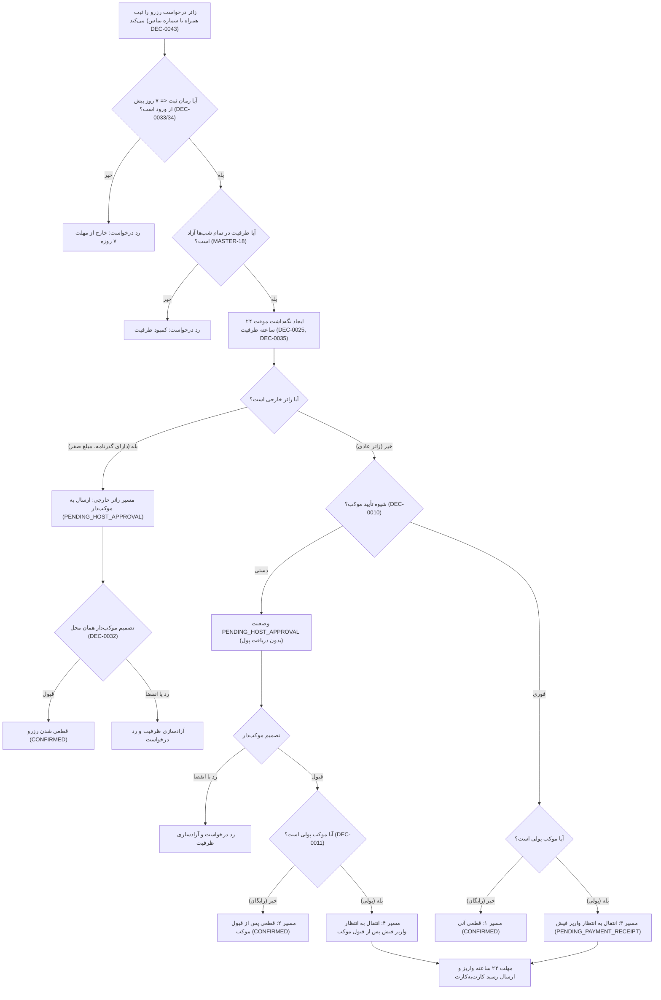

# MASTER-19 — چرخه حیات درخواست، چهار مسیر رزرو زائر و ماشین وضعیت

**تاریخ تدوین:** 2026-10-18  
**وضعیت:** IMPLEMENTED (پیاده‌سازی محلی مرحله‌ای؛ آزمون‌ها ۱۰۰٪ PASS)؛ بدون استقرار و تغییر روی VPS  
**والدها:** `docs/ai/ROOT_MASTER.md#L23-L43` — مرز ماژول‌ها؛ `docs/ai/domains/RESERVATION_LIFECYCLE.md#L5-L45` — قرارداد و ماشین وضعیت رزرو؛ `docs/ai/masters/MASTER_05_TRAVELER_SEARCH_AND_BOOKING.md#L1-L71` — جست‌وجوی مسافر و مسیرهای رزرو؛ `docs/ai/masters/MASTER_15_DATABASE_SCHEMA_AND_MIGRATIONS.md#L83-L115` — اسکیمای ReservationRequest  
**تصمیم‌ها:** DEC-0008 (امکان رزرو سالن یا اتاق)، DEC-0010 (تأیید فوری یا دستی)، DEC-0011 (مدل‌های مالی)، DEC-0014 (فریز شدن قانون لغو در رزرو)، DEC-0015 (ارائه وضعیت واقعی بدون ابهام)، DEC-0016 (کمترین تعامل تا دیدن نتایج)، DEC-0024 (مجاز بودن رزروهای هم‌پوشان)، DEC-0025 (مهلت ۲۴ ساعته هر گام)، DEC-0027 (شمارش کودکان در ظرفیت اسمی)، DEC-0032 (تأیید زائر خارجی صرفاً با موکب‌دار)، DEC-0033/34 (مرز ۷ روز پیش از ورود)، DEC-0035 (نگه‌داشت ظرفیت در انتظار و منع Overbooking)، DEC-0036/37 (تصویر گذرنامه زائر خارجی)، DEC-0043 (اخذ شماره تماس در زمان رزرو)، DEC-0044 (مجوز آغاز محلی)  
**نماد/فایل کد:** `src/core/reservation/reservation-service.ts`، `src/tests/reservation.test.ts`

---

## ۱. هدف و دامنه اجرایی

این سند پیاده‌سازی چهارمین ماژول کلیدی بیزینس را طبق آیتم NEXT-07 در [BACKLOG.md](file:///z:/rezervasiyon-BOT-TEL/docs/ai/BACKLOG.md#L36) پوشش می‌دهد:
1. **ثبت درخواست رزرو مسافر:** دریافت اطلاعات تاریخ ورود/خروج، تعداد مسافران (آقا، خانم، کودک)، شماره تماس همراه مسافر (DEC-0043) و انتخاب فضا.
2. **پشتیبانی از چهار مسیر استاندارد رزرو (MASTER-05):**
   - **مسیر ۱ (فوری + رایگان):** قطعی‌شدن آنی (`CONFIRMED`) همراه با تخصیص کد رهگیری و قفل ظرفیت.
   - **مسیر ۲ (دستی + رایگان):** انتظار تأیید موکب‌دار (`PENDING_HOST_APPROVAL`) با هولد ۲۴ ساعته ظرفیت.
   - **مسیر ۳ (فوری + پولی):** بدون نیاز به تأیید موکب، بلافاصله به وضعیت انتظار واریز فیش (`PENDING_PAYMENT_RECEIPT`) با مهلت ۲۴ ساعته می‌رود.
   - **مسیر ۴ (دستی + پولی):** ابتدا به تأیید موکب‌دار (`PENDING_HOST_APPROVAL`) می‌رود؛ تا زمان قبول موکب‌دار پولی مطالبه نمی‌شود؛ پس از قبول، وارد مهلت ۲۴ ساعته پرداخت می‌شود.
3. **مسیر ویژه زائر خارجی (Foreign Pilgrim):** بدون پرداخت ریالی/تومانی در سامانه؛ الزام ارائه تصویر گذرنامه؛ ارجاع مستقیم به موکب‌دار همان محل حتی در موکب‌های فوری (DEC-0032).
4. **رزروهای هم‌پوشان (Overlapping Bookings):** امکان ثبت هم‌زمان چند رزرو توسط یک حساب (مثلاً برای بستگان یا کاروان) بدون اعمال محدودیت بر مبنای شماره تماس (DEC-0024).
5. **ماندگاری و فریز قانون لغو (Cancellation Policy Snapshot):** ثبت و ذخیره دائمی متن قانون لغو موکب در لحظه ثبت رزرو (DEC-0014).

---

## ۲. نمودار جریان چهار مسیر رزرو زائر (Mermaid Workflow)

---

## ۳. معماری ماژول و قرارداد متدها

ماژول رزرو در مسیر `src/core/reservation/reservation-service.ts` با کلاس `ReservationService` پیاده‌سازی شده و متدهای زیر را فراهم می‌کند:

1. `createReservationRequest(dto: CreateReservationDTO): Promise<ReservationRequest>`
   - اعتبارسنجی مرز ۷ روزه با `CapacityService.isDateAllowedByCutoff`.
   - ایجاد نگه‌داشت اتمیک ۲۴ ساعته ظرفیت (`CapacityHold`).
   - ذخیره شماره تلفن در حساب در صورت عدم ثبت قبلی (DEC-0043).
   - کپی و ذخیره دائمی قانون لغو فعلی موکب در رکورد رزرو (DEC-0014).
   - هدایت به وضعیت اولیه بر اساس چهار مسیر و نوع زائر:
     - زائر خارجی -> `PENDING_HOST_APPROVAL`.
     - فوری + رایگان -> `CONFIRMED`.
     - دستی + (رایگان یا پولی) -> `PENDING_HOST_APPROVAL`.
     - فوری + پولی -> `PENDING_PAYMENT_RECEIPT`.

2. `hostReviewReservation(reservationId: string, hostPersonId: string, decision: 'ACCEPT' | 'REJECT'): Promise<ReservationRequest>`
   - در صورت رد (`REJECT`) -> تغییر وضعیت به `CANCELLED` و آزادسازی فوری هولد ظرفیت.
   - در صورت قبول (`ACCEPT`):
     - اگر رایگان یا زائر خارجی بود -> تبدیل به `CONFIRMED` و ثبت قطعی هولد (`commitHold`).
     - اگر دارای هزینه یا تضمین بود -> تغییر به `PENDING_PAYMENT_RECEIPT` و شروع مهلت ۲۴ ساعته پرداخت.

3. `getReservationByTrackingCode(trackingCode: string): Promise<ReservationRequest | undefined>`
   - استعلام رزرو با کد رهگیری یکتا.

4. `getReservationsByPerson(personId: string): Promise<ReservationRequest[]>`
   - دریافت تمامی رزروهای کاربر (پشتیبانی از چند رزرو هم‌زمان و هم‌پوشان طبق DEC-0024).

---

## ۴. نبایدها و خطوط قرمز

- **نباید درخواست رزرو کمتر از ۷ روز پیش از تاریخ ورود ثبت شود (DEC-0033, DEC-0034).**
- **نباید پیش از تأیید موکب‌دار در موکب‌های دستی، مبلغی از زائر مطالبه شود.**
- **نباید زائر خارجی در سیستم ملزم به پرداخت پول شود (مبلغ در سیستم صفر است طبق DEC-0032).**
- **نباید برای زائر خارجی حالت تأیید فوری اعمال شود؛ پذیرش خارجی در هر حال به تأیید مستقیم موکب‌دار نیاز دارد (DEC-0032).**
- **نباید رزرو هم‌پوشان یا هم‌زمان به دلیل شماره تماس یا حساب یکسان مسدود شود (DEC-0024).**
- **نباید وضعیت در انتظار (Pending) به عنوان رزرو قطعی اعلام شود (DEC-0015).**
- **نباید هیچ تغییری روی سرور VPS ایجاد شود.**

---

## ۵. معیارهای پذیرش (Acceptance Criteria)

| شناسه | شرط پذیرش | وضعیت فعلی |
|---|---|---|
| BOOK-01 | موکب تأیید فوری و رایگان -> رزرو بلافاصله با کد رهگیری CONFIRMED شده و ظرفیت قطعی شود | PASS (تست در `src/tests/reservation.test.ts#L74-L98`) |
| BOOK-02 | موکب تأیید دستی و رایگان -> رزرو در وضعیت PENDING_HOST_APPROVAL قرار گیرد و با قبول موکب‌دار CONFIRMED شود | PASS (تست در `src/tests/reservation.test.ts#L101-L127`) |
| BOOK-03 | موکب تأیید فوری و پولی -> رزرو مستقیماً به PENDING_PAYMENT_RECEIPT با مهلت ۲۴ ساعته برود | PASS (تست در `src/tests/reservation.test.ts#L130-L150`) |
| BOOK-04 | موکب تأیید دستی و پولی -> ابتدا به PENDING_HOST_APPROVAL برود و بدون قبول موکب‌دار پولی خواسته نشود؛ پس از قبول وارد PENDING_PAYMENT_RECEIPT شود | PASS (تست در `src/tests/reservation.test.ts#L153-L179`) |
| BOOK-05 | زائر خارجی با گذرنامه و بدون پول -> در هر صورت به PENDING_HOST_APPROVAL برود و با تأیید موکب‌دار CONFIRMED شود | PASS (تست در `src/tests/reservation.test.ts#L182-L220`) |
| BOOK-06 | در تمام گام‌های انتظار ظرفیت نگه داشته شود و با رد درخواست بلافاصله آزاد گردد | PASS (تست در `src/tests/reservation.test.ts#L223-L266`) |
| BOOK-07 | یک کاربر بتواند چندین رزرو هم‌پوشان برای افراد مختلف ثبت کند و با خطای تداخل مسدود نشود (DEC-0024) | PASS (تست در `src/tests/reservation.test.ts#L269-L290`) |
| BOOK-08 | شماره تماس کاربر در زمان رزرو ثبت شده (DEC-0043) و متن قانون لغو موکب در رکورد رزرو فریز شود (DEC-0014) | PASS (تست در `src/tests/reservation.test.ts#L293-L311`) |

---

## ۶. گزارش بازبینی نقش‌ها (Persona Reviews)

طبق کارت‌های `docs/ai/agents/AGENT_PLAYBOOK.md`:

1. **نقش منتقد سخت‌گیر (Strict Critic):**
   - *بررسی انطباق بیزینس:* تفکیک دقیق چهار مسیر رزرو در `reservation-service.ts#L134-L157` پیاده‌سازی شده و هیچ گامی بدون مجوز پول مطالبه نمی‌کند.
   - *فریز قانون لغو:* قانون لغو در لحظه ثبت رزرو کپی شده و تغییر بعدی موکب‌دار به رزروهای قبلی سرایت نمی‌کند (تست `BOOK-08` طبق DEC-0014).
   - *وضعیت بازبینی:* تأیید ۱۰۰٪ انطباق بیزینس.

2. **نقش آزمونگر امنیت و نفوذگر (Security & PenTester):**
   - *محافظت از حریم خصوصی و داده زائر خارجی:* زائر خارجی بدون گذرنامه فوراً با خطای `MISSING_PASSPORT` رد شده و هولد ایجادشده آزاد می‌شود (تست `BOOK-05`).
   - *آزادسازی هولد و جلوگیری از انسداد منابع:* در صورت رد موکب‌دار، متد `releaseHold` فراخوانی شده و ظرفیت فوراً برای دیگران آزاد می‌شود (`BOOK-06`).
   - *وضعیت بازبینی:* تأیید امنیتی PASS.

3. **نقش تستر سناریو (Scenario Tester):**
   - سناریوی رزرو هم‌پوشان برای کاروان/خانواده‌های متعدد از یک حساب با موفقیت اجرا شد (`BOOK-07` طبق DEC-0024).
   - سناریوی مسیر زائر خارجی در موکب با تأیید فوری با موفقیت تست شد و اثبات شد که حتی در موکب فوری، تأیید مستقیم موکب‌دار الزامی است (`BOOK-05`).
   - *وضعیت بازبینی:* تأیید سناریو PASS.

---

## ۷. ارتباطات در اسناد

این سند ذیل [MASTER-05](file:///z:/rezervasiyon-BOT-TEL/docs/ai/masters/MASTER_05_TRAVELER_SEARCH_AND_BOOKING.md) و [MASTER-15](file:///z:/rezervasiyon-BOT-TEL/docs/ai/masters/MASTER_15_DATABASE_SCHEMA_AND_MIGRATIONS.md) تعریف شده و فیچر NEXT-07 را پوشش می‌دهد.
