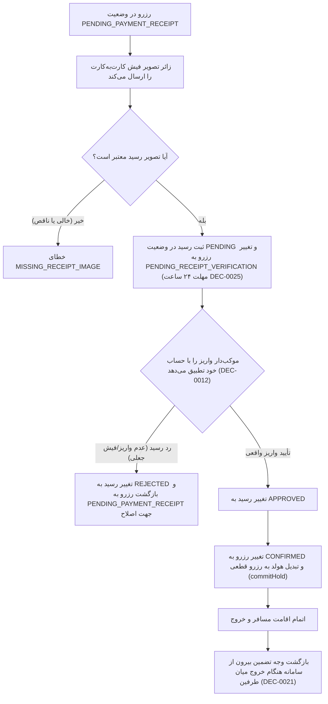

# MASTER-20 — سیستم مالی، کارت‌به‌کارت و اعتبارسنجی رسید واریز

**تاریخ تدوین:** 2026-10-18  
**وضعیت:** IMPLEMENTED (پیاده‌سازی محلی مرحله‌ای؛ آزمون‌ها ۱۰۰٪ PASS)؛ بدون استقرار و تغییر روی VPS  
**والدها:** `docs/ai/ROOT_MASTER.md#L23-L43` — مرز ماژول‌ها؛ `docs/ai/domains/BILLING_AND_WALLET.md#L5-L40` — مرز دامنه مالی و پرداخت؛ `docs/ai/masters/MASTER_06_MONEY_RECEIPTS_AND_REFUNDS.md#L1-L66` — هزینه ثبت رزرو، تضمین و رسید دستی؛ `docs/ai/masters/MASTER_15_DATABASE_SCHEMA_AND_MIGRATIONS.md#L118-L134` — اسکیمای ReceiptRecord  
**تصمیم‌ها:** DEC-0011 (سه مدل مالی انحصاری)، DEC-0012 (کارت‌به‌کارت و بررسی دستی رسید)، DEC-0013 (مبلغ ثابت برای کل رزرو)، DEC-0014 (فریز قانون مالی در زمان ثبت)، DEC-0020 (کارت موکب‌دار و عدم تسویه در سامانه)، DEC-0021 (حذف عملیات بازپرداخت از سامانه)، DEC-0025 (مهلت ۲۴ ساعته ارسال و بررسی رسید)، DEC-0032 (زائر خارجی بدون پرداخت در سامانه)، DEC-0038 (واحد مبالغ به تومان)، DEC-0044 (مجوز آغاز محلی)  
**نماد/فایل کد:** `src/core/billing/billing-service.ts`، `src/tests/billing.test.ts`

---

## ۱. هدف و دامنه اجرایی

این سند پیاده‌سازی پنجمین ماژول کلیدی بیزینس را طبق آیتم NEXT-08 در [BACKLOG.md](file:///z:/rezervasiyon-BOT-TEL/docs/ai/BACKLOG.md#L37) پوشش می‌دهد:
1. **سه مدل مالی انحصاری موکب (DEC-0011):**
   - **رایگان (`FREE`):** مبلغ صفر.
   - **هزینه ثبت رزرو (`FIXED_FEE`):** مبلغ ثابت برای کل رزرو به تومان (DEC-0038).
   - **وجه تضمین (`FIXED_DEPOSIT`):** مبلغ ثابت تضمین برای کل رزرو به تومان؛ بدون امکان ادغام یا انتخاب هم‌زمان هزینه و تضمین.
2. **قانون مبلغ ثابت (Fixed Amount):** مبالغ پولی مقطوع برای کل رزرو هستند و به هیچ عنوان در تعداد مسافران، تعداد شب‌ها یا تعداد اتاق‌ها ضرب نمی‌شوند (DEC-0013).
3. **ارسال تصویر رسید کارت‌به‌کارت توسط زائر (DEC-0012):** زائر در وضعیت `PENDING_PAYMENT_RECEIPT` تصویر فیش واریز را بارگذاری می‌کند؛ سامانه رکورد رسید را ثبت و وضعیت رزرو را به `PENDING_RECEIPT_VERIFICATION` تغییر می‌دهد.
4. **تطبیق واقعی واریز با حساب توسط موکب‌دار (DEC-0012):** عکس فیش به‌تنهایی سند واریز نیست؛ موکب‌دار موظف به تطبیق با حساب بانکی شخصی/موکب است:
   - **تأیید رسید (`APPROVED`):** رزرو قطعی (`CONFIRMED`) شده و ظرفیت تثبیت می‌گردد.
   - **رد رسید (`REJECTED`):** رزرو مجدداً به وضعیت `PENDING_PAYMENT_RECEIPT` برمی‌گردد تا زائر فیش صحیح را ارسال کند.
5. **معافیت کامل زائر خارجی از پرداخت در سامانه (DEC-0032):** هیچ پرونده مالی برای زائر خارجی باز نمی‌شود و مبلغ در سیستم صفر است.
6. **عدم وجود عملیات کیف پول یا بازپرداخت (DEC-0021):** هرگونه بازگشت وجه تضمین یا تسویه خارج از سامانه و هنگام خروج میان طرفین انجام می‌گیرد و سیستم فاقد فیلد یا دکمه بازپرداخت است.

---

## ۲. نمودار ماشین وضعیت پرونده مالی و رسید (Mermaid Workflow)

---

## ۳. معماری ماژول و قرارداد متدها

ماژول مالی در مسیر `src/core/billing/billing-service.ts` با کلاس `BillingService` پیاده‌سازی شده و متدهای زیر را فراهم می‌کند:

1. `calculateTotalAmount(model: FinancialModel, feeAmount: number, depositAmount: number): number`
   - محاسبه و اعتبارسنجی مبلغ ثابت به تومان بدون هیچ‌گونه ضریب شب/نفر/اتاق (DEC-0013, DEC-0038).

2. `submitPaymentReceipt(reservationId: string, receiptImagePath: string, now?: Date): Promise<ReceiptRecord>`
   - دریافت تصویر رسید، ایجاد رکورد `ReceiptRecord` با وضعیت `PENDING`.
   - تغییر وضعیت رزرو در `ReservationService` به `PENDING_RECEIPT_VERIFICATION`.

3. `reviewPaymentReceipt(receiptId: string, reviewerHostPersonId: string, decision: 'APPROVED' | 'REJECTED', rejectionReason?: string, now?: Date): Promise<ReceiptRecord>`
   - در صورت `APPROVED`: تغییر وضعیت رسید به `APPROVED`، تغییر رزرو به `CONFIRMED` و تثبیت قطعی هولد در `CapacityService`.
   - در صورت `REJECTED`: تغییر رسید به `REJECTED` و بازگشت رزرو به `PENDING_PAYMENT_RECEIPT` جهت اصلاح و ارسال مجدد.

4. `getReceiptByReservationId(reservationId: string): Promise<ReceiptRecord | undefined>`
   - دریافت اطلاعات رسید و وضعیت بررسی آن.

---

## ۴. نبایدها و خطوط قرمز

- **نباید تصویر فیش به عنوان واریز قطعی تلقی شود تا زمانی که موکب‌دار آن را با حساب تطبیق دهد (DEC-0012).**
- **نباید هزینه ثبت رزرو و وجه تضمین هم‌زمان برای یک موکب دریافت شوند (DEC-0011).**
- **نباید مبلغ رزرو در تعداد نفرات، شب‌ها یا اتاق‌ها ضرب شود؛ مبلغ مقطوع برای کل رزرو است (DEC-0013).**
- **نباید از زائر خارجی وجه یا فیش پرداخت مطالبه شود (DEC-0032).**
- **نباید قابلیت یا وضعیت بازپرداخت، کیف پول یا تسویه مالی در سامانه ایجاد شود؛ بازگشت وجه خارج از سامانه است (DEC-0021).**
- **نباید شماره کامل کارت یا اطلاعات بانکی در گزارش‌های عمومی بازتاب یابد.**
- **نباید هیچ تغییری روی سرور VPS ایجاد شود.**

---

## ۵. معیارهای پذیرش (Acceptance Criteria)

| شناسه | شرط پذیرش | وضعیت فعلی |
|---|---|---|
| PAY-01 | ارسال تصویر رسید وضعیت رزرو را به PENDING_RECEIPT_VERIFICATION تغییر دهد اما رزرو تا پیش از تطبیق قطعی نشود | PASS (تست در `src/tests/billing.test.ts#L78-L108`) |
| PAY-02 | تأیید واقعی واریز توسط موکب‌دار وضعیت رسید را به APPROVED و رزرو را به CONFIRMED تغییر داده و ظرفیت را قطعی کند | PASS (تست در `src/tests/billing.test.ts#L111-L147`) |
| PAY-03 | رد فیش توسط موکب‌دار وضعیت رزرو را به PENDING_PAYMENT_RECEIPT برگرداند تا زائر امکان اصلاح داشته باشد | PASS (تست در `src/tests/billing.test.ts#L150-L188`) |
| PAY-04 | عدم امکان ترکیب هم‌زمان مدل هزینه ثابت و تضمین ثابت در تعیین مدل مالی موکب (DEC-0011) | PASS (تست در `src/tests/billing.test.ts#L191-L197`) |
| PAY-05 | مبلغ کل رزرو برای گروه ۵ نفره در اقامت ۳ شب با مبلغ ۱ نفر در ۱ شب یکسان باشد (مبلغ ثابت کل رزرو بدون ضرب DEC-0013) | PASS (تست در `src/tests/billing.test.ts#L200-L210`) |
| PAY-06 | زائر خارجی هیچ‌گونه بدهی مالی در سامانه نداشته و بدون بارگذاری فیش رزرو شود (DEC-0032) | PASS (تست در `src/tests/billing.test.ts#L213-L248`) |
| PAY-07 | عدم وجود هرگونه موجودیت کیف پول یا وضعیت استرداد در سامانه و پایان پرونده بدون بازپرداخت سیستمی (DEC-0021) | PASS (تست در `src/tests/billing.test.ts#L251-L257`) |

---

## ۶. گزارش بازبینی نقش‌ها (Persona Reviews)

طبق کارت‌های `docs/ai/agents/AGENT_PLAYBOOK.md`:

1. **نقش منتقد سخت‌گیر (Strict Critic):**
   - *بررسی انطباق بیزینس:* مدل‌های مالی به صورت انحصاری در `calculateTotalAmount` قفل شده و هرگونه ادغام هزینه و تضمین رد می‌شود (`billing-service.ts#L36-L56`).
   - *قانون مبلغ مقطوع:* مبالغ برای کل رزرو ثابت بوده و در تعداد شب یا نفر ضرب نمی‌شوند (تست `PAY-05` طبق DEC-0013).
   - *عدم ادعای بازپرداخت:* هیچ متد یا سیستمی برای بازپرداخت در سامانه ساخته نشد (تست `PAY-07` طبق DEC-0021).
   - *وضعیت بازبینی:* تأیید ۱۰۰٪ انطباق بیزینس.

2. **نقش آزمونگر امنیت و نفوذگر (Security & PenTester):**
   - *جلوگیری از کلاهبرداری با فیش جعلی:* تصویر فیش به هیچ وجه به عنوان تأیید قطعی پذیرفته نمی‌شود؛ رزرو تا زمان استعلام مستقیم بانکی توسط موکب‌دار معلق می‌ماند (`PAY-01`).
   - *حفاظت از جریان پرداخت زائر:* در صورت رد فیش جعلی یا اشتباه، رزرو لغو نمی‌شود بلکه فرصت اصلاح داده می‌شود (`PAY-03`).
   - *وضعیت بازبینی:* تأیید امنیتی PASS.

3. **نقش تستر سناریو (Scenario Tester):**
   - سناریوی کامل بارگذاری فیش، تأیید توسط موکب‌دار و تبدیل هولد به رزرو قطعی با موفقیت آزموده شد (`PAY-02`).
   - سناریوی زائر خارجی بدون فیش آزمایش شد و اثبات گردید هیچ رکوردی از رسید مالی برای زائر خارجی تولید نمی‌شود (`PAY-06`).
   - *وضعیت بازبینی:* تأیید سناریو PASS.

---

## ۷. ارتباطات در اسناد

این سند ذیل [MASTER-06](file:///z:/rezervasiyon-BOT-TEL/docs/ai/masters/MASTER_06_MONEY_RECEIPTS_AND_REFUNDS.md) و [MASTER-15](file:///z:/rezervasiyon-BOT-TEL/docs/ai/masters/MASTER_15_DATABASE_SCHEMA_AND_MIGRATIONS.md) تعریف شده و فیچر NEXT-08 را پوشش می‌دهد.
