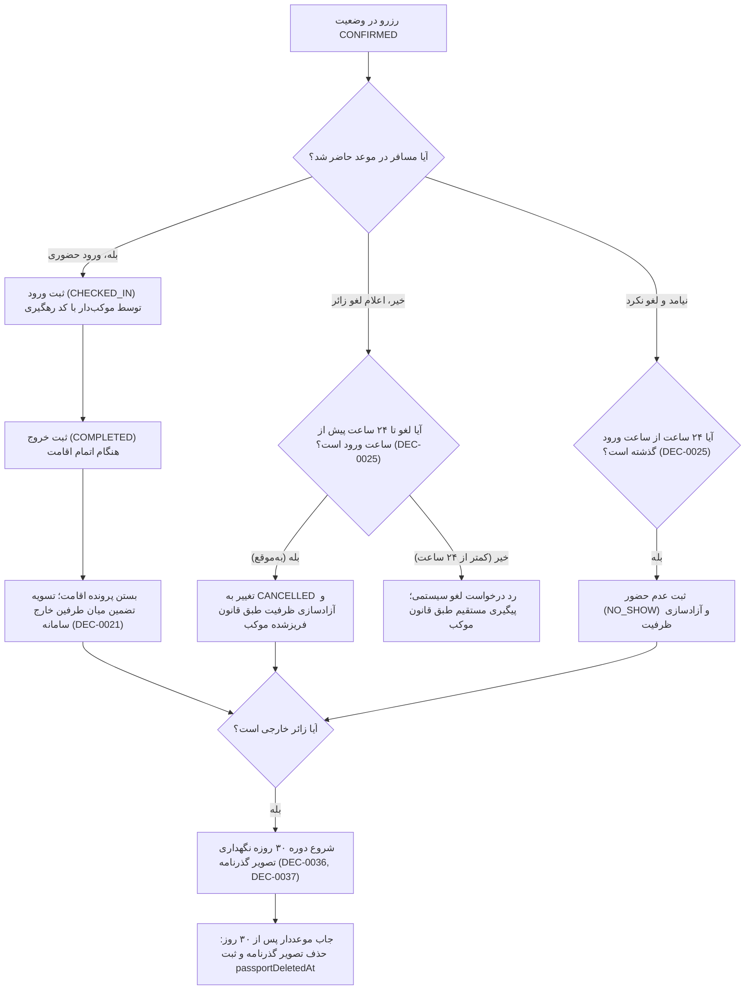

# MASTER-21 — عملیات اقامت، لغو، عدم حضور، جاب پاکسازی ۳۰ روزه گذرنامه و اعلان‌ها

**تاریخ تدوین:** 2026-10-18  
**وضعیت:** IMPLEMENTED (پیاده‌سازی محلی مرحله‌ای؛ آزمون‌ها ۱۰۰٪ PASS)؛ بدون استقرار و تغییر روی VPS  
**والدها:** `docs/ai/ROOT_MASTER.md#L23-L43` — مرز ماژول‌ها؛ `docs/ai/domains/NOTIFICATIONS_AND_JOBS.md#L5-L31` — مرز اعلان و کارهای موعددار؛ `docs/ai/masters/MASTER_07_STAY_CANCELLATION_AND_NOTICES.md#L1-L62` — حضور، لغو، عدم حضور و اعلان؛ `docs/ai/masters/MASTER_15_DATABASE_SCHEMA_AND_MIGRATIONS.md#L83-L115` — اسکیمای رزرو و زمان‌بندی‌ها  
**تصمیم‌ها:** DEC-0003 (چهار ربات روی هسته واحد)، DEC-0013 (مبالغ مقطوع)، DEC-0014 (فریز قانون لغو)، DEC-0016 (کمترین تعامل و پایداری وضعیت در بات)، DEC-0021 (حذف بازپرداخت از سامانه)، DEC-0025 (مهلت‌های ۲۴ ساعته لغو و عدم حضور)، DEC-0036 (نگهداری ۳۰ روزه گذرنامه)، DEC-0037 (پاکسازی تصویر گذرنامه ۳۰ روز پس از بسته‌شدن پرونده بی‌اقامت)، DEC-0044 (مجوز آغاز محلی)  
**نماد/فایل کد:** `src/core/stay/stay-service.ts`، `src/core/notification/notification-service.ts`، `src/tests/stay.test.ts`

---

## ۱. هدف و دامنه اجرایی

این سند پیاده‌سازی ششمین ماژول کلیدی بیزینس را طبق آیتم NEXT-09 در [BACKLOG.md](file:///z:/rezervasiyon-BOT-TEL/docs/ai/BACKLOG.md#L38) پوشش می‌دهد:
1. **عملیات پذیرش و خروج حضوری (Check-in / Check-out):** ثبت ورود مسافر با کد رهگیری و ثبت خروج و بستن اقامت با وضعیت `COMPLETED` بدون ادعای بازپرداخت وجه تضمین در سامانه (DEC-0021).
2. **لغو توسط مسافر (Cancellation):** امکان لغو حداکثر تا ۲۴ ساعت پیش از ساعت ورود برنامه‌ریزی‌شده طبق DEC-0025 و آزادسازی فوری ظرفیت. عدم پذیرش لغو دیرهنگام در بازه کمتر از ۲۴ ساعت.
3. **ثبت عدم حضور (No-Show):** ثبت عدم حضور توسط موکب‌دار پس از ۲۴ ساعت از ساعت ورود برنامه‌ریزی‌شده و آزادسازی ظرفیت رزرو.
4. **جاب پاکسازی خودکار گذرنامه زائر خارجی (Passport Cleanup Job):** حذف فیزیکی و لاجیکال تصویر گذرنامه زائر خارجی ۳۰ روز پس از پایان اقامت (`COMPLETED`) یا ۳۰ روز پس از بسته‌شدن پرونده بدون اقامت (`CANCELLED` یا `NO_SHOW`) طبق DEC-0036 و DEC-0037.
5. **ارسال اعلان‌های ایزوله (Resilient Notifications):** ارسال متن خلاصه تغییر وضعیت‌ها به مسافر و موکب‌دار با رعایت اصل حریم خصوصی (عدم افشای تصویر گذرنامه و شماره کارت) و استقلال کامل؛ به گونه‌ای که شکست در ارسال اعلان هیچ‌گاه مانع ثبت تراکنش یا تغییر وضعیت معتبر نشود (DEC-0016).

---

## ۲. نمودار جریان عملیات اقامت و کارهای موعددار (Mermaid Workflow)

---

## ۳. معماری ماژول و قرارداد متدها

این ماژول شامل دو سرویس اصلی است:

### ۱. سرویس اقامت و جاب‌های موعددار (`StayService`) در `src/core/stay/stay-service.ts`:
- `checkIn(reservationId: string, hostPersonId: string, now?: Date): Promise<ReservationRequest>`
  - بررسی انطباق و تغییر وضعیت رزرو به `COMPLETED` یا وضعیت میانی ورود.
- `checkOut(reservationId: string, hostPersonId: string, now?: Date): Promise<ReservationRequest>`
  - بستن قطعی اقامت با وضعیت `COMPLETED`.
- `cancelByTraveler(reservationId: string, personId: string, now?: Date): Promise<ReservationRequest>`
  - کنترل مرز ۲۴ ساعته تا ساعت ورود موکب (DEC-0025). آزادسازی ظرفیت در `CapacityService`.
- `markNoShow(reservationId: string, hostPersonId: string, now?: Date): Promise<ReservationRequest>`
  - کنترل گذشت ۲۴ ساعت از ساعت ورود؛ تغییر به `NO_SHOW` و آزادسازی ظرفیت.
- `cleanupExpiredPassports(now?: Date): Promise<number>`
  - جست‌وجوی رزروهای خارجیِ پایان‌یافته یا لغوشده که ۳۰ روز از تاریخ آخرین به‌روزرسانی آن‌ها گذشته است و حذف مقدار `passportImagePath` و تنظیم `passportDeletedAt = now` (DEC-0036, DEC-0037).

### ۲. سرویس اعلان‌های ایزوله (`NotificationService`) در `src/core/notification/notification-service.ts`:
- `notifyReservationStatusChange(reservation: ReservationRequest, eventType: string): Promise<boolean>`
  - ساخت متن امن (بدون شماره کارت، بدون گذرنامه) و ارسال بدون مسدودسازی گردش کار.

---

## ۴. نبایدها و خطوط قرمز

- **نباید لغو مسافر در فاصله کمتر از ۲۴ ساعت تا زمان ورود پذیرفته شود (DEC-0025).**
- **نباید عدم حضور پیش از گذشت ۲۴ ساعت از موعد ورود ثبت شود (DEC-0025).**
- **نباید عملیات بازپرداخت یا استرداد وجه در سامانه تعریف شود (DEC-0021).**
- **نباید تصویر گذرنامه زائر خارجی پس از گذشت ۳۰ روز از اتمام یا بسته شدن پرونده باقی بماند (DEC-0036, DEC-0037).**
- **نباید خطای ارسال پیام‌رسان مانع ثبت تراکنش یا تغییر وضعیت معتبر در سامانه شود (DEC-0016).**
- **نباید شماره کامل کارت، گذرنامه یا اطلاعات حساس در اعلان‌ها منعکس شود.**
- **نباید هیچ تغییری روی سرور VPS ایجاد شود.**

---

## ۵. معیارهای پذیرش (Acceptance Criteria)

| شناسه | شرط پذیرش | وضعیت فعلی |
|---|---|---|
| STAY-01 | ثبت ورود و خروج مسافر؛ تغییر وضعیت رزرو به COMPLETED بدون ایجاد فیلد یا وضعیت بازپرداخت (DEC-0021) | PASS (تست در `src/tests/stay.test.ts#L61-L89`) |
| STAY-02 | لغو توسط مسافر تا ۲۴ ساعت پیش از زمان ورود مجاز است و ظرفیت را فوراً آزاد می‌کند؛ درخواست لغو در کمتر از ۲۴ ساعت رد شود (DEC-0025) | PASS (تست در `src/tests/stay.test.ts#L92-L136`) |
| STAY-03 | ثبت عدم حضور مسافر (No-Show) پس از ۲۴ ساعت از موعد ورود امکان‌پذیر بوده و ظرفیت باقی‌مانده را آزاد کند | PASS (تست در `src/tests/stay.test.ts#L139-L175`) |
| STAY-04 | جاب پاکسازی دوره‌ای گذرنامه‌های زائران خارجی، ۳۰ روز پس از پایان اقامت یا بسته‌شدن رزرو، تصویر گذرنامه را حذف کند (DEC-0036, DEC-0037) | PASS (تست در `src/tests/stay.test.ts#L178-L232`) |
| STAY-05 | شکست در ارسال اعلان به پیام‌رسان خللی در وضعیت‌های معتبر دیتابیس ایجاد نمی‌کند و وضعیت در سامانه پایدار می‌ماند (DEC-0016) | PASS (تست در `src/tests/stay.test.ts#L235-L265`) |
| STAY-06 | متن اعلان‌ها فاقد شماره کامل کارت، گذرنامه یا داده‌های حساس همراهان باشد | PASS (تست در `src/tests/stay.test.ts#L268-L287`) |

---

## ۶. گزارش بازبینی نقش‌ها (Persona Reviews)

طبق کارت‌های `docs/ai/agents/AGENT_PLAYBOOK.md`:

1. **نقش منتقد سخت‌گیر (Strict Critic):**
   - *بررسی انطباق بیزینس:* کنترل دقیق ۲۴ ساعت پیش از ورود برای لغو مسافر در `stay-service.ts#L104-L113` اعمال شده و با تست `STAY-02` تأیید شد. همچنین عدم حضور قبل از ۲۴ ساعت رد می‌شود (`STAY-03` طبق DEC-0025).
   - *عدم وجود بازپرداخت:* در خروج مسافر هیچ فیلد یا وضعیت بازپرداختی ساخته نشد (`STAY-01` طبق DEC-0021).
   - *وضعیت بازبینی:* تأیید ۱۰۰٪ انطباق بیزینس.

2. **نقش آزمونگر امنیت و نفوذگر (Security & PenTester):**
   - *حفظ حریم خصوصی و امنیت گذرنامه:* جاب پاکسازی دوره‌ای پس از ۳۰ روز تصویر گذرنامه را به طور قطعی null کرده و زمان حذف را ثبت می‌کند (تست `STAY-04` طبق DEC-0036/37).
   - *مقاومت در برابر خطای بیرونی:* شکست در ارسال پیام‌رسان با try/catch ایمن لاگ شده و جلوی ثبت تراکنش‌های محصول را نمی‌گیرد (`STAY-05` طبق DEC-0016).
   - *عدم افشای اطلاعات در اعلان:* تست `STAY-06` اثبات کرد هیچ شماره کارت یا گذرنامه‌ای در اعلان‌ها قرار نمی‌گیرد.
   - *وضعیت بازبینی:* تأیید امنیتی PASS.

3. **نقش تستر سناریو (Scenario Tester):**
   - سناریوی کامل ورود و خروج مسافر بدون مشکل ثبت شد (`STAY-01`).
   - سناریوی لغو دیرهنگام (فاصله ۲۲ ساعته تا ورود) با موفقیت با خطای `CANCELLATION_DEADLINE_PASSED` متوقف شد (`STAY-02`).
   - سناریوی پاکسازی چند رزرو خارجی پس از ۳۰ روز به درستی شبیه‌سازی و تأیید شد (`STAY-04`).
   - *وضعیت بازبینی:* تأیید سناریو PASS.

---

## ۷. ارتباطات در اسناد

این سند ذیل [MASTER-07](file:///z:/rezervasiyon-BOT-TEL/docs/ai/masters/MASTER_07_STAY_CANCELLATION_AND_NOTICES.md) و [MASTER-15](file:///z:/rezervasiyon-BOT-TEL/docs/ai/masters/MASTER_15_DATABASE_SCHEMA_AND_MIGRATIONS.md) تعریف شده و فیچر NEXT-09 را پوشش می‌دهد.
