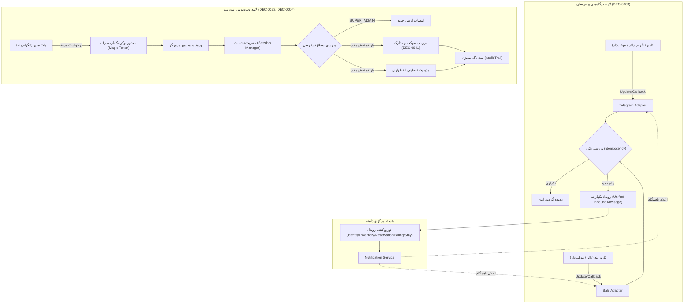

# MASTER-22 — درگاه‌های پیام‌رسان (تلگرام و بله) و وب‌ویو احراز هویت مدیریت

**تاریخ تدوین:** 2026-10-18  
**وضعیت:** IMPLEMENTATION (فاز اول محلی)  
**والدها:**  
- [MASTER_08_ADMIN_OPERATIONS_AND_HANDOFF.md](file:///z:/rezervasiyon-BOT-TEL/docs/ai/masters/MASTER_08_ADMIN_OPERATIONS_AND_HANDOFF.md)
- [CHANNEL_ADAPTERS.md](file:///z:/rezervasiyon-BOT-TEL/docs/ai/domains/CHANNEL_ADAPTERS.md)
- [ADMIN_AND_TRUST.md](file:///z:/rezervasiyon-BOT-TEL/docs/ai/domains/ADMIN_AND_TRUST.md)
**تصمیم‌های مرتبط:** DEC-0003, DEC-0004, DEC-0012, DEC-0015, DEC-0016, DEC-0028, DEC-0041, DEC-0043  

---

## ۱. هدف و دامنه اجرایی

این مستر ساختار درگاه‌های ارتباطی چهارگانه پیام‌رسان‌ها (تلگرام و بله برای زائر و موکب‌دار) و زیرسیستم وب‌ویو/پنل مرورگر مدیریت را مشخص می‌کند:
1. **آداپتورهای پیام‌رسان (Channel Adapters):** تبدیل ورودی‌های خام تلگرام و بله (متن، دکمه‌های شیشه‌ای اینلاین، اسناد و عکس) به مدل داده یکپارچه دامنه، فیلتر و حذف پیام‌های تکراری ناشی از قطعی شبکه (Idempotency / Deduplication)، و تبدیل پیام‌های خروجی و دکمه‌ها به فرمت استاندارد هر پلتفرم.
2. **احراز هویت وب‌ویو مدیریت (Admin WebView Auth):** صدور توکن امن یک‌بارمصرف با عمر کوتاه از طریق بات تلگرام/بله ادمین، ایجاد نشست‌های امن مرورگر برای مدیران با طول عمر مشخص، و اعتبارسنجی نقش‌ها (`SUPER_ADMIN` در برابر `APPOINTED_ADMIN`) طبق DEC-0004 و DEC-0028.
3. **عملیات مدیریتی و ممیزی (Admin Operations & Audit Trail):** بررسی کارتابل موکب‌های منتظر تأیید با ثبت مستند دلیل، زمان و شناسه ادمین؛ ممنوعیت اکید تأیید فیش مالی به‌جای موکب‌دار (DEC-0012)؛ انتصاب ادمین منحصراً توسط مدیر اصلی؛ و رسیدگی به تعطیلی اضطراری موکب با شناسایی رزروهای متأثر بدون دستکاری سابقه تاریخی.

---

## ۲. نبایدها (قواعد بازدارنده قطعی)

1. **نباید** منطق بیزینس و محاسبات ظرفیت یا وضعیت رزرو در آداپتورهای پیام‌رسان قرار گیرد؛ درگاه‌ها صرفاً پل ترجمه و انتقال به هسته دامنه‌اند.
2. **نباید** در صورت تکرار پیام یا کال‌بک از سوی پیام‌رسان بر اثر قطعی شبکه، عملیات دو بار در هسته اجرا شود (الزام فیلتر تکرار با کلید یکتای پیام/آپدیت).
3. **نباید** مدیر سامانه (اعم از مدیر اصلی یا ادمین منصوب) بتواند فیش واریز کارت‌به‌کارت موکب را تأیید کند؛ تطبیق مالی منحصراً در اختیار موکب‌دار همان موکب است (DEC-0012, MASTER-08 ADM-03).
4. **نباید** ادمین منصوب بتواند ادمین دیگری منصوب کند؛ انتصاب ادمین‌ها منحصراً در اختیار `SUPER_ADMIN` است.
5. **نباید** توکن ورود یک‌بارمصرف پس از یک بار مصرف یا پس از انقضا معتبر باشد (Replay Attack Prevention).
6. **نباید** اطلاعات حساس زائران، تصاویر گذرنامه یا توکن‌های دسترسی در لاگ‌های عادی، اعلان‌ها یا خروجی‌های بدون دسترسی ادمین افشا شوند.
7. **نباید** تعطیلی موکب رکوردهای رزرو قطعی گذشته را حذف فیزیکی کند.

---

## ۳. معماری جریان داده و درگاه‌ها (Mermaid Diagram)

---

## ۴. قرارداد نمادها و کلاس‌ها

### ۴.۱. آداپتورهای پیام‌رسان (`src/channels/`)
- `TelegramAdapter` و `BaleAdapter`: پیاده‌سازی اینترفیس مشترک `ChannelAdapter` برای ترجمه پیام‌ها و دکمه‌های اینلاین.
- `MessageDeduplicator`: حافظه و جدول کش جهت جلوگیری از پردازش مجدد `message_id` یا `update_id` تکراری.
- `UnifiedInboundMessage` و `UnifiedOutboundMessage`: مدل داده مشترک پیام‌ها، عکس‌ها و کلیدهای تعاملی.

### ۴.۲. احراز هویت و عملیات مدیریت (`src/admin/admin-service.ts`)
- `AdminAuthService`:
  - `generateLoginToken(adminId: string): Promise<string>`
  - `exchangeTokenForSession(token: string): Promise<AdminSession>`
  - `validateSession(sessionId: string): Promise<AdminUser | null>`
- `AdminManagementService`:
  - `appointAdmin(superAdminId: string, targetUserId: string, targetDisplayName: string): Promise<AdminUser>`
  - `getPendingHosts(adminId: string): Promise<PendingHostReviewItem[]>`
  - `reviewHost(adminId: string, hostId: string, decision: 'APPROVE' | 'REJECT' | 'REQUEST_INFO', reason: string): Promise<void>`
  - `inspectEmergencyClosure(adminId: string, hostId: string): Promise<EmergencyClosureReport>`
  - `getAuditLogs(adminId: string): Promise<AdminAuditLog[]>`

---

## ۵. معیارهای پذیرش و سناریوهای آزمون (Acceptance Criteria)

| شناسه | سناریو | انتظار قطعی | پیاده‌سازی و آزمون | وضعیت |
|---|---|---|---|---|
| CH-01 | ارسال پیام یا کلیک تکراری در تلگرام یا بله | تشخیص از طریق Idempotency Cache و عدم تکرار فراخوانی عملیات هسته | [`MessageDeduplicator`](file:///z:/rezervasiyon-BOT-TEL/src/channels/channel-adapter.ts#L19-L65) و تست [`CH-01`](file:///z:/rezervasiyon-BOT-TEL/src/tests/channels_and_admin.test.ts#L58-L100) | PASS (واقعی با Bun Test) |
| CH-02 | تبدیل دکمه‌های شیشه‌ای اینلاین یکپارچه به ساختار پلتفرم | تولید ساختار معتبر `inline_keyboard` برای تلگرام و قالب سازگار با بله | [`TelegramAdapter.formatOutbound`](file:///z:/rezervasiyon-BOT-TEL/src/channels/channel-adapter.ts#L128-L152) و [`BaleAdapter.formatOutbound`](file:///z:/rezervasiyon-BOT-TEL/src/channels/channel-adapter.ts#L225-L248) و تست [`CH-02`](file:///z:/rezervasiyon-BOT-TEL/src/tests/channels_and_admin.test.ts#L102-L135) | PASS (واقعی با Bun Test) |
| CH-03 | استقلال هسته از خطای ارسال پیام درگاه | خطای درگاه به هیچ عنوان تراکنش بیزینس را دچار شکست یا بازگشت نمی‌کند | [`TelegramAdapter.sendOutbound`](file:///z:/rezervasiyon-BOT-TEL/src/channels/channel-adapter.ts#L157-L164) و تست [`CH-03`](file:///z:/rezervasiyon-BOT-TEL/src/tests/channels_and_admin.test.ts#L137-L153) | PASS (واقعی با Bun Test) |
| ADM-01 | ورود مدیر به پنل وب‌ویو با توکن یک‌بارمصرف | صدور نشست موفق با توکن معتبر؛ رد توکن منقضی یا بازپخش‌شده (یک‌بارمصرف) | [`AdminAuthService.exchangeTokenForSession`](file:///z:/rezervasiyon-BOT-TEL/src/admin/admin-service.ts#L119-L155) و تست [`ADM-01`](file:///z:/rezervasiyon-BOT-TEL/src/tests/channels_and_admin.test.ts#L158-L185) | PASS (واقعی با Bun Test) |
| ADM-02 | بررسی و تأیید موکب توسط ادمین منصوب با ثبت ممیزی | وضعیت موکب به `APPROVED` تغییر می‌کند، در جست‌وجو نمایان می‌شود و لاگ ممیزی ثبت می‌گردد | [`AdminManagementService.reviewHost`](file:///z:/rezervasiyon-BOT-TEL/src/admin/admin-service.ts#L278-L315) و تست [`ADM-02`](file:///z:/rezervasiyon-BOT-TEL/src/tests/channels_and_admin.test.ts#L187-L245) | PASS (واقعی با Bun Test) |
| ADM-03 | تلاش ادمین منصوب برای انتصاب ادمین جدید | خطا با کد عدم دسترسی (تنها `SUPER_ADMIN` مجاز به انتصاب است) | [`AdminManagementService.appointAdmin`](file:///z:/rezervasiyon-BOT-TEL/src/admin/admin-service.ts#L225-L259) و تست [`ADM-03`](file:///z:/rezervasiyon-BOT-TEL/src/tests/channels_and_admin.test.ts#L247-L280) | PASS (واقعی با Bun Test) |
| ADM-04 | تلاش ادمین برای تأیید فیش پرداخت کارت‌به‌کارت مسافر | خطا با کد مرز اختیار (تأیید فیش منحصراً در حیطه موکب‌دار است - DEC-0012) | [`AdminManagementService.verifyPaymentReceipt`](file:///z:/rezervasiyon-BOT-TEL/src/admin/admin-service.ts#L320-L323) و تست [`ADM-04`](file:///z:/rezervasiyon-BOT-TEL/src/tests/channels_and_admin.test.ts#L282-L290) | PASS (واقعی با Bun Test) |
| ADM-05 | رسیدگی به تعطیلی اضطراری موکب در پنل مدیریت | استخراج فهرست رزروهای فعال متأثر بدون حذف فیزیکی رکوردهای سابقه | [`AdminManagementService.inspectEmergencyClosure`](file:///z:/rezervasiyon-BOT-TEL/src/admin/admin-service.ts#L329-L375) و تست [`ADM-05`](file:///z:/rezervasiyon-BOT-TEL/src/tests/channels_and_admin.test.ts#L292-L325) | PASS (واقعی با Bun Test) |

