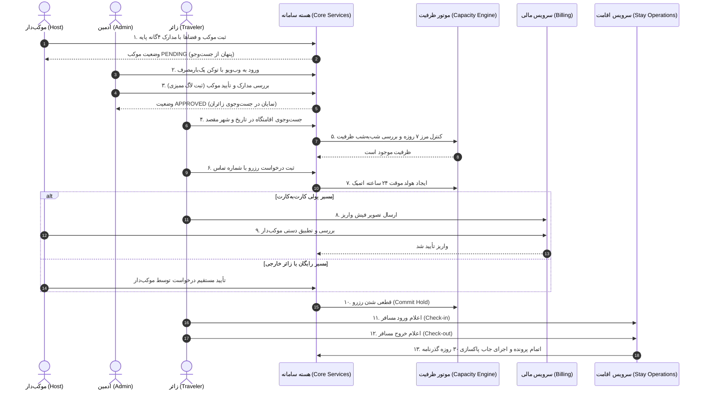

# MASTER-23 — آزمون‌های سرتاسری یکپارچه و پذیرش نهایی سامانه (E2E Acceptance)

**تاریخ تدوین:** 2026-10-18  
**وضعیت:** IMPLEMENTATION (فاز اول محلی)  
**والدها:**  
- [MASTER_10_END_TO_END_ACCEPTANCE.md](file:///z:/rezervasiyon-BOT-TEL/docs/ai/masters/MASTER_10_END_TO_END_ACCEPTANCE.md)  
- [ROOT_MASTER.md](file:///z:/rezervasiyon-BOT-TEL/docs/ai/ROOT_MASTER.md)  
- [RESERVATION_LIFECYCLE.md](file:///z:/rezervasiyon-BOT-TEL/docs/ai/domains/RESERVATION_LIFECYCLE.md)  
**تصمیم‌های مرتبط:** DEC-0001 تا DEC-0044  

---

## ۱. هدف و دامنه اجرایی

این مستر آزمون‌های یکپارچه سرتاسری (End-to-End Acceptance) را تدوین و اجرا می‌کند که تمامی ماژول‌های توسعه‌یافته فاز اول محلی را در سناریوهای واقعی و به هم پیوسته مورد آزمون قرار می‌دهند:
1. ثبت نام موکب با ۴ مدرک استاندارد (DEC-0041) و تفکیک اتاق‌ها و سالن‌ها.
2. احراز هویت وب‌ویو ادمین با توکن جادویی، بررسی مدارک و تأیید موکب با لاگ ممیزی (DEC-0004, DEC-0028).
3. اتصال حساب تلگرام و بله با کد یک‌بارمصرف ۲۴ ساعته (DEC-0040) و ورود اولیه بدون شماره تلفن (DEC-0043).
4. استعلام ظرفیت و اعمال مرز ۷ روزه به وقت مقصد (DEC-0033/34) و شمارش همه کودکان در ظرفیت (DEC-0027).
5. اجرای ۴ مسیر رزرو زائر (فوری/دستی × رایگان/پولی) و مسیر زائر خارجی با گذرنامه و ارجاع به موکب‌دار (DEC-0032).
6. سیستم مالی کارت‌به‌کارت، ارسال فیش، تطبیق دستی موکب‌دار و ممنوعیت مداخله مالی ادمین (DEC-0012).
7. عملیات ورود (Check-in)، خروج (Check-out)، ثبت لغو ۲۴ ساعته (DEC-0025)، عدم حضور و پاکسازی ۳۰ روزه گذرنامه (DEC-0036).
8. درگاه‌های پیام‌رسان تلگرام و بله با مهار پیام تکراری (Idempotency) و ارسال امن اعلان‌ها (DEC-0016).

---

## ۲. نبایدها (قواعد بازدارنده قطعی)

1. **نباید** هیچ تستی بدون اجرای واقعی در محیط محلی وضعیت `PASS` دریافت کند.
2. **نباید** در جریان آزمون از داده‌های واقعی، گذرنامه‌های واقعی یا شماره‌کارت‌های حقیقی استفاده شود (منحصراً داده ساختگی Mock).
3. **نباید** هیچ دستوری روی سرور VPS اجرا شود؛ تمام سناریوها در محیط ایزوله محلی اجرا می‌شوند (DEC-0044).
4. **نباید** هیچ نقضی در مرزهای مصوب DEC رخ دهد (به‌ویژه عدم وجود بازپرداخت DEC-0021، عدم تأیید فیش توسط ادمین DEC-0012، و حذف گذرنامه پس از ۳۰ روز DEC-0036).

---

## ۳. گراف جریان پذیرش سرتاسری (Mermaid Diagram)

---

## ۴. معیارهای پذیرش سرتاسری و پیاده‌سازی آزمون‌ها

| شناسه | عنوان سناریو سرتاسری | انتظار قطعی | پیاده‌سازی و آزمون | وضعیت |
|---|---|---|---|---|
| E2E-SC01 | سفر کامل زائر در مسیر فوری و رایگان با ثبت موکب و تأیید ادمین | از ثبت موکب تا ورود و خروج مسافر با حفظ پیوستگی کامل و قطعی شدن آنی ظرفیت | [`src/tests/e2e_acceptance.test.ts#L79-L163`](file:///z:/rezervasiyon-BOT-TEL/src/tests/e2e_acceptance.test.ts#L79-L163) | PASS (واقعی با Bun Test) |
| E2E-SC02 | سفر کامل زائر در مسیر پولی کارت‌به‌کارت با ارسال فیش و تأیید موکب‌دار | طی گام‌های واریز، تطبیق دستی موکب‌دار، نهایی شدن رزرو و عدم دخالت ادمین | [`src/tests/e2e_acceptance.test.ts#L168-L235`](file:///z:/rezervasiyon-BOT-TEL/src/tests/e2e_acceptance.test.ts#L168-L235) | PASS (واقعی با Bun Test) |
| E2E-SC03 | سناریوی زائر خارجی: بدون درخواست وجه، با گذرنامه و پاکسازی ۳۰ روزه | ارجاع به موکب‌دار، فاقد مبلغ در سامانه، و پاکسازی قطعی تصویر گذرنامه پس از ۳۰ روز | [`src/tests/e2e_acceptance.test.ts#L240-L304`](file:///z:/rezervasiyon-BOT-TEL/src/tests/e2e_acceptance.test.ts#L240-L304) | PASS (واقعی با Bun Test) |
| E2E-SC04 | رقابت هم‌زمان دو کانال تلگرام و بله برای آخرین ظرفیت (Overbooking Check) | یک کاربر موفق و کاربر دوم با وضعیت عدم ظرفیت مواجه شود؛ بدون منفی شدن ظرفیت | [`src/tests/e2e_acceptance.test.ts#L310-L368`](file:///z:/rezervasiyon-BOT-TEL/src/tests/e2e_acceptance.test.ts#L310-L368) | PASS (واقعی با Bun Test) |
| E2E-SC05 | اتصال حساب دو پیام‌رسان با کد ۲۴ ساعته و رزروهای هم‌پوشان چندگانه | مشاهده رزروهای ثبت‌شده در هر دو پیام‌رسان و پذیرش چند رزرو هم‌زمان برای افراد مختلف | [`src/tests/e2e_acceptance.test.ts#L372-L437`](file:///z:/rezervasiyon-BOT-TEL/src/tests/e2e_acceptance.test.ts#L372-L437) | PASS (واقعی با Bun Test) |
| E2E-SC06 | کنترل دقیق مرز ۷ روزه و مرز ۲۴ ساعته لغو و عدم امکان ثبت پس از مرز | رد رزرو با کمتر از ۷ روز مانده به ورود و لغو موفق پیش از ۲۴ ساعت با آزادسازی فوری ظرفیت | [`src/tests/e2e_acceptance.test.ts#L441-L504`](file:///z:/rezervasiyon-BOT-TEL/src/tests/e2e_acceptance.test.ts#L441-L504) | PASS (واقعی با Bun Test) |

