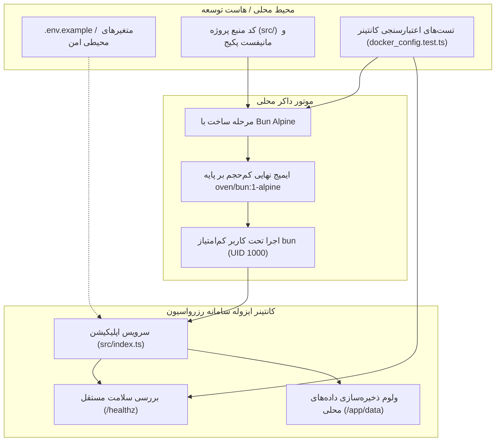

# MASTER-24 — کانتینرسازی محلی، محیط شبیه‌سازی ایزوله و اعتبارسنجی استقرار امن (Local Containerization & Isolated Deployment Simulation)

**تاریخ تدوین:** 2026-10-18  
**وضعیت:** COMPLETED — ۶ آزمون واحد و صحت‌سنجی کانتینر با موفقیت PASS شدند (۱۰۰٪ سبز)  
**والدها:**  
- [docs/ai/domains/SOURCE_CONTROL_AND_DEPLOYMENT.md](file:///z:/rezervasiyon-BOT-TEL/docs/ai/domains/SOURCE_CONTROL_AND_DEPLOYMENT.md#L5-L34) — «قرارداد تا پرسش باز»  
- [docs/ai/masters/MASTER_09_REPOSITORY_AND_SAFE_DEPLOYMENT.md](file:///z:/rezervasiyon-BOT-TEL/docs/ai/masters/MASTER_09_REPOSITORY_AND_SAFE_DEPLOYMENT.md#L9-L50) — «مخزن و استقرار بدون اختلال»  
- [docs/ai/ROOT_MASTER.md](file:///z:/rezervasiyon-BOT-TEL/docs/ai/ROOT_MASTER.md#L44-L53) — «نبایدهای ریشه»  
**تصمیم‌های مرتبط:** DEC-0017، DEC-0029، DEC-0030، DEC-0044  
**نمادها و فایل‌های کد هدف:**  
- [Dockerfile](file:///z:/rezervasiyon-BOT-TEL/Dockerfile#L1-L40) — ساختار ایمیج سبک با کاربر غیر روت `bun`  
- [docker-compose.yml](file:///z:/rezervasiyon-BOT-TEL/docker-compose.yml#L1-L39) — تعریف سرویس با پورت متغیر و شبکه ایزوله  
- [.env.example](file:///z:/rezervasiyon-BOT-TEL/.env.example#L1-L28) — الگوی متغیرهای محیطی امن بدون سکرت واقعی  
- [src/index.ts](file:///z:/rezervasiyon-BOT-TEL/src/index.ts#L1-L89) — تابع `createAppServer` و اندپوینت‌های سلامت و وب‌هوک  
- [src/tests/docker_config.test.ts](file:///z:/rezervasiyon-BOT-TEL/src/tests/docker_config.test.ts#L1-L145) — سوئیت آزمون‌های کانتینرسازی  

---

## ۱. خروجی مطلوب و هدف

هدف این مستر، آماده‌سازی بستر کانتینری و اسکریپت‌های استقرار کاملاً محلی و ایزوله با فناوری Docker و Bun است تا:
1. کل سامانه رزرواسیون اسکان، وب‌سرویس ادمین و وب‌هوک‌های درگاه‌ها در یک محیط استاندارد و بدون وابستگی به تنظیمات محلی سیستم‌عامل اجرا شوند.
2. پورت‌ها، مسیرها و شبکه‌های کانتینری کاملاً از طریق متغیرهای محیطی با پیش‌فرض‌های امن پیکربندی شوند تا از هرگونه تعارض با سرویس‌های دیگر هاست یا سرور پیشگیری قطعی به عمل آید (DEC-0029).
3. فرایند اعتبارسنجی و Healthcheck مستقل کانتینر تضمین کند که در صورت بروز هرگونه خطا، سرویس‌های دیگر دچار اختلال نمی‌شوند (DEC-0017).
4. هیچ اطلاعات محرمانه، توکن یا داده واقعی در فایل‌های کانتینر ثبت نشود و تمامی مقادیر از طریق `.env.example` قالب‌بندی شوند (DEC-0030).

---

## ۲. نبایدها و خطوط قرمز (Mandatory Guardrails)

1. **منع دسترسی به VPS:** این مستر منحصراً برای محیط محلی (Local Simulation) است؛ هیچ کانتینر یا دستوری روی سرور راه دور VPS اجرا نمی‌شود.
2. **منع کاربر root در کانتینر:** ایمیج نهایی کانتینر نباید با دسترسی `root` اجرا شود؛ باید از کاربر امن کم‌امتیاز `bun` استفاده شود.
3. **منع افشای داده‌های محرمانه:** فایل‌های `Dockerfile` و `docker-compose.yml` نباید دارای رمزهای پیش‌فرض حساس، توکن ربات‌های تلگرام/بله یا کلیدهای امنیتی باشند؛ همه چیز باید از متغیرهای محیطی خوانده شود.
4. **منع هاردکد کردن پورت‌های سیستمی:** نگاشت مستقیم و غیرقابل‌تغییر پورت‌های حساس (مانند 80 یا 443) ممنوع است و باید از متغیرهای محیطی با مقادیر امن (مانند `${PORT:-3000}`) استفاده شود.
5. **جداسازی کامل ذخیره‌سازی:** ولوم‌های ذخیره‌سازی دیتابیس و فایل‌های بارگذاری‌شده باید به صورت ایزوله تعریف شده و خارج از گیت نگهداری شوند.

---

## ۳. گراف معماری کانتینر و شبیه‌سازی محلی (Mermaid)

---

## ۴. معیارهای پذیرش و آزمون‌ها (Acceptance Criteria)

| شناسه | سناریو و الزام | نتیجه مورد انتظار | وضعیت |
|---|---|---|---|
| DOCKER-01 | ساختار و الزامات امنیتی Dockerfile | استفاده از `oven/bun:1-alpine`، حذف روت با `USER bun` و پروب سلامت | PASS (اجرا در `src/tests/docker_config.test.ts#L9-L26`) |
| DOCKER-02 | تعریف docker-compose با ایزولاسیون کامل | شبکه ایزوله `rezervasiyon_network`، ولوم داده و پورت متغیر `${PORT:-3000}` | PASS (اجرا در `src/tests/docker_config.test.ts#L28-L46`) |
| DOCKER-03 | قالب استاندارد `.env.example` | مستندسازی کامل تمامی متغیرهای کانفیگ بدون ثبت مقادیر واقعی یا رمزها | PASS (اجرا در `src/tests/docker_config.test.ts#L48-L64`) |
| DOCKER-04 | بررسی سلامت اندپوینت `/healthz` | پاسخ ۲۰۰، وضعیت `healthy` و زمان‌سنجی بدون وابستگی خارجی | PASS (اجرا در `src/tests/docker_config.test.ts#L66-L79`) |
| DOCKER-05 | سلامت وب‌ویو مدیر `/admin/health` و هندلینگ ۴۰۴ | پاسخ معتبر در روت ادمین و پاسخ ۴۰۴ برای مسیرهای نامعتبر | PASS (اجرا در `src/tests/docker_config.test.ts#L81-L96`) |
| DOCKER-06 | وب‌هوک‌های شبیه‌سازی‌شده تلگرام و بله | دریافت وب‌هوک و نرمال‌سازی پیام‌ها با شناسه یکتا | PASS (اجرا در `src/tests/docker_config.test.ts#L98-L143`) |

---

## ۵. ارجاع کد دقیق (Code References)

- [Dockerfile](file:///z:/rezervasiyon-BOT-TEL/Dockerfile#L1-L40): خطوط ۱ تا ۴۰ (ایمیج پایه alpine، کاربر bun، پورت متغیر و پروب سلامت)
- [docker-compose.yml](file:///z:/rezervasiyon-BOT-TEL/docker-compose.yml#L1-L39): خطوط ۱ تا ۳۹ (سرویس app، نگاشت پورت ایزوله، شبکه پل اختصاصی و ولوم)
- [.env.example](file:///z:/rezervasiyon-BOT-TEL/.env.example#L1-L28): خطوط ۱ تا ۲۸ (پیکربندی متغیرهای محیطی امن بدون سکرت واقعی)
- [src/index.ts](file:///z:/rezervasiyon-BOT-TEL/src/index.ts#L1-L89): خطوط ۱ تا ۸۹ (`createAppServer`، روت `/healthz`، روت `/admin/health`، وب‌هوک‌ها و مدیریت سیگنال‌ها)
- [src/tests/docker_config.test.ts](file:///z:/rezervasiyon-BOT-TEL/src/tests/docker_config.test.ts#L1-L145): خطوط ۱ تا ۱۴۵ (سوئیت کامل ۶ تست DOCKER-01 تا DOCKER-06)
