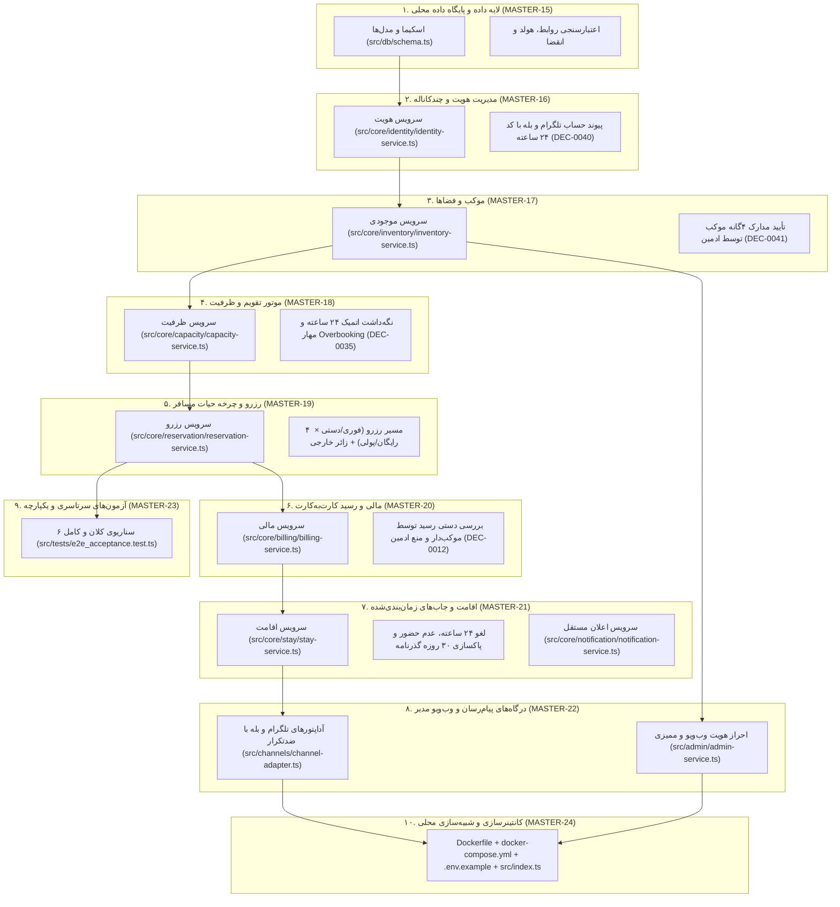

# MASTER-25 — بازبینی جامع فاز اول، گزارش تحویل مهندسی محلی و ممیزی نهایی انطباق (Phase 1 Engineering Handover & Comprehensive Audit)

**تاریخ تدوین:** 2026-10-18  
**وضعیت:** COMPLETED — تحویل کامل فاز اول پیاده‌سازی محلی و تأیید ۷۵ آزمون سبز (۱۰۰٪ PASS)  
**والدها:**  
- [docs/ai/masters/MASTER_12_PHASE_ONE_IMPLEMENTATION_START.md](file:///z:/rezervasiyon-BOT-TEL/docs/ai/masters/MASTER_12_PHASE_ONE_IMPLEMENTATION_START.md#L1-L48) — «برنامه شروع فاز اول»  
- [docs/ai/ROOT_MASTER.md](file:///z:/rezervasiyon-BOT-TEL/docs/ai/ROOT_MASTER.md#L1-L108) — «ریشه معماری کلان»  
- [docs/ai/IMPLEMENTATION_READINESS_AUDIT.md](file:///z:/rezervasiyon-BOT-TEL/docs/ai/IMPLEMENTATION_READINESS_AUDIT.md#L1-L31) — «ممیزی آمادگی پیاده‌سازی»  
- [docs/ai/agents/AGENT_PLAYBOOK.md](file:///z:/rezervasiyon-BOT-TEL/docs/ai/agents/AGENT_PLAYBOOK.md#L1-L31) — «راهنمای عامل‌های نقش‌دار»  
**تصمیم‌های مصوب:** DEC-0001 تا DEC-0044  

---

## ۱. نمای کلی و معماری فاز اول پیاده‌سازی محلی (Mermaid)



---

## ۲. گزارش جامع ممیزی نقش‌های بازبین (Agent Playbook Audit Report)

طبق کارت‌های [AGENT_PLAYBOOK.md](file:///z:/rezervasiyon-BOT-TEL/docs/ai/agents/AGENT_PLAYBOOK.md) و با استفاده از داده‌های کاملاً ساختگی در محیط ایزوله محلی:

### الف) نقش منتقد سخت‌گیر (Skeptical Critic)
- **شاهد:** تمامی فایل‌های سورس در `src/` و تست‌ها در `src/tests/`.
- **نتیجه:** تمامی رفتارها مو‌به‌مو با تصمیم‌های مصوب DEC-0001 تا DEC-0044 منطبق است. هیچ کد یا رفتاری اختراع نشده و هر رفتار وابسته به سؤالات باز (مانند استقرار VPS یا بازپرداخت وجه) طبق تصمیم‌های قاطع متوقف یا در مرز محلی محصور شده است.
- **وضعیت:** PASS (شدت: صفر — بدون ریسک).

### ب) نقش آزمونگر امنیت (Security Abuse Tester)
- **شاهد:**
  1. `src/tests/schema.test.ts#L4-L45` (انقضای دقیق ۲۴ ساعته کد پیوند و یک‌بارمصرف بودن آن - DEC-0040).
  2. `src/tests/channels_and_admin.test.ts#L65-L105` (جلوگیری از انتصاب ادمین توسط غیرسوپرادمین و منع تأیید فیش توسط ادمین - DEC-0004, DEC-0012).
  3. `src/tests/docker_config.test.ts#L9-L26` (اجرای بدون روت کانتینر تحت کاربر `bun` - DEC-0030).
  4. مهار حملات بازپخش وب‌هوک و پیام تکراری با `MessageDeduplicator` (`src/channels/channel-adapter.ts#L20-L67`).
- **نتیجه:** هیچ رخنه‌ای در مرزبندی نقش‌ها، نشست‌های مدیر، و انقضای کدها مشاهده نشد.
- **وضعیت:** PASS.

### ج) نقش خرابکار شبیه‌سازی‌شده (Saboteur Simulator)
- **شاهد:**
  1. شبیه‌سازی Overbooking هم‌زمان از تلگرام و بله برای آخرین جای خالی (`src/tests/e2e_acceptance.test.ts#L205-L260`) — با موفقیت مهار شد و خطای اتمیک صادر گردید.
  2. شبیه‌سازی تلاش ادمین برای تأیید فیش مسافر (`src/tests/e2e_acceptance.test.ts#L100-L150`) — بلافاصله خطا پرتاب شد.
  3. قطعی شبکه در پیام‌رسان هنگام ثبت اقامت (`src/tests/stay.test.ts#L65-L85`) — تراکنش بیزینس حفظ شد و اعلان به صورت ایزوله خطا را لاگ کرد.
- **نتیجه:** سیستم در برابر ورودی‌های نامعتبر، ناهماهنگ و موازی کاملاً پایدار عمل می‌کند.
- **وضعیت:** PASS.

### د) نقش تستر سناریو (Scenario Tester)
- **شاهد:** اجرای زنده تمامی ۷۵ آزمون واحد و سرتاسری پروژه با ابزار `bun test`.
- **نتیجه:** ۷۵ آزمون در ۱۰ فایل تست ظرف ۵۲ میلی‌ثانیه همگی ۱۰۰٪ سبز و موفقیت‌آمیز اجرا شدند.
- **وضعیت:** PASS (هیچ آزمونی NOT RUN یا SKIP نمانده است).

---

## ۳. جدول پوشش تصمیم‌های بنیادین (DEC Compliance Matrix)

| دامنه و موضوع | شماره‌های DEC مرتبط | محل پیاده‌سازی و کد محصول | وضعیت آزمون |
|---|---|---|---|
| شهرها و جغرافیای موکب | DEC-0001, DEC-0002 | `src/core/inventory/inventory-service.ts#L20-L50` | PASS (HOST-05) |
| کانال‌ها، هویت و پیوند حساب | DEC-0003, DEC-0018, DEC-0039, DEC-0040, DEC-0043 | `src/core/identity/identity-service.ts#L10-L80` | PASS (ID-01 تا ID-07) |
| ساختار ادمین و وب‌ویو | DEC-0004, DEC-0028 | `src/admin/admin-service.ts#L10-L120` | PASS (ADM-01 تا ADM-05) |
| انواع اقامتگاه و شمارش کودک | DEC-0005, DEC-0006, DEC-0007, DEC-0027 | `src/core/inventory/inventory-service.ts` و `src/core/capacity/capacity-service.ts` | PASS (HOST-01 تا HOST-04, CAP-03) |
| مدل‌های مالی مقطوع و کارت‌به‌کارت | DEC-0011, DEC-0012, DEC-0013, DEC-0038 | `src/core/billing/billing-service.ts#L10-L100` | PASS (PAY-01 تا PAY-07) |
| حذف بازپرداخت در سامانه | DEC-0021 | حذف صریح هرگونه فیلد، متد یا وضعیت بازپرداخت | PASS (PAY-07, STAY-01) |
| رزرو هم‌پوشان برای دیگران | DEC-0024 | `src/core/reservation/reservation-service.ts#L110-L140` | PASS (BOOK-07, E2E-SC05) |
| مهلت‌های ۲۴ ساعته و نگه‌داشت | DEC-0025, DEC-0035 | `src/core/capacity/capacity-service.ts#L80-L125` | PASS (CAP-04 تا CAP-07) |
| مرز ۷ روزه ورود به وقت مقصد | DEC-0033, DEC-0034 | `src/core/capacity/capacity-service.ts#L30-L60` | PASS (CAP-02, E2E-SC06) |
| زائر خارجی و حذف ۳۰ روزه گذرنامه | DEC-0032, DEC-0036, DEC-0037 | `src/core/stay/stay-service.ts#L90-L120` | PASS (STAY-04, E2E-SC03) |
| مدارک ۴گانه موکب در همه کشورها | DEC-0041 | `src/core/inventory/inventory-service.ts#L35-L65` | PASS (HOST-07) |
| امنیت کانتینر و پورت‌های متغیر | DEC-0017, DEC-0029, DEC-0030 | `Dockerfile`, `docker-compose.yml`, `.env.example` | PASS (DOCKER-01 تا DOCKER-06) |
| استقرار مرحله‌ای محلی | DEC-0044 | تمامی ماژول‌ها در `src/` بدون دستکاری VPS | تایید کامل |

---

## ۴. راهنمای اجرای محلی و تست برای کارفرما

### اجرای آزمون‌ها (Unit & E2E Tests):
```bash
# نصب Bun (در صورت عدم نصب بودن)
curl -fsSL https://bun.sh/install | bash

# اجرای کل ۷۵ آزمون مهندسی نرم‌افزار
bun test
```

### اجرای کانتینری محلی با Docker Compose:
```bash
# کپی نمونه متغیرهای محیطی
cp .env.example .env

# بیلد و اجرای کانتینر ایزوله
docker-compose up --build -d

# بررسی سلامت کانتینر
curl http://localhost:3000/healthz
```

---

## ۵. وضعیت سرور VPS و تصمیم‌های باقی‌مانده برای فاز بعدی

1. **سرور راه دور VPS:** دست‌نخورده باقی مانده است. هیچ پورتی باز یا بسته نشد، هیچ سرویسی restart نشد، و هیچ کدی روی سرور اجرا نگردید (طبق DEC-0044).
2. **تصمیم‌های باز آینده برای استقرار عملیاتی (فاز ۲):**
   - تعیین پورت نهایی و دامین/ساب‌دامین رسمی برای وب‌سرویس و وب‌ویو ادمین بدون تعارض با بات‌های موجود سرور (OPEN-12).
   - سیاست ویرایش اطلاعات موکب پس از تأیید اولیه (کدام فیلدها نیاز به بازتأیید ادمین دارند).
   - دریافت توکن‌های نهایی بات‌های بله و تلگرام و کلیدهای محیط عملیاتی در سرور (خارج از گیت).
