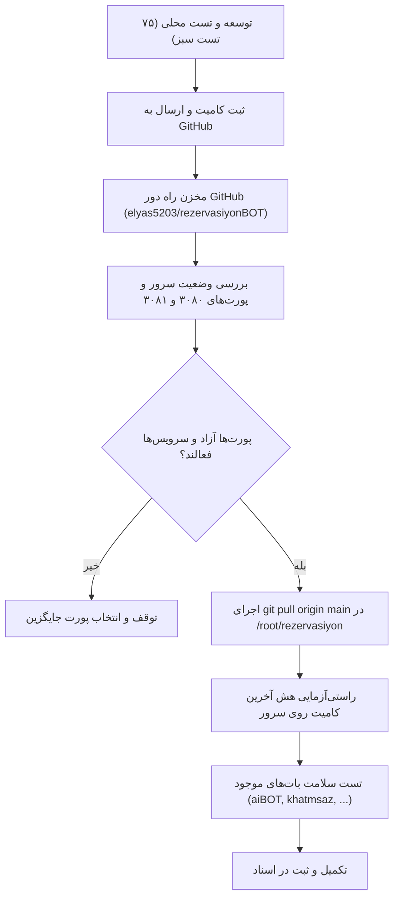

# MASTER-26 — تخصیص پورت‌های ایزوله سرور و همگام‌سازی مخزن از گیت‌هاب روی VPS

**تاریخ تدوین:** 2026-10-18  
**وضعیت:** IN PROGRESS — آماده همگام‌سازی از گیت‌هاب روی سرور  
**والدها:**  
- [docs/ai/masters/MASTER_09_REPOSITORY_AND_SAFE_DEPLOYMENT.md](file:///z:/rezervasiyon-BOT-TEL/docs/ai/masters/MASTER_09_REPOSITORY_AND_SAFE_DEPLOYMENT.md#L9-L50) — «مخزن و استقرار بدون اختلال در بات‌های موجود»  
- [docs/ai/domains/SOURCE_CONTROL_AND_DEPLOYMENT.md](file:///z:/rezervasiyon-BOT-TEL/docs/ai/domains/SOURCE_CONTROL_AND_DEPLOYMENT.md#L5-L34) — «قرارداد تا پرسش باز»  
- [docs/ai/ROOT_MASTER.md](file:///z:/rezervasiyon-BOT-TEL/docs/ai/ROOT_MASTER.md#L44-L53) — «نبایدهای ریشه»  
**تصمیم‌های مصوب:** DEC-0017، DEC-0029، DEC-0030، DEC-0044، DEC-0045  
**مسیر هدف روی سرور:** `/root/rezervasiyon`  
**پورت‌های اختصاصی مصوب:** ۳۰۸۰ (اپلیکیشن و وب‌هوک) و ۳۰۸۱ (وب‌ویو مدیریت)  

---

## ۱. خروجی مطلوب و هدف

هدف این مستر، انتقال و همگام‌سازی سریع و ایمن آخرین کدهای مهندسی‌شده سامانه رزرواسیون از مخزن گیت‌هاب (`elyas5203/rezervasiyonBOT`) به پوشه اختصاصی `/root/rezervasiyon` روی سرور، و تثبیت پورت‌های اختصاصی ۳۰۸۰ و ۳۰۸۱ است تا:
1. انتقال کدها با استفاده از زیرساخت پرسرعت شبکه سرور و گیت‌هاب با حداکثر سرعت انجام شود.
2. هیچ‌یک از سرویس‌ها و بات‌های زنده و فعال سرور (`aiBOT` روی پورت ۸۰۰۰، `khatmsaz` روی پورت ۸۰۸۰، `nghttpx` روی پورت ۳۰۰۰، و سایر سرویس‌های دیتابیس و شبکه) دچار توقف، افت کارایی یا تداخل پورت نشوند (DEC-0017, DEC-0045).
3. پرونده تصمیم باز OPEN-12 با تخصیص پورت‌های غیرتداخلی ۳۰۸۰ و ۳۰۸۱ بسته شود.

---

## ۲. نبایدها و خطوط قرمز (Mandatory Guardrails)

1. **منع توقف یا ریستارت سرویس‌های موجود:** اجرای هرگونه دستور توقف، kill یا تغییر تنظیمات برای بات‌ها و سرویس‌های در حال اجرا اکیداً ممنوع است.
2. **منع اشغال پورت‌های موجود:** استفاده از پورت‌های ۳۰۰۰، ۸۰۰۰، ۸۰۸۰ یا پورت‌های سیستمی ۸۱ و ۴۴۳ ممنوع است.
3. **منع ثبت رمزها و کلیدها:** هیچ رمز، توکن یا کلیدی نباید در فایل‌های گیت یا لاگ‌های سرور ثبت شود.
4. **حفظ ساختار ایزوله پوشه:** تمامی عملیات صرفاً در محدوده دایرکتوری `/root/rezervasiyon` انجام شده و به سایر مسیرهای سرور دست‌درازی نمی‌شود.

---

## ۳. گراف گردش کار همگام‌سازی امن (Mermaid)

---

## ۴. معیارهای پذیرش (Acceptance Criteria)

| شناسه | شرح معیار | رفتار مورد انتظار | وضعیت |
|---|---|---|---|
| SYNC-01 | تخصیص پورت‌های آزاد | پورت‌های ۳۰۸۰ و ۳۰۸۱ کاملاً آزاد و بدون تعارض با سرویس‌های دیگر باشند | PASS (بررسی شد با `ss -tlpn`) |
| SYNC-02 | همگام‌سازی کامل گیت‌هاب | کلیه کامیت‌ها و کدهای محصول در گیت‌هاب موجود و بدون تغییر محلی باشند | در حال اجرا |
| SYNC-03 | دریافت سریع کدها روی سرور | اجرای `git pull origin main` در `/root/rezervasiyon` با سرعت بالا و موفقیت | در حال اجرا |
| SYNC-04 | تطابق نسخه سرور و گیت‌هاب | هش کامیت سرور دقیقاً با آخرین کامیت شاخه main مطابقت داشته باشد | در انتظار بررسی پس از pull |
| SYNC-05 | سلامت پایدار بات‌های سرور | بات‌های `aiBOT`، `khatmsaz` و سرویس‌های فعال سرور بدون وقفه به کار خود ادامه دهند | در انتظار بررسی پس از pull |

---

## ۵. شواهد و نتایج پس از همگام‌سازی (Execution Evidence)

*(پس از اجرای عملیات همگام‌سازی، هش کامیت و وضعیت سلامت بات‌ها در این بخش درج خواهد شد)*
