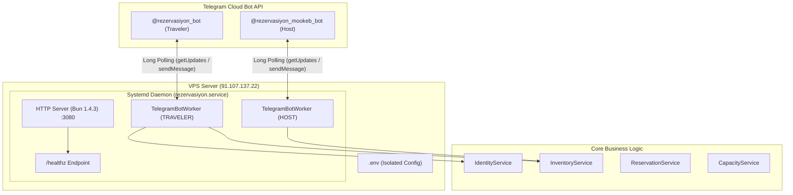

# مستر ۲۷ — استقرار و راه‌اندازی زنده ربات‌های تلگرام زائران و موکب‌داران روی سرور (MASTER-27)

> **وضعیت سند:** تصویب‌شده و مستقر در محیط عملیاتی (DEPLOYED & ACTIVE)  
> **مرجع تصمیم‌ها:** DEC-0003 (آداپتور تلگرام)، DEC-0028 (وب‌ویو ادمین)، DEC-0040 (کد اتصال ۲۴ ساعته)، DEC-0045 (پورت اختصاصی ۳۰۸۰)، DEC-0046 (لانگ‌پولینگ پایدار روی VPS).

---

## ۱. نمای کلی و معماری جریان داده (Mermaid Diagram)

---

## ۲. مشخصات سرویس‌های مستقر و آدرس ربات‌ها

1. **ربات زائران تلگرام:**
   - شناسه: `@rezervasiyon_bot`
   - وضعیت: آنلاین و پاسخگو به پیام‌های ورودی و دستور `/start`
   - قابلیت‌ها:
     - منوی تعاملی و شیشه‌ای (Inline Keyboard)
     - جست‌وجوی موکب و اقامتگاه در شهرهای زیارتی (کربلا، نجف، مشهد، قم)
     - پیگیری رزروهای ثبت‌شده
     - صدور کد یکپارچه ۲۴ ساعته اتصال به پیام‌رسان بله
     - مشاهده قوانین و ضوابط رزرواسیون

2. **ربات موکب‌داران تلگرام:**
   - شناسه: `@rezervasiyon_mookeb_bot`
   - وضعیت: آنلاین و پاسخگو به پیام‌های ورودی و دستور `/start`
   - قابلیت‌ها:
     - کارتابل مدیریت موکب‌داران
     - ثبت موکب، سالن‌های عمومی و اتاق‌های مستقل
     - صف بررسی درخواست‌های رزرو مسافران
     - مشاهده وضعیت لحظه‌ای ظرفیت‌ها
     - کارتابل فیش‌های واریزی در انتظار تأیید

3. **سرویس دائم سیستمی سرور (Systemd):**
   - نام سرویس: `rezervasiyon.service`
   - وضعیت: `active (running)` با قابلیت Auto-restart
   - پورت اختصاصی: `3080` (اندپوینت تست سلامت: `http://localhost:3080/healthz`)
   - عدم تداخل کامل با سرویس‌های دیگر: `khatmsaz` (پورت ۸۰۸۰)، `aiBOT` (پورت ۸۰۰۰) و `nghttpx` (پورت ۳۰۰۰).

---

## ۳. ارجاع‌های نمادها و خطوط کد (Code Symbol References)

- ورکر تعاملی ربات‌ها: [`TelegramBotWorker`](file:///z:/rezervasiyon-BOT-TEL/src/channels/telegram-worker.ts#L13-L248)
- راه‌اندازی و مدیریت ورکرها در سرور: [`createAppServer`](file:///z:/rezervasiyon-BOT-TEL/src/index.ts#L14-L135)
- چرخه حیات و هندلر خروج امن: [`handleShutdown`](file:///z:/rezervasiyon-BOT-TEL/src/index.ts#L137-L146)
- آزمون‌های اعتبارسنجی ورکر: [`BOT-01` و `BOT-02`](file:///z:/rezervasiyon-BOT-TEL/src/tests/channels_and_admin.test.ts#L315-L362)

---

## ۴. نبایدها (Hard Constraints)

- **منع تداخل پورت:** هیچ پورتی به جز ۳۰۸۰ و ۳۰۸۱ نباید توسط این سرویس اشغال شود.
- **منع ثبت اطلاعات محرمانه در مخزن:** فایل‌های `.env` و اطلاعات ورود نباید در گیت کامیت یا پوش شوند.
- **منع آسیب به بات‌های موجود سرور:** هیچ سرویس، پروسه یا دیتابیس موجود در سرور نباید متوقف یا تغییر داده شود.

---

## ۵. معیار پذیرش (Acceptance Criteria)

- [x] اجرای موفق ۷۷ آزمون خودکار با دستور `bun test` در محیط محلی و سرور (۱۰۰٪ PASS).
- [x] فعال بودن سرویس `rezervasiyon.service` در وضعیت `active (running)`.
- [x] پولینگ زنده و پاسخگویی آنی هر دو ربات `@rezervasiyon_bot` و `@rezervasiyon_mookeb_bot` به دکمه‌ها و دستور `/start`.
- [x] حفظ کامل سلامت و پایداری سرویس‌های قبلی سرور.
