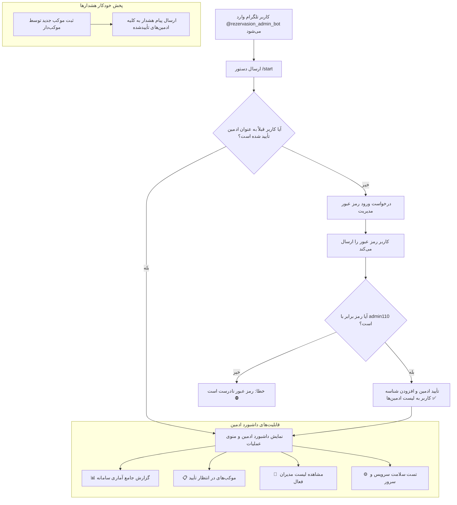

# مستر ۲۸ — ربات تلگرام ادمین، احراز هویت با رمز عبور و پخش گزارش‌ها (MASTER-28)

> **وضعیت سند:** در حال پیاده‌سازی و استقرار (IN PROGRESS)  
> **مرجع تصمیم‌ها:** DEC-0004 (تأیید موکب با مدیر)، DEC-0012 (منع تأیید فیش توسط ادمین)، DEC-0028 (ابزار مدیریت)، DEC-0045 (پورت اختصاصی ۳۰۸۰)، DEC-0046 (لانگ‌پولینگ تلگرام)، DEC-0047 (ربات ادمین و رمز عبور).

---

## ۱. هدف و دامنه کار

راه‌اندازی ربات سوم تلگرام با نقش **مدیریت سامانه (ADMIN)** تحت یوزرنیم `@rezervasion_admin_bot`:
1. **احراز هویت ادمین:** هر کاربری پس از ارسال دستور `/start`، ملزم به وارد کردن رمز عبور مصوب (`admin110` / `ADMIN_SECRET_KEY`) است. در صورت تطابق، کاربر به لیست ادمین‌های تأییدشده افزوده می‌شود.
2. **داشبورد و گزارش‌های مدیریتی:** ارائه گزارش آماری وضعیت موکب‌ها، اتاق‌ها، رزروها و سلامت سرور.
3. **کارتابل موکب‌ها:** امکان مشاهده موکب‌های جدید در انتظار بررسی (`PENDING`) و تأیید یا رد آنها همراه با ثبت دلیل مستند.
4. **پخش خودکار رویدادها (Broadcast):** ارسال لحظه‌ای اعلانات ثبت موکب‌های جدید یا گزارش‌های مهم برای تمام ادمین‌های تأییدشده.

---

## ۲. گراف جریان احراز هویت و عملیات ربات ادمین (Mermaid Diagram)

---

## ۳. نبایدهای مستر ۲۸ (Hard Constraints)

1. **عدم هاردکد کردن توکن و پسورد در گیت:** توکن تلگرام و رمز عبور نباید در فایل‌های عمومی گیت یا تست‌ها قرار گیرند؛ مقدار پیش‌فرض امن از طریق متغیر محیطی خوانده می‌شود.
2. **منع دخالت ادمین در تأیید فیش مسافر (DEC-0012):** ادمین تحت هیچ شرایطی حق تأیید یا رد فیش کارت‌به‌کارت را ندارد (منحصراً اختیار موکب‌دار است).
3. **عدم اختلال در بات‌های زائر و موکب‌دار:** ورکر ادمین باید کاملاً موازی و ایزوله با دو ورکر دیگر اجرا شود.

---

## ۴. معیار پذیرش (Acceptance Criteria)

- [ ] پیاده‌سازی کلاس `AdminBotWorker` یا توسعه `TelegramBotWorker` برای پشتیبانی از نقش `ADMIN`.
- [ ] اعتبارسنجی رمز عبور `admin110` و ثبت خودکار در لیست ادمین‌ها.
- [ ] بازگرداندن گزارش آماری موکب‌ها و رزروها با دکمه یا کامند.
- [ ] عبور موفق ۱۰۰٪ تمام تست‌های واحد با دستور `bun test`.
- [ ] استقرار روی سرور و راه‌اندازی زنده ربات `@rezervasion_admin_bot` در کنار دو ربات دیگر.
- [ ] عدم تداخل با پورت‌ها یا سرویس‌های فعال قبلی سرور.
