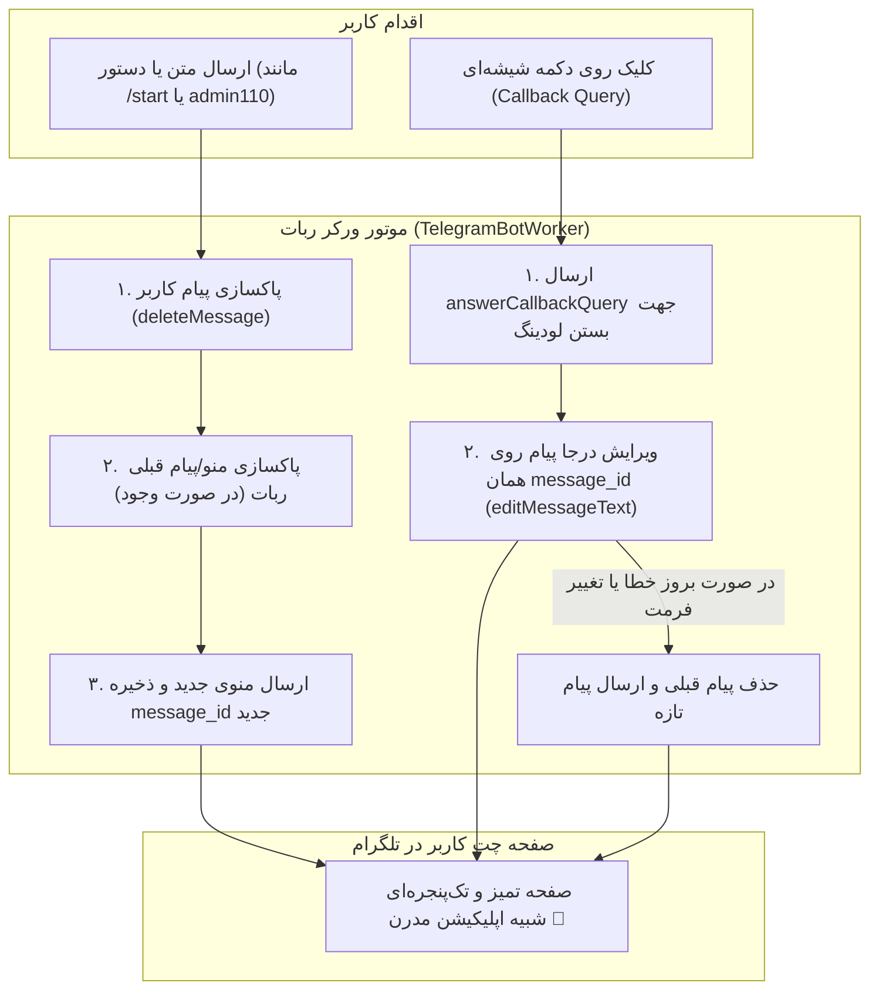

# مستر ۲۹ — تجربه کاربری ویرایش درجا و پاکسازی پیام‌های قبلی (MASTER-29)

> **وضعیت سند:** تصویب‌شده و در حال پیاده‌سازی (IN PROGRESS)  
> **مرجع تصمیم‌ها:** DEC-0048 (الگوی پاکسازی پیام‌ها مشابه ختم‌ساز)، DEC-0003 (آداپتور تلگرام)، DEC-0047 (ربات ادمین).  
> **مرجع سورس الگو:** `C:\xampp\htdocs\Khatm\src\khatmsaz\bot\handlers\create_khatm.py` و `profile.py`

---

## ۱. هدف و مقایسه با بات ختم‌ساز

در بررسی کدهای بات ختم‌ساز (`C:\xampp\htdocs\Khatm`)، دو الگوی اساسی تجربه کاربری (UX) مشاهده شد:
1. **پاکسازی پیام تایپی کاربر (`delete_message`):** وقتی کاربر دستوری مثل `/start` یا متنی را ارسال می‌کند، ربات بلافاصله پس از پردازش، پیام کاربر را پاک می‌کند (`message.bot.delete_message(message.chat.id, message.message_id)`). این کار مانع از شلوغ شدن تاریخچه چت با دستورات متنی می‌شود.
2. **ویرایش پیام در جای خود (`edit_message_text`):** در تمام کلیک‌های دکمه‌های شیشه‌ای (Callback Queries)، به جای ارسال پیام جدید به انتهای چت، همان پیام فعلی در جای خود تغییر می‌کند (`callback.message.edit_text(...)`).
3. **پاکسازی پیام قبلی ربات:** در صورتی که نیاز به ارسال پیام جدید باشد، شناسه پیام قبلی ربات در استیت ذخیره شده و قبل از ارسال پیام جدید، پیام قبلی حذف می‌شود تا کاربر همواره فقط **یک صفحه یا پنجره تعاملی فعال** در چت ببیند.

---

## ۲. گراف جریان پاکسازی و ویرایش پیام (Mermaid Diagram)

---

## ۳. متدهای فنی در لایه ورکر (`TelegramBotWorker`)

- `deleteMessage(chatId: string, messageId: number | string): Promise<boolean>`
- `editMessageText(params: { chatId: string; messageId: number | string; text: string; inlineKeyboard?: any[][] }): Promise<boolean>`
- `editOrSendMessage(params: { chatId: string; messageId?: number | string; text: string; inlineKeyboard?: any[][] }): Promise<void>`
- ذخیره و ردگیری `lastBotMessageIds: Map<string, number | string>` به ازای هر چت.

---

## ۴. نبایدها (Hard Constraints)

1. شکست در پاکسازی پیام (مثلاً پیام‌های قدیمی‌تر از ۴۸ ساعت یا خطای شبکه) نباید تراکنش یا پاسخگویی ربات را متوقف کند؛ تمام تماس‌های پاکسازی با `try ... catch` ایزوله می‌شوند.
2. در پاسخ به `callback_query`، خطای عدم تغییر متن (`message is not modified`) باید نادیده گرفته شود تا ربات بدون ارور به کار خود ادامه دهد.
3. در گزارش‌های چندگانه (مانند لیست موکب‌های منتظر بررسی)، پیام موکب تأییدشده باید درجا به وضعیت «تأیید شد ✅» تغییر یابد بدون ارسال پیام‌های تکراری در انتهای چت.

---

## ۵. معیار پذیرش (Acceptance Criteria)

- [ ] حذف خودکار پیام‌های ارسالی کاربر (مانند `/start` و `admin110`) بلافاصله پس از پردازش.
- [ ] ویرایش درجا (`editMessageText`) در تمام دکمه‌های شیشه‌ای منوی زائر، موکب‌دار و ادمین.
- [ ] ذخیره و مدیریت `lastBotMessageIds` در حافظه ورکر.
- [ ] حفظ کامل عملکرد تمام ۸۲ تست قبلی و افزودن تست‌های واحد پاکسازی و ویرایش درجا.
- [ ] استقرار روی سرور و تست روانی عملکرد در هر سه ربات تلگرام.
