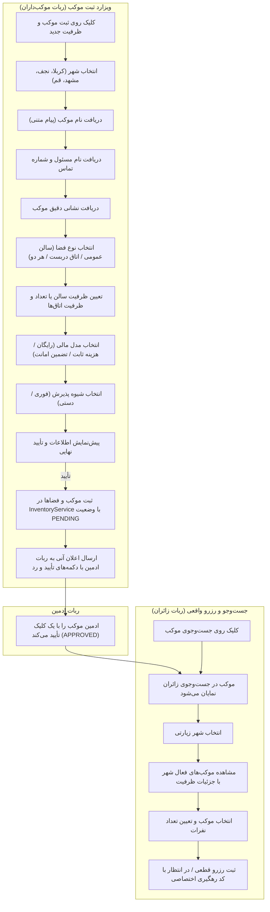

# MASTER-30 — جریان‌های تعاملی گام‌به‌گام (Wizard) ثبت موکب، فضاها و رزرو واقعی زائر در تلگرام

## ۱. هدف و دامنه
این مستر پیرو دستور صریح کارفرما و تصمیم مصوب `DEC-0049`، کلیه دکمه‌ها و منوهای ربات‌های تلگرام (به‌ویژه دکمه «➕ ثبت موکب و ظرفیت جدید» در `@rezervasiyon_mookeb_bot` و دکمه «🔍 جست‌وجوی موکب» در `@rezervasiyon_bot`) را از حالت متن‌های استاتیک خارج کرده و به یک ماشین وضعیت تعاملی، مرحله‌ای (Wizard) و متصل به پایگاه داده و سرویس‌های هسته تبدیل می‌کند.

## ۲. گراف جریان فرآیند (Mermaid)

## ۳. نبایدهای سراسری
1. **هیچ دکمه‌ای نباید بن‌بست باشد:** هیچ دکمه‌ای نباید صرفاً پیام متنی بدون اقدام تعاملی یا امکان پیشروی بعدی باشد.
2. **رعایت پاکسازی پیام‌ها (DEC-0048):** پیام‌های متنی کاربر پس از دریافت پاک شده و منوها درجا (`editMessageText`) ویرایش شوند تا چت شلوغ نشود.
3. **رعایت الزامات قانونی اسکان (DEC-0002, DEC-0041):** شهرهای عربستان ممنوع، مدارک پایه و مسئول موکب الزامی، و وضعیت موکب تا پیش از تأیید ادمین در حالت `PENDING` باقی بماند.
4. **عدم تداخل با سایر سرویس‌های سرور (DEC-0017, DEC-0045):** پورت ۳۰۸۰ و سرویس‌های `aiBOT` و `khatmsaz` روی سرور دست‌نخورده بمانند.

## ۴. معیارهای پذیرش (Acceptance Criteria)
- [x] **WIZ-01:** کلیک روی «➕ ثبت موکب و ظرفیت جدید» ویزارد ثبت را باز کرده و لیست شهرهای مجاز زیارتی را با دکمه شیشه‌ای ارائه دهد.
- [x] **WIZ-02:** با انتخاب شهر، ربات نام موکب را طلب کند؛ پس از تایپ کاربر، پیام پاکسازی شده و گام مسئول و تماس فعال شود.
- [x] **WIZ-03:** گام‌های آدرس، نوع فضا، ظرفیت، مدل مالی و شیوه پذیرش به ترتیب کامل شوند.
- [x] **WIZ-04:** در گام نهایی، پیش‌نمایش موکب نمایش داده شده و با کلیک روی تأیید، موکب و فضاهای آن به طور واقعی در `InventoryService` ذخیره شوند.
- [x] **WIZ-05:** بلافاصله پس از ثبت، اعلان زنده با دکمه‌های `APPROVE_PLACE_<id>` و `REJECT_PLACE_<id>` برای ادمین‌های ربات `@rezervasion_admin_bot` ارسال شود.
- [x] **WIZ-06:** با تأیید موکب توسط ادمین، زائر در `@rezervasiyon_bot` بتواند در بخش جست‌وجو موکب را ببیند و اقدام به ثبت رزرو کند.
- [x] **WIZ-07:** در بخش وضعیت سالن‌ها و اتاق‌ها (`ROOMS_STATUS`)، موکب‌دار بتواند لیست موکب‌ها و ظرفیت‌های ثبت‌شده خود را مشاهده کند.
- [x] **WIZ-08:** تمام آزمون‌های واحد و یکپارچه ۱۰۰٪ PASS شوند (۸۷ آزمون موفق).

## ۵. ارجاع‌های دقیق کد و پیاده‌سازی (Code References)
- **ساختار داده و متغیرهای وضعیت ویزارد:** [src/channels/telegram-worker.ts#L18-L45](file:///z:/rezervasiyon-BOT-TEL/src/channels/telegram-worker.ts#L18-L45) — نمادهای `HostWizardSession` و `TravelerReservationRecord` و نگاشت‌های `hostWizards` و `travelerReservations`.
- **جریان جست‌وجو، فیلتر شهر و رزرو زائر:** [src/channels/telegram-worker.ts#L288-L518](file:///z:/rezervasiyon-BOT-TEL/src/channels/telegram-worker.ts#L288-L518) — متد `handleTravelerMessage`.
- **ماشین وضعیت و ویزارد ثبت موکب و کارتابل فضاها:** [src/channels/telegram-worker.ts#L520-L960](file:///z:/rezervasiyon-BOT-TEL/src/channels/telegram-worker.ts#L520-L960) — متد `handleHostMessage`.
- **آزمون‌های خودکار ویزارد و رزرو:** [src/tests/channels_and_admin.test.ts#L555-L830](file:///z:/rezervasiyon-BOT-TEL/src/tests/channels_and_admin.test.ts#L555-L830) — آزمون‌های `WIZ-01`، `WIZ-02` و `WIZ-03`.

