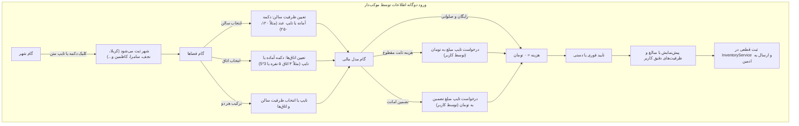

# MASTER-31 — انعطاف‌پذیری دوگانه در ثبت اطلاعات (دکمه‌های آماده + ورود دلخواه متنی/عددی ظرفیت، اتاق‌ها، هزینه و شهر)

## ۱. هدف و دامنه
این مستر بر اساس بازخورد مستقیم کارفرما و تصاویر ارسالی از محیط تلگرام و تصمیم مصوب `DEC-0050`، کلیه بخش‌های ویزارد ربات‌ها را ارتقا می‌دهد تا کاربر به گزینه‌های دکمه‌ای از پیش تعیین‌شده محدود نباشد و بتواند در تمامی گام‌ها (ظرفیت سالن، تعداد و ظرفیت اتاق‌ها، مبالغ هزینه و تضمین مالی به تومان، و نام شهر) ارقام و عبارات دلخواه خود را تایپ کند.

## ۲. گراف جریان فرآیند (Mermaid)

## ۳. نبایدهای سراسری
1. **هیچ مقداری نباید سخت‌کد شود:** مبالغ ۵۰ یا ۱۰۰ هزار تومان و تعداد ۵ یا ۱۰ اتاق نباید تنها انتخاب‌های کاربر باشند؛ دکمه‌ها صرفاً پیشنهاد سریع هستند و کاربر همواره می‌تواند هر عدد دلخواهی را تایپ کند.
2. **پشتیبانی از ارقام فارسی و انگلیسی:** متون ورودی کاربر باید از نظر ارقام فارسی (`۰۱۲۳۴۵۶۷۸۹`) و کاما/جداکننده (`،` یا `,`) نرمال‌سازی شوند.
3. **منع شهرهای عربستان (DEC-0002):** در صورت تایپ شهرهای مکه، مدینه، جده و... سیستم باید مانع ثبت شود.
4. **رعایت پاکسازی پیام‌ها (DEC-0048):** پیام‌های متنی تایپ‌شده کاربر پس از دریافت و پردازش بلافاصله حذف شوند.

## ۴. معیارهای پذیرش (Acceptance Criteria)
- [x] **FLEX-01:** در گام ظرفیت سالن عمومی، موکب‌دار بتواند علاوه بر دکمه‌های آماده، عدد دلخواه (مانند `150` یا `۲۵۰`) را تایپ کند.
- [x] **FLEX-02:** در گام اتاق‌های دربست، موکب‌دار بتواند علاوه بر دکمه‌های آماده، ترکیب دلخواه (مانند `3 اتاق 5 نفره` یا `3*5` یا `3 در 5`) را تایپ کند و سیستم ۳ اتاق با ظرفیت ۵ بسازد.
- [x] **FLEX-03:** در گام مدل مالی، با انتخاب «هزینه ثابت» یا «تضمین امانت»، ربات مبلغ را طلب کند و کاربر بتواند عدد دلخواه به تومان (مانند `70000` یا `۳۰۰,۰۰۰`) را بنویسد.
- [x] **FLEX-04:** در گام شهر، علاوه بر دکمه‌ها، کاربر بتواند نام هر شهر زیارتی دلخواه (مثلاً `سامرا` یا `کاظمین`) را تایپ کند.
- [x] **FLEX-05:** تمام آزمون‌های واحد و یکپارچه ۱۰۰٪ PASS شوند.

## ۵. ارجاع‌های پیاده‌سازی و آزمون‌ها (Code References)
- `normalizePersianDigits(input)`: [telegram-worker.ts](file:///z:/rezervasiyon-BOT-TEL/src/channels/telegram-worker.ts#L18-L28)
- `parseRoomSpecs(input)`: [telegram-worker.ts](file:///z:/rezervasiyon-BOT-TEL/src/channels/telegram-worker.ts#L30-L47)
- `parseTomanValue(input)`: [telegram-worker.ts](file:///z:/rezervasiyon-BOT-TEL/src/channels/telegram-worker.ts#L49-L60)
- `TelegramBotWorker.handleHostMessage`: [telegram-worker.ts](file:///z:/rezervasiyon-BOT-TEL/src/channels/telegram-worker.ts#L600-L950)
- `TelegramBotWorker.handleTravelerMessage`: [telegram-worker.ts](file:///z:/rezervasiyon-BOT-TEL/src/channels/telegram-worker.ts#L365-L595)
- آزمون‌های FLEX-01 تا FLEX-05: [channels_and_admin.test.ts](file:///z:/rezervasiyon-BOT-TEL/src/tests/channels_and_admin.test.ts#L835-L1000)

